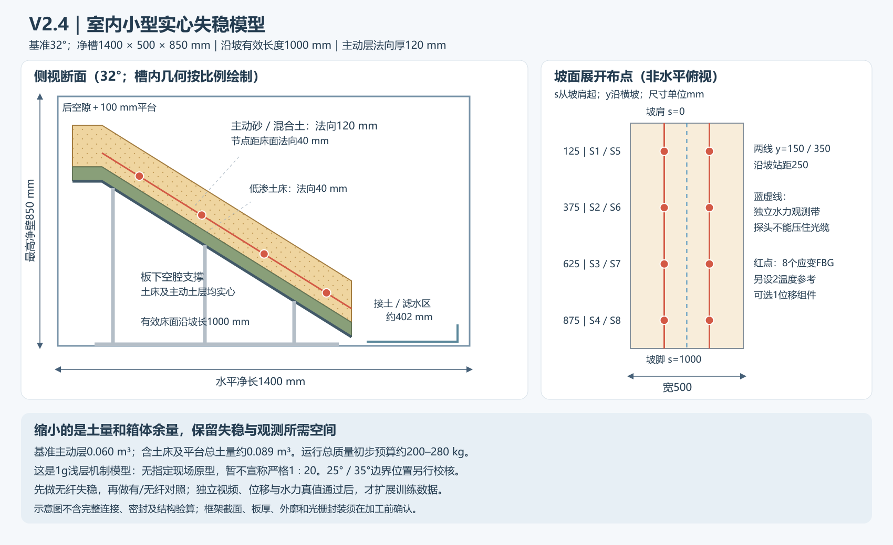

# 桥梁边坡光栅阵列监测方案

本项目研究桥台及道路邻近边坡的异常滑动与振动感知，重点包括实体模型制造、FBG光栅阵列封装铠装与布设、独立真值试验及CNN-LSTM识别。文档按现存版本分目录保存。

## 版本目录

| 目录 | 内容 | 日期与状态 |
|---|---|---|
| [versions/v1-initial](versions/v1-initial/README.md) | 早期文献选型、模型/现场施工初稿及FBG施工初稿 | 主体编写于2026-09-21，部分文件保留2026-10-12后续说明；作为历史讨论 |
| [versions/v2.2-manufacturing](versions/v2.2-manufacturing/README.md) | 模型制造、光栅封装与安装、文献、现场比较及需求核查 | 2026-10-12；保留作制造安装参考 |
| [versions/v2.3-failure-model](versions/v2.3-failure-model/README.md) | 材料选择、实心分层结构、滑移/塌落触发、评价指标和训练标签 | 2026-10-13；保留作为前版 |
| [versions/v2.4-indoor-compact](versions/v2.4-indoor-compact/README.md) | 室内小型尺寸、文献与比例校核、制造安装、失稳及数据放行 | 2026-10-14；当前优先试制方案 |
| [sources](sources/README.md) | 用户提供的原始技术方案 | 源文件标题含v3，其版本号属于原始工程文件，独立于本项目模型方案V2.2 |

当前仅有上述实际保存的文件，未发现独立的V2/V2.1历史快照；不根据最新文件反向编造旧版。后续修改请在新版本目录中保存，并通过Git提交记录追踪。

## 当前重点与最新成果

当前优先阅读[V2.4室内小型模型](versions/v2.4-indoor-compact/README.md)：推荐净槽1.40×0.50×0.85 m，实心主动坡段沿坡长1.00 m、宽0.50 m、法向厚0.12 m；采用砂/混合土、薄低渗床和板下空腔支撑。与V2.3相比净平面占地减少约27%、主动层土量减少约33%。[文献与比例校核](versions/v2.4-indoor-compact/小型模型文献与比例校核.md)列出直接/间接证据及1g相似限制，不将尺寸建议宣称为已验证最小模型或严格原型1∶20。

先核实室内承载、水路、低应力土料及主机，试制无纤失稳和有/无纤对照，取得独立视频、位移与水力真值，通过[数据放行](versions/v2.4-indoor-compact/试制验收与训练数据放行清单.md)后再扩充CNN-LSTM训练数据。以下V2.2文件保留为制造与安装参考。

- [边坡实体模型方案 V2.2](versions/v2.2-manufacturing/边坡实体模型方案_v2优化版.md)：比例、几何尺寸、箱体材质与固定、土料与填筑、构件及光栅布点。
- [光栅制造、铠装与安装专项](versions/v2.2-manufacturing/光栅阵列制造铠装与安装专项设计.md)：成缆截面、制造路线、四类固定节点与样件验收。
- [补充文献调研](versions/v2.2-manufacturing/光栅阵列边坡监测_补充文献调研.md)：16组17篇参考，标明证据层级及适用限制。
- [模型与真实现场试验比较](versions/v2.2-manufacturing/边坡监测试验_模型与现场可行性比较.md)：场地线索、试点工作包、成本计算与组合建议。
- [需求核查与制造放行清单](versions/v2.2-manufacturing/V2.2方案_需求核查与制造放行清单.md)：用户要求逐项对照、修订记录与未取得的实证。

当前建议先做材料与无传感器小土槽试验，确认可重复滑移/塌落和独立标签，再做光栅传力样件及主机适配，最后进行有许可的现场非破坏性试点。模型尺寸、构件截面及验收阈值为建议设计；结构验算、土料试验、厂家确认和场地许可尚待落实。

本仓库收录项目文档与自产示意图，论文仅给出处和研究摘要，未上传论文全文。未明确授权开放许可，仓库中不额外添加开源许可证。
