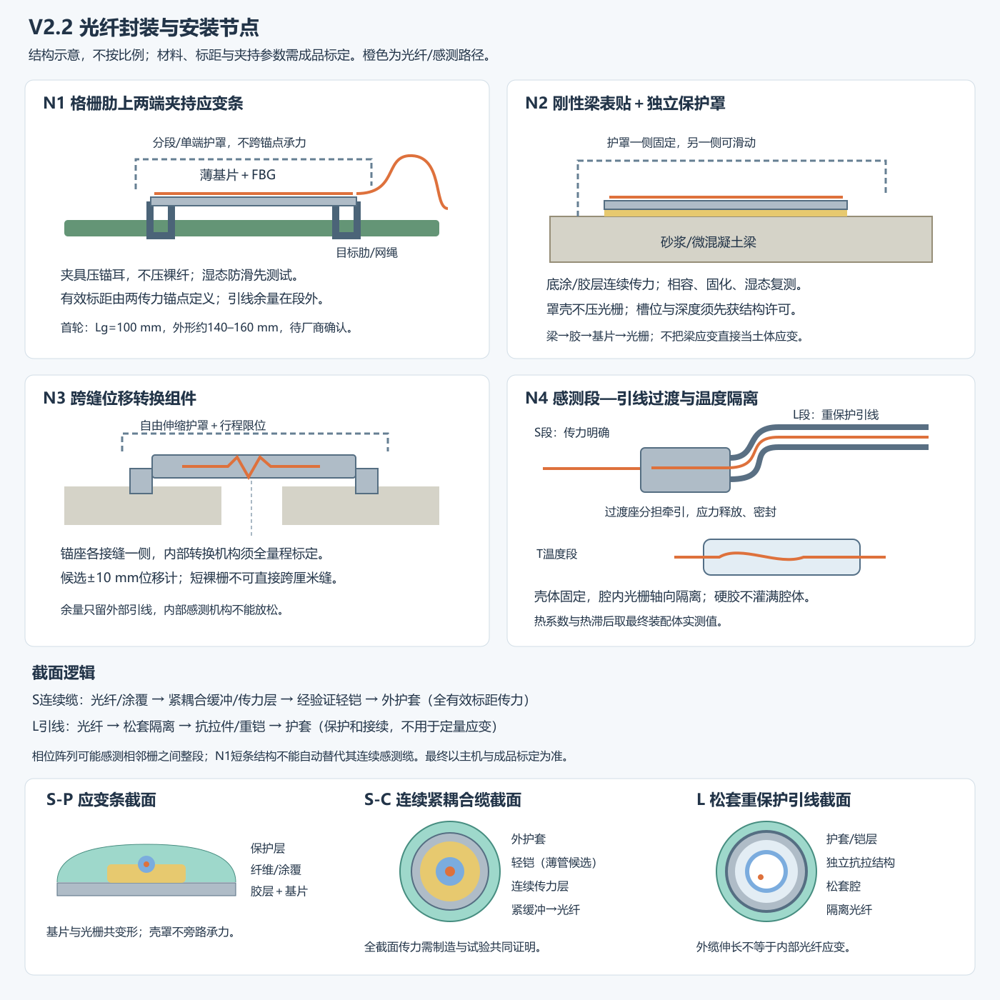

# 光栅阵列制造、铠装与安装专项设计

版本：V2.2配套；日期：2026-10-12。状态：建议制造方案与样件验证规格，尚非供应商定型产品或已施工成果。

## 1 建议采购什么、怎么铺

主模型采用工厂预制的**短标距FBG应变条＋位移转换封装＋隔离温度封装＋铠装连接引线**。传感器的机械轴线沿构件受测方向，传感器之间的引线只负责光路连通和保护。优先在柔性网片上用两端传力夹安装；刚性梁另用表贴粘结作为对照。

若已有主机是超弱阵列相位解调，先取兼容样段验证短栅距、静态响应和区段定位。其两反射点间整段可能是有效标距，必须采用连续耦合应变缆或明确的区段端点传力设计，不能把普通独立应变条串改名后接入。短标距不支持时，先做全尺寸构件测段；缓慢滑移用兼容波长FBG位移/应变模块补充。混合系统增加主机成本，须与借用/租用波长解调设备比较后确定。

以下尺寸用于向厂家提出可制造样件，均需厂家审核、实测复标及安装试验；未作为商用产品参数。机械原则主要依据文献[1][2]，超弱阵列路线依据[3]。

## 2 四类结构及材料截面

可编辑矢量图：[光纤封装与安装节点.svg](光纤封装与安装节点.svg)。

| 类型 | 推荐候选结构：从内到外 | 为什么这样选及风险 |
|---|---|---|
| S-P 点式应变条 | 约125 μm包层光纤→原涂覆/复涂层→薄胶传力层→薄弹性金属或GFRP基片→柔性防水保护层→分段护罩 | 光栅与基片共变形，基片两端传力；新增刚度、热膨胀、固化预应变均需标定 |
| S-C 连续应变缆 | 光栅光纤→紧耦合涂覆/缓冲→低蠕变传力层→经验证的薄壁金属管或轻编织保护层→粗糙聚合物外护套 | 全标距传力；填胶、管壁与光纤需实际连接，空管/松套不能当成应变缆 |
| T 温度参考 | FBG→不承受轴向荷载的小腔体/松套→小型金属或聚合物密封外壳→保护引线 | 外壳固定、栅本体隔离；考虑热响应滞后，腔内胶不得重新锁死光栅 |
| L 非感测引线 | 光纤→松套缓冲/防水结构→独立抗拉件→不锈钢软管或编织铠→耐候护套 | 抗拉抗压由抗拉件和铠层承担，光纤不承担牵引；这类缆不用于定量土应变 |

**应变条样件尺寸窗口：**机械有效标距Lg先取100 mm，外形总长约140–160 mm、宽8–12 mm；金属基片厚0.2–0.5 mm或GFRP片厚0.5–1.0 mm各试一种。固定耳位于标距外两端。此长度可安装于250 mm横坡点距，但交叉点、连接器及跳线弯曲须在点位图中避让。两种基片属于样件对比，最终按传力、刚度扰动和湿态稳定性选一种。

**连续缆样件尺寸窗口：**成品外径约2–4 mm作为首轮制造讨论值；重保护引线约4–6 mm作为首轮报价值。厂商如只能供更粗缆，应重新核验安装长度、弯角、夹具与附加刚度。外径不能代替有效光学或机械标距。

| 材料/保护选项 | 适合位置 | 必须比较的事项 |
|---|---|---|
| 薄不锈钢基片/薄壁管 | 点式基片、经耦合验证的轻铠应变段 | 抗腐蚀、热膨胀、金属层是否分担荷载、弯折局部损伤 |
| GFRP基片 | 薄型应变条候选 | 纤维方向、吸水、弹性模量、层间损伤和胶层剥离 |
| PU/TPU柔性护套 | 感测段防水与耐磨候选 | 湿热老化、蠕变、厚度、应变传递；不能只看手感柔软 |
| PE耐候护套 | 引线或经处理的应变缆外层 | PE低表面能导致粘结难；底涂/表面处理须做相容试验 |
| 松套金属软管、重铠 | 设备箱进线、跨沟、非感测引线 | 抗压、弯曲半径、导水与终端密封；不得未经校准当S段 |
| 芳纶/钢丝抗拉件 | L引线首选；感测缆须专门设计 | 感测缆若抗拉件过强且与端点连接，可能旁路传感层、改变传力 |

不是“有金属就不能测”，也不是“有铠装就能测”。最终结构取决于连续或端点机械耦合以及安装方式；土体拉拔和长期蠕变是独立验证项。[1][4]

## 3 工厂制造流程与光栅写制

1. **冻结接口**：取得主机波段、接头、反射率范围、单通道点数、栅距/标距限制、静态量定义、全通道速率、相位/波长原始数据接口。
2. **选写制路线**：少量常规点式阵列优先购买成熟UV写制与封装产品；大量等间隔弱栅可讨论拉丝塔在线、透涂覆UV或飞秒写制。不同技术的反射谱、机械强度、制造批次一致性和主机兼容性分别确认。[3]
3. **按点表预制**：CH1–6各4个应变点；CH7位移2＋温度2；CH8温度2＋可选动态2。设备接口允许时每串内部点位顺序与空间坐标一一映射。不要采购后现场剥铠寻栅。
4. **涂覆/复涂与筛选**：记录写制前后光谱；若剥涂覆写栅，应提供复涂工艺与强度筛选记录；透涂覆写制也须证明成品强度。不得用“无剥涂”代替实测机械可靠性。
5. **封装与应力控制**：光纤贴合基片/传力层，控制胶层和固化夹持；预应变仅在成品规定范围内。需要测压缩时要核查基片屈曲、端夹和光纤支持，不能只证明拉伸响应。
6. **成缆、铠装、接续**：薄层挤塑/粘结、轻铠及引线过渡按已认可工艺，热加工/焊管不得损伤光栅。每个状态保存光谱/反射图；熔接点位于不受力区，点式组件优先工厂接续。
7. **完整组件标定**：测试最终基片、胶、护套、铠装、锚耳和温度系数；完成压缩、拉伸、循环、湿态、温度及动态测试后才出厂。厂家裸栅系数仅用于预估。
8. **出厂文件**：结构截面、地址/波长、坐标/轴向、量程、有效标距、安装夹力/扭矩、施工/工作弯曲半径、牵引限值、温补系数、频响、接头损耗、光学基线、试验曲线及序列号。

栅长lg（写制区长度）、栅间距p（相邻反射点距离）、机械标距Lg（锚点间或共变形段）、相位标距Lφ（解调有效区段）须分别标注。四者不相等时应在一张纵向结构图上显示。

**波长预算示例，仅用于询价：**若成品Kε=1.2 pm/με，KT=10 pm/°C，机械范围±2500με，环境相对标定温度±20°C，则单点漂移至少±3.2 nm，左右总窗口6.4 nm，再加峰宽、光谱制造偏差和保护间隔。4点/通道可能需约26 nm以上可用带宽；真实成品KT会受基片热膨胀影响，此例不能代替厂商计算。若主机可用带宽不够，应缩小经过验证的量程、减少每通道点数或增加通道，不能让邻峰碰撞。

## 4 四个安装节点：固定在哪里

### N1 柔性格栅/网绳上的两端传力夹

路径：目标肋/绳 → 两个防滑鞍形夹 → 基片两端锚耳 → 有效基片段 → 光栅。先张紧网片并记录结构预张力，再装传感器；夹具不落在会滑移转动的交叉节点。

候选夹接触长度20–30 mm，两端之间形成100 mm机械标距；不同夹具长度不改变“最终锚点中心到中心距离”定义。橡胶/聚合物衬垫只能设在夹持面，不铺成标距内软隔离层。若衬垫发生蠕变或湿态滑动，换硬质有纹理夹面并查压伤，而不是不断加夹力。

两端夹紧值先用拉拔试验确定：记录施加夹力或螺栓扭矩、肋条压痕、湿态滑移和应变回零。不在裸光纤上直接压螺栓。保护罩分段、单端或滑动固定，不跨接两锚点分担拉力。传感器引线从端夹外侧进入固定的过渡座；余量圈在跳线区而非100 mm标距内。

### N2 刚性梁表贴粘结与护罩

路径：梁表面 → 胶/底涂 → 连续贴合基片 → 光栅。样件先清除浮浆，记录表面粗糙度和干燥状态；胶粘体系按梁材与基片材质共同选择。候选胶厚0.1–0.3 mm供首轮试件比较，不当厂家已确认工艺。用薄垫片/控胶工具控制厚度，固化时临时固定；固化温度、时间和波长变化记录。

粘贴基片全长和仅粘两端是不同机械方案，分别标定：本节点首选连续贴合测表面应变；端点方案测两端平均伸长，不声称还原每一点局部应变。护罩与基片保持间隙，螺钉不穿受测段；采用浅槽先取得结构许可及图纸，不能自行切断框架梁钢筋。

### N3 跨缝位移组件与运动余量

两个锚固座分别接到缝两侧目标构件，安装工厂位移计（弹性梁/杠杆/弹簧等减敏结构），内置光栅通过转换比测位移；候选量程±10 mm用于模型首轮询价，按预计运动和校准结果改定。设置机械限位和自由伸缩防护罩，两端锚座与测试轴线同向；倾斜产生的几何误差记录。

100 mm标距直接伸长±0.25 mm就达到±2500με，厘米级缝宽不能由这类短条直接承担。位移计要提交完整位移—波长双向曲线、迟滞、温度效应与过载恢复结果。传感段内禁止用松弛光纤“解决量程”；余量设在外部引线，长度覆盖运动需求且不小于厂商弯曲半径限制。

### N4 感测段到重铠引线及温度隔离

在非感测区设过渡座：感测段锚耳承担测量传力，引线抗拉件/金属铠承担牵引，二者不通过裸纤硬连接。过渡座有应力释放、渐变弯曲和密封，出线先进入圆弧导向再进入固定卡。引线保护卡不跨越预期移动边界。

温度FBG小壳体固定在同一高度/热环境，内部光纤自由轴向伸缩；隔离腔的引线也设应力释放。不能将温度壳灌满硬胶后仍称机械隔离。支撑、胶和壳体带来的热滞后以温箱试验评估，升降温均测试。

## 5 光路、安装路线与长度

横坡两排各2.0 m有效观测宽度，顺坡两条各1.44 m覆盖斜长，总观测路径约6.88 m；它不是32点方案的总购缆长度，也不等于连续相位感测长度。独立短条方案的24个应变标距各100 mm，合计机械有效段2.4 m，但节点之间仍有观测盲区。

32点的光路为8串各4点。每串引线实际长度：厂内串联跳线＋到箱外接续箱的路线＋接续箱到主机距离＋在允许弯曲半径下的检修余量。现场量取再生成裁线表，不能用6.88 m直接报价。连接器集中在箱外稳定接续箱，箱内避免连接器落入土层或滑面。

跳线在网片肋外側有松弛服务弯，但不挂在传感标距上。横顺坡交叉处优先让一条非感测跳线绕开，标注走向和非感测段；不将传感条互相叠压。跨排水、尖锐边缘加护管，管口倒角。引线卡间距由弯曲半径、下垂和动态悬空测试确定，首轮可试150/300 mm两档比较，而非宣称一个固定间距适用于所有缆。

## 6 能区分成缆失败和安装失败的试件验收

每种结构和固定工艺至少3个独立样件；分两级测试：一级厂家成缆样件，二级构件加完整安装件。记录夹具、胶层、土体和光纤是否各有滑移，且同步用独立位移计/应变片作真值。

静态估计：εFBG=(Δλ−KT,成品·ΔT)/Kε,成品；传递率η=εFBG/ε参考。两端标距方案用ε参考=Δu/Lg，连续粘结则取同位置基片/梁表面独立应变。接近零应变不计算比值，采用全加载区间回归斜率和截距。基片改变结构局部应变时先测“装前/装后”差异，不能全归为光纤传递损失。

| 试验 | 首轮建议流程 | 输出/失败后返工 |
|---|---|---|
| 轴向拉压 | 以已确认±2500με成品为例，在100 mm标距上±0.05、±0.10、±0.20 mm分级；每级稳态读数，5轮往返 | 单调性、标定斜率、非线性、迟滞、回零；若不允许压缩改做拉伸预应变方案 |
| 恒定变形保持 | 0.10 mm级持续1 h，同时测参考位移和温度 | 时间漂移与胶/护套蠕变；1 h通过不等于长期耐久通过 |
| 固定抗滑 | 干、湿各测试，外部逐级加载到组件工作上限 | 标出首次滑移；调整夹面/底涂/胶，不单纯加强扎带 |
| 温度 | 候选10、20、30、40°C各稳态，升降各1轮，无机械载荷 | 温补系数、滞后和残余漂移；按实际服务环境扩大测试范围 |
| 湿态 | 先喷水/湿土接触，再持续24 h暴露后复标 | 密封、脱胶、光谱损失；这是筛选试验，不认证IP等级 |
| 动态 | 5、10、20、50、100 Hz低幅受控激励，成缆和装配态均与参考传感器同步 | 传递函数幅相、谐振、重复性；测试台达不到的频段不写已验证 |
| 区段/邻点 | 分别激励两个已知位置并改变间距 | 定位、串扰、感测/引线边界；不可分辨则改栅距/解调/点表 |
| 土内对照 | 同含水率密度下拉拔，至少3件，记录各端相对位移 | 脱耦位移和有效锚固段；不把拉出过程中缆应变当土体均匀应变 |

建议首轮放行指标：工作范围内无峰冲突/失栅；校准后静态最大误差≤满量程10%，迟滞≤满量程5%；同工艺样件斜率变异系数≤10%；恒定变形经温补漂移≤满量程5%；湿态复测仍满足同一标准。**这些是项目拟定目标，不是文献统一限值或已达性能。** 系统量程按有符号全跨度定义，验收前书面固定计算方法，避免满量程定义歧义。

η接近1并非所有封装的必要条件；减敏位移计可能故意η较低。只有输出稳定、可标定且满足独立真值误差要求才可使用。相位解调按厂家定义的区段积分/平均量标定，不能直接套波长公式。

## 7 采购BOM与厂家答复表

| 物项 | 建议数量 | 必须答复 |
|---|---:|---|
| 点式应变组件 | 24工作点＋按损耗议定备件 | 基片/胶/涂覆截面；拉压范围；100 mm标距可否实现；主机峰预算 |
| 位移组件 | 2工作点 | 双向量程、转换机构、安装轴线、限位与完整标定 |
| 温度隔离组件 | 4工作点 | 轴向隔离、KT及响应时间、壳体固定方式 |
| 动态FBG组件 | 可选2点 | 类型、单位、频带、全通道采样适配；不用则总栅数30 |
| 夹具及过渡座 | 应变两端夹共48个位置，另计位移锚座/引线座 | 肋/绳尺寸、夹力/扭矩、抗滑/压伤、可拆更换 |
| 接续/设备箱 | 箱外1套；现场另按路线设 | 密封等级及检验、铠层终端、抗拉固定、进线弯曲 |
| 成缆验证样段 | S-C目标、普通松套L对照，各至少3件 | 同主机同长度/激励；分别成缆与安装测试 |
| 胶/底涂试件 | 每候选体系至少3独立件 | 与PE/PP/PET/GFRP/混凝土相容、湿态与固化记录 |

优先询价成品模块加厂家预制串，避免实验室从裸光纤开始自行制造刻栅与铠装。不要只询“多少米光纤多少钱”，而应把标定、点表、引线长度、夹具、质保及更换责任一起报价。

## 8 文献依据与边界

[1] Bastianini et al., 2019. Optical Fiber Sensing Cables for Brillouin-Based Distributed Measurements. https://doi.org/10.3390/s19235172 。已读相关全文；借鉴涂覆、护套、锚固和传力，不移植Brillouin解调系数。

[2] Drusa et al., 2021. Measurement of Axial Strain of Geogrid by Optical Sensors. https://doi.org/10.3390/s21196404 。已读相关全文；有不合适胶损伤格栅的记录，其室内胶带保护不能替代现场铠装。

[3] Wang et al., 2026. Recent Advances in Ultra-Weak Fiber Bragg Gratings Array for High-Performance Distributed Acoustic Sensing (Invited). https://doi.org/10.3390/s26020742 。已读相关全文；写制工艺及相位区段概念，不担保任一设备静态响应。

[4] Nowak et al., 2022. Hybrid Fiber Optic Cable for Strain Profiling and Crack Growth Measurement in Rock, Cement, and Brittle Installation Media. https://doi.org/10.3390/s22249685 。摘要证据，Brillouin自锚与变形重分配概念；不是已验证FBG封装。

[5] Abushagur et al., 2025. Comparative Study of Distributed Acoustic Sensing Responses in Telecommunication Optical Cables. https://doi.org/10.3390/s25247600 。摘要证据，Rayleigh DAS不同缆构造的台架响应差异；不把其SNR排序视为本系统性能排序。

[6] Zhu et al., 2017. FBG-Based Monitoring of Geohazards: Current Status and Trends. https://doi.org/10.3390/s17030452 。已读相关全文，温补和构件集成依据。
