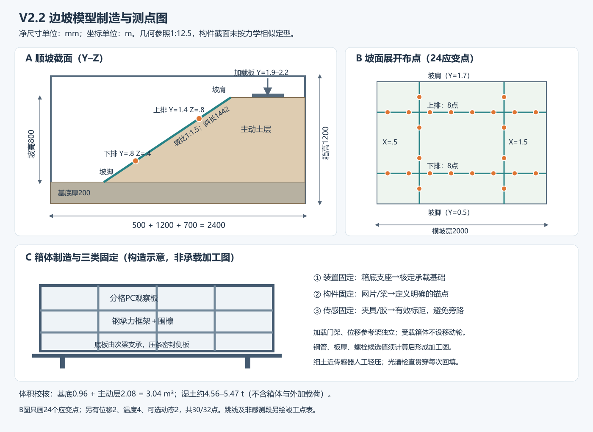

# 光栅阵列边坡实体模型优化方案

版本：V2.2 模型制造与光纤安装评审版  
日期：2026-10-12  
状态：供方案评审、厂家样件讨论和设备适配使用；尺寸与测点为建议设计值，尚未施工或验收。

本次重点：模型比例、尺寸、材质与固定构造；光栅制造、封装铠装与安装节点；文献支持与真实场地试验路径。

配套阅读：[光栅阵列制造铠装与安装专项设计](光栅阵列制造铠装与安装专项设计.md)、[补充文献调研](光栅阵列边坡监测_补充文献调研.md)、[模型与现场可行性比较](边坡监测试验_模型与现场可行性比较.md)、[本版需求核查](V2.2方案_需求核查与制造放行清单.md)。
## 1 方案目标与本次优化

本方案以光栅阵列为主，研究坡体变形如何通过防护构件、夹具/粘结层、光缆护套与缓冲层传递至光栅，以及如何区分缓慢滑移、局部构件变形和环境振动。建议先完成材料与成缆传力标定，再开展局部边坡模型试验，最后进入真实边坡短段验证。

本版在现有V2基础上补齐制造与安装设计，并对照《FBG光栅阵列施工方案》和《国道边坡健康监测项目技术方案v3》校核。它可用于实验室、加工单位和传感器厂家联合评审；钢结构承载计算、土料配比试验和厂家成缆确认完成后，才能形成正式加工放行图。

相较原方案，本次主要调整：

1. 把现场方案的坡面构件绑扎作为主线，土内埋设作为对照；先辨明现场“加固格栅”究竟是土工格栅、柔性防护网还是混凝土框架梁。
2. 区分常规波分复用 FBG 和弱/超弱光栅阵列；不预设所有阵列都能接入普通波长解调仪。
3. 取消以“5 m × 5 m 全面连续感知”描述两条测线。两个高度的测点形成两排离散观测，测线间与测点间的变化需要独立验证。
4. 给出合计准确的 32 点、8 通道配置，替代原方案阵列数量与总点数不一致的配置。
5. 将图像、位移、雨量和加速度真值纳入验收；分类准确率与预警提前量由试验评价，不预先承诺。

## 2 开工前的设备适配关口

| 项目 | 常规波分复用 FBG | 弱或超弱光栅阵列 |
|---|---|---|
| 常见识别方式 | 不同光栅的反射波长 | 可结合时域、波长或相位识别，具体取决于系统 |
| 空间能力 | 测点位置主要取决于预制栅距和封装标距 | 同时受栅距、脉冲分辨率和有效标距约束 |
| 动态观测 | 高速波长变化或专用加速度传感器 | 可能测动态应变或相位差，须核对是否支持静态量 |
| 设计前必须取得 | 波段、单通道点数、最大波长漂移、全通道速率 | 反射率、栅距、最小可分辨间隔、标距、静态/动态量定义 |

厂家技术资料必须说明 1000 Hz 是否在全部通道和测点同时开启时仍成立。只给最高单通道速率不足以确定多点振动采样能力。

如果现有设备只能区分 2–5 m 的光纤区段，不能直接承诺识别模型上相距 0.25 m 的异常。将光缆盘绕到小模型上会改变空间映射和机械传力，不能视为自动获得更高空间分辨率。处理顺序为：先测试设备是否支持短栅距阵列；不支持时采用兼容解调设备或开展全尺寸测段标定，暂不批量建造模型。

设备适配试验需在两个已知位置分别施加微位移和敲击，检验能否分辨两事件、是否发生邻点串扰，并检查零漂、温补、同步时间戳和原始数据导出。通过后才确定最终阵列采购表。

## 3 第一步完成构件传力标定

采用约 0.8 m × 0.6 m 的可更换构件试验架，分别测试柔性土工格栅或防护网，以及代表刚性框架梁的样件。这个试验架用于连接与传力测试，不代表缩尺边坡。

设置三组独立试件：

| 组别 | 安装方式 | 验证问题 |
|---|---|---|
| A | 防滑夹具在传感封装的设计锚点固定，连接光缆留余量 | 轴向位移是否可靠传入传感有效段 |
| B | 按厂家工艺粘结或嵌槽保护 | 粘结方式是否提高重复性，以及温度和湿润的影响 |
| C | 仅扎带绑扎护套作为对照 | 松动、滑移及护套内脱耦对结果的影响 |

先做已知位移分级加载与卸载，再做已知频率振动；在干燥与湿润条件下重复。每种连接至少采用 3 个独立试件，记录位移—光学响应曲线、迟滞、残余零漂和振动传递特性。扎带不得勒压光栅本体或熔接点，刚性样件边缘需设置保护。

新增两步隔离测试：先单独夹持成缆样件的外护套并拉伸，核查护套到光栅的传递；再把同一结构样件安装到构件上加载，核查构件到光缆的传递。只有第二步测试无法区分厂家成缆脱耦与现场夹具打滑。轻铠应变缆与普通松套铠装通信缆分别作为目标样件和对照，不能只测试裸栅后认为成缆性能相同。

用相同构件和相同加载进行比较。若比较不同材料，必须单独解释刚度差异，不能把结构更硬导致的响应变化归因于绑扎工艺。

推荐进入下一阶段的条件：量程内响应单调，卸载可恢复；重复结果可解释；温补后不存在主导信号的温漂；邻点事件可区分。初期静态误差目标可设为量程的 10% 以内，该值是项目验收建议，不是设备已验证指标。

## 4 第二步建设局部边坡模型

### 4.1 几何与承载

建议模型箱内尺寸为顺坡水平长度 2.4 m、横坡宽度 2.0 m、箱高 1.2 m。基底厚度约 0.2 m，坡高 0.8 m，坡比 1:1.5，坡面水平投影 1.2 m，坡角约 33.7°，坡面斜长约 1.44 m。坡顶平台长 0.7 m，坡脚平台长 0.5 m，三段水平长度合计 2.4 m。

坐标：X 为横坡方向，0–2.0 m；Y 为顺坡水平投影，0–2.4 m；Z 自箱底向上。坡脚起点为 Y=0.5 m、Z=0.2 m，坡肩为 Y=1.7 m、Z=1.0 m。

按上述几何估算填土体积约 3.04 m³。若湿密度为 1.5–1.8 t/m³，土重约 4.6–5.5 t，另加箱体和加载反力。此值用于实验场地承载筛选，最终以土样实测密度和结构设计复核。钢框架承担侧向土压力，透明板用于观察，加载架须独立受力。

该模型代表局部边坡截段，不代表完整 400 m 国道边坡。保留现场两条测线位于约 0.25H、0.75H 的高度关系，即模型距坡脚高差 0.2 m 和 0.6 m；不能据此把模型试验时间、荷载或预警提前量直接换算成现场值。

### 4.2 土体与可更换边界

基底采用较稳定土层，上部采用可控含水率和压实状态的填土。预设滑面位置需由土体直剪参数及初步计算确定，再设置可更换弱界面。人工滑面用于事件定位验证，自然形成滑面用于验证检测的泛化能力；两种试验标签分别保存。

坡面设置可更换防护构件：柔性格栅用于第一阶段传力研究；现场若为刚性框架梁，增加独立刚性构件工况，并明确其接触、锚固和节点关系。两种构件不能在未说明刚度与边界差异时互相替代。

桥台或台背构件作为后续模块加装。第一阶段先完成边坡和构件传力，避免同时改变坡体、桥台荷载和结构连接而无法解释响应。

### 4.3 模型比例：几何1:12.5，第一阶段做机制模型

暂以原需求中10 m坡高作为几何参照，定义长度比例 λL=原型/模型=10/0.8=12.5，即模型:原型=1:12.5。该比例仅在现场坡高确为10 m且采用相同坡比时成立；原型未测绘前属于设计假设。对应局部原型横坡宽25 m、顺坡总水平长度30 m、坡面水平投影15 m、坡顶平台8.75 m、坡脚平台6.25 m。原需求400 m沿线长度不缩入这一个箱体。

| 相似项目 | 当前取值/关系 | 是否已满足 |
|---|---|---|
| 长度、位移 | λL=12.5；满足几何相似时λu=12.5 | 几何可制造；位移不能脱离力学相似直接反演 |
| 坡角、摩擦角 | 理想相似为1 | 坡角已定；土体摩擦角待实测 |
| 重力、密度 | 常重力λg=1；同类土λρ约1 | 可实现，但不是离心试验 |
| 自重应力、黏聚力、弹性模量 | 理想λσ=λρλgλL≈12.5；λc、λE须与之匹配 | 同一种土通常不能同时满足 |
| 力、梁抗弯刚度 | 理想λF=λσλL²≈1953；λEI=λσλL⁴≈305176 | 现有模型构件未按此配制 |
| 格栅单位宽拉伸刚度J | 理想λJ=λσλL≈156.25 | 商用格栅不能按几何裁小便认为满足 |
| 惯性运动时间 | 仅满足重力惯性相似时λt=√λL≈3.54 | 不适用于本版渗流、蠕变、预警时长 |

因此，本版首先验证“已知变形→连接传力→光栅响应→识别定位”，土体和防护构件按可测、可重复选型。后续若要预测原型失稳，须另建相似材料和渗流相似方案，或使用本模型参数建立数值模型再与现场校准。[1][7]

### 4.4 模型制造总图与尺寸控制

可编辑矢量图：[模型制造与布点示意.svg](模型制造与布点示意.svg)。

图中尺寸是净尺寸，线宽、板厚、梁高不按比例；详细加工公差如下为项目建议，不是规范条文。

| 部位 | 制作/放样尺寸 | 制造控制和接口 |
|---|---|---|
| 箱体净空 | Y2400×X2000×Z1200 mm | 净长宽建议±5 mm；四角底标高差≤3 mm，调平后记录 |
| 箱体外廓 | 取决于框架及密封压条 | 不把净尺寸当运输外尺寸；加工方提供外廓、重心和吊点图 |
| 坡形 | 基底200 mm；坡高800 mm；坡比1:1.5 | 用可移除剖面模板控制；坡肩Z1000 mm，箱顶余高200 mm |
| 分层填土 | 压实后厚度100 mm/层 | 每层测厚；基底2层，上部最多8层，随坡形裁切 |
| 横坡测线 | Y800/Z400、Y1400/Z800 mm | 用坡脚起点和箱底共同放样；测点中心建议±5 mm |
| 加载板 | 600×300 mm，厚度由弯曲验算确定 | X700–1300，Y1900–2200 mm；距坡肩200 mm；球铰均压 |
| 位移/视频参考 | 箱外独立测量架 | 不固定在可能受力变形的透明侧板或加载架上 |

先用两块可移除坡形样板控制截面，再用横向标尺控制宽度和坡顶平台。侧壁附近设置观测标记，中心区域设置独立真值；即使传感器避开侧壁，也不能自动排除侧壁对整体滑面的影响。

### 4.5 箱体材质、支撑和固定方式

采用“焊接钢承力骨架＋可拆侧板＋防水内衬＋独立加载门架”。推荐在经核定承载的地面基础上制作，不放在未核验的普通楼板上。下表是用于报价和计算的首轮候选截面，**不是已验算施工截面**，不得据此直接承载试验。

| 部件 | 候选材质/尺寸 | 连接与受力要求 |
|---|---|---|
| 底框主梁、立柱 | Q235B钢；100×100×5 mm方管作为初选 | 主受力焊缝和节点板由加工设计确定；除锈防腐，焊后查尺寸 |
| 底部次梁、侧面围檩 | Q235B钢；80×40×4 mm矩形管作为初选 | 报价布局可先按约400 mm支承间距；按板挠度及土压力调整 |
| 底板、后端及非观察侧板 | 钢板6 mm作为初选 | 底板由密布次梁支承，局部支座反力不能用平均面荷载替代 |
| 可视侧板 | 透明PC板15 mm作为初选，分格受支承 | 压条＋弹性密封垫夹持；校核跨度、挠度、蠕变；不作为主承力框架 |
| 固定螺栓 | 压条M8、可拆结构节点M12为报价初选 | 槽孔热胀预留、垫片及拧紧值由板材/结构设计确认；不在受力透明板上随意钻孔 |
| 密封内衬 | 防水涂层或约1 mm可更换防水膜 | 接缝翻边止水；观察面薄膜须透明；膜的土体摩擦影响进入边界说明 |
| 底座 | 钢底座、垫板、固定支座，取消受载移动轮 | 支承点下基础验算，使用灌浆/垫铁调平；锚栓规格与布置由反力计算确定 |
| 加载门架 | 独立钢门架＋加载器＋荷重传感器 | 与模型箱分开传力，基础同时核算竖向力与抗倾覆；不让PC侧板承担加载反力 |

不将模型箱当运输容器吊运带土成品。吊点仅按经批准的空箱重量设计，移动前排水卸土；传感组件另行保护。边框预留侧板拆卸和回填检修口，观察板外设置挡护，避免破坏试验时人员接近。

结构计算的输入至少包含：实测湿密度、最高水位、满水意外工况、最大施加荷载、偏心加载、底板集中支承、侧板分格及连接、加载门架与地基反力。供筛选的数量级：土荷载4.6–5.5 t约45–54 kN，分布在4.8 m²上平均9.3–11.2 kPa；全箱1.2 m水深底部静水压力约11.8 kPa。两者不构成完整结构验算；排水失效和浮力/孔压需按同一物理工况组合，不能任意叠加满土与满空箱水重量。

侧板与土体接触面选低摩擦、可更换薄膜作首轮边界，试验前做土—壁面滑移试验记录摩擦。箱底基底层采用粗糙接触以减少整体滑动，并单独检查底部是否滑移。若研究整体滑动，换成规定底部边界，不能在一次试验中默默改变。透明板膨胀变形、侧壁摩擦和箱底约束均进入数值模型。

### 4.6 土料材质、配制、用量与填筑

第一轮优先采用级配和含水率容易控制的砂质土，不直接把随机取来的建筑弃土当标准材料。可先采购洗净中细砂、筛分粉土/黏土两种原料，进行砂:细料质量比90:10、80:20、70:30三组小样筛选；这些是预试验配方，未测定前不确定哪组能稳定成坡或受雨失稳。纯砂可作为与文献[1]接近的加载对照。

每组测粒径级配、天然/配制含水率、最大干密度与最佳含水率、目标密度下直剪c、φ及渗透系数k；非饱和降雨试验补水分特征/吸力记录，不能只用饱和参数解释早期入渗。[7] 材料选定后同批原料供全部对比批次，封存样品。

机制模型首轮粒径可先筛至≤5 mm以便100 mm薄层填筑和保护光纤，属于试验设计建议；若模拟真实块石坡，应另设块石配比、尺寸效应及抗压伤封装试验，不能沿用本细料制造流程宣称代表碎石边坡。

| 制样控制项 | 建议首轮设置 | 记录和验收 |
|---|---|---|
| 压实状态 | 主动层压实系数K=ρd/ρd,max先试0.85；基底先试0.95 | 每层取密度检查；建议容许±0.02，达不到先修正填筑工艺 |
| 含水率 | 以各配比击实结果及成坡试验选择，不固定为一个通用百分数 | 同一对比批次建议偏差≤1个百分点；干质量/加水量记账 |
| 密度与总量 | 体积3.04 m³；湿密度1.5–1.8 t/m³用于预算 | 湿土4.56–5.47 t，含10%试样/损耗备料约5.0–6.0 t；损耗不装入箱内 |
| 基底/主动层 | 基底0.96 m³、上部2.08 m³ | 分批计量；不把基底强度假设当已验证不滑动 |
| 填筑 | 每层100 mm压实厚度，称质量后均匀铺料 | 首轮人工/轻型工具，传感器附近禁直接夯击；比较批次工具与遍数一致 |

层质量用m湿=ρd×V层×(1+w)计算；w按干土质量定义。先做小槽试填确定松铺厚度与压实遍数，再进入模型；不要规定相同“夯几遍”却产生不同密度。湿润土拌匀密封静置到含水均匀后复测，具体静置时间由材料小试确定。竣工表逐层记录日期、批号、坐标、实测密度、含水率、光谱和照片。

人工弱界面首轮可使用可更换土质弱层，标记设计厚度并实测剪切强度；不直接指定光滑塑料膜为自然滑面。若用薄膜进行已知边界滑移标定，须把它列为人工机构工况，报告摩擦和排水改变。无预设弱层批次用于检查算法是否只识别预制滑面。

### 4.7 防护构件、锚固与模型固定

**主模型优先选柔性构件。** 商用双向土工格栅按完整肋条排布裁片，候选覆盖横坡宽2.0 m、坡面斜长约1.44 m，坡顶/坡脚翻边各暂留200 mm；整张顺坡总长约1.84 m。网孔、肋宽、材质、单位宽拉伸刚度及低应变曲线由实物检测确定，不按1:12.5缩小商品网孔。面网和埋置加筋格栅是不同受力结构，分别命名。

将传感条安装在网片与土体直接接触之外的可检修肋面。坡顶/坡脚翻边采用宽夹板夹持完整肋条，禁止螺栓穿伤肋条；夹板连接可调支座，测量并记录初始张力。两种边界分别试验：A型支座固定到箱外刚架，研究“稳定锚点—移动坡体”传力；B型支座连接到经拉拔标定的土内锚片，研究锚固随动。A型会改变稳定性，不能当作真实未知锚固。侧边网片与侧壁留非锚固自由边，传感测点不通过侧板绑扎固定。

**刚性框架仅作独立对照批次。** 可制作细骨料砂浆/微混凝土可拆梁，首轮候选截面60×60 mm、两根横梁2.0 m、两根顺坡梁1.44 m。干涉处采用可识别的螺栓连接片或预埋连接件，明确节点是铰接、滑动还是固接；首轮可选铰接以便更换。材龄、抗压强度、弹性模量、配筋与截面均须记录，60 mm截面不是原型框架梁按比例缩小后的定型尺寸。

梁与土面贴合，通过少量规定位置锚杆连接；锚杆长度、直径、锚片面积按小型拉拔试验确定，首轮比较可固定为同一套构造，不直接给出未经验证的承载力。传感条表贴在梁轴线，护罩单端固定。刚性梁、网片和土内格栅不要同时加在主模型后把增加稳定性误判为光纤方案效果。

所有固定关系分三类登记：①实验装置固定（箱体、门架、独立测量架）；②结构加固固定（网片、梁、锚杆）；③传感固定（传力夹、胶层、引线卡）。第三类应尽量不增加结构约束，扎带和护罩不得变成第二类隐藏加固。光栅具体固定详见专项设计节点N1–N4。

### 4.8 加载、降雨、排水与制造顺序

首轮加载采用可控螺旋/液压加载器，配置独立荷重传感器和限位。建议试点控制上限10 kN，是否提高由门架、箱体及土体预试验共同决定；600×300 mm加载板在10 kN下名义均布压力约55.6 kPa。可先用0.5 kN步长探索，每级等待位移/应变变化稳定并记录，不将文献3 kN步长直接照搬到不同加载面积的模型。[1]

降雨采用箱外上方喷头架、流量计、稳压/调压装置，净箱面积4.8 m²。首轮用20、40、60 mm/h校准喷头，体积流量分别约1.6、3.2、4.8 L/min；这是水平全覆盖流量，最终坡面截留与径流量实测。用至少9个接水杯校准空间分布，制造验收可先要求杯间变异系数≤15%，未达标调整喷头，不将泵流量等同入渗量。

箱底设防堵排水口和可观察集水箱，管径先以DN25作报价起点，按最大流量、泥沙和管路损失复核；另设高位溢流和沉砂滤网。排水口周围局部反滤，不沿潜在滑面铺连续砂带。底部是排水还是不排水边界，在每个工况开始前确定；集水计量闭合入水—出水—储水变化，记录漏水。

制造顺序：设备短栅距适配和材料小试 → 箱体/门架计算与加工图 → 空箱检查调平及渗漏检查 → 基底逐层填筑 → 埋设真值和对照点 → 主动层逐层填筑 → 坡形修整 → 安装防护构件及标记 → 安装已标定光栅组件 → 基线和轻量激励验收 → 加载/降雨试验。光栅保护不能等填完后才补；每次回填及罩壳安装后重新通光。

### 4.9 制造清单、采购接口与放行资料

| 项目 | 首轮数量/工程量 | 采购或制造资料 |
|---|---:|---|
| 钢框架模型箱、可视侧面 | 1套，净2.4×2.0×1.2 m | 计算书、外廓/节点图、板材、焊接、支承反力 |
| 独立加载门架与加载系统 | 1套，首轮≤10 kN | 额定力、荷重标定、偏心/限位、基础接口 |
| 土料与备用料 | 湿料预算5.0–6.0 t/建模批次 | 配比、级配、击实、剪切、渗透、逐层记录 |
| 柔性网片 | 1工作片＋替换片；约2.0×1.84 m/片 | 材质、肋条方向、拉伸及夹持试验 |
| 可拆刚性梁 | 独立对照：横2、顺2 | 材龄/强度/E、连接与锚固、安装轴线 |
| 传感系统 | 24应变＋2位移＋4温度＋可选2动态FBG | 专项设计BOM；常规8通道方案总计32/30点 |
| 真值设备 | 位移3点、加速度2点、视频、温湿/孔压 | 坐标、量程、标定、同步、独立参考架 |
| 降雨排水 | 喷头架1套、流量计、9接水杯、集水计量 | 分布、流量、排水与溢流试验 |

加工放行前必须有：批准版尺寸图及结构计算；土样试验与首轮稳定成坡结果；光栅主机兼容说明；传感成品截面、点表及标定；安装夹具/胶样件结果；现场实验场地基础复核。未取得的资料以“待测/待厂家确认”列出，不能用本方案中的候选规格代替检验。

## 5 阵列布置与准确的点数配置

以下 32 点配置适用于经适配验证的常规 FBG 阵列。弱/超弱阵列应根据实际测量单元另编点表，保留相同观测区域与真值位置。

| 解调通道 | 测点类型 | 数量 | 区域 |
|---|---|---:|---|
| CH1 | 表面应变 FBG | 4 | 下测线左半段 |
| CH2 | 表面应变 FBG | 4 | 下测线右半段 |
| CH3 | 表面应变 FBG | 4 | 上测线左半段 |
| CH4 | 表面应变 FBG | 4 | 上测线右半段 |
| CH5 | 表面顺坡应变 FBG | 4 | 左顺坡剖面 |
| CH6 | 表面顺坡应变 FBG | 4 | 右顺坡剖面 |
| CH7 | 位移 FBG 2 点、温度 FBG 2 点 | 4 | 裂缝或滑移边界，以及上下测线温补 |
| CH8 | 温度 FBG 2 点、动态 FBG 2 点 | 4 | 浅/深层温补，以及两处动态对照 |
| 合计 | 应变24、位移2、温度4、动态2 | 32 | 8 通道，每通道4点 |

动态 FBG 可采用已标定加速度计；如未配备，先使用普通同步加速度计作振动真值，CH8 暂保留空位，实际接入光栅为 30 点。不得把应变信号幅值未经标定直接称为加速度。

横坡应变点建议 X=0.125、0.375、0.625、0.875、1.125、1.375、1.625、1.875 m，间隔 0.25 m。上、下测线对应 Y 约为 1.4 m 和 0.8 m，Z 约为 0.8 m 和 0.4 m。

两个顺坡剖面建议 X=0.5、1.5 m，各在 Y=0.65、0.95、1.25、1.55 m 布点。实际测点封装长度不得超过可用安装段，交叉处避免封装碰撞。

土内应变对照可在独立试验批次把 CH5、CH6 的 8 点替换为土内封装测点；不在保持32点总量的表述下额外增加未统计的测点。换位前后分别标定，并按不同试验批次管理。

常规 FBG 的每个波长窗口需覆盖预应变、拉压工作范围、温度漂移、峰宽和保护间隔，使用封装标定系数计算；不同通道可以复用波长，但不能在同一通道发生峰值重叠。

## 6 施工与基线记录

### 6.1 先确定三类测量和四类线段

轴向应变：传感封装与构件连续共变形，或使用已标定的端点传力结构，记录有效标距。跨缝位移：两端分别安装在相对移动的构件上，采用有量程与限位的位移封装。振动：感测段与目标构件可靠贴靠，减少悬空段，标定幅频响应。

四类线段：S应变感测段、D动态感测段、T机械隔离温度段、L不参与定量测量的铠装引线。不得用一根普通松套铠装缆承担全部功能。弱光栅相位型系统的感测区段可能是相邻反射点间整段光纤，不能只固定反射点而让其间测量区段自由悬空。

### 6.2 工厂预制与出厂点表

按照通道和安装方向分别预制阵列，出厂前完成：栅号、中心波长或时域地址、反射率、栅距、物理安装点、有效标距和引线长度对照。每根串的连接器和防水过渡结构在出厂图上注明，现场不剥开成品铠装重新寻找光栅。

供方须提交截面图，说明光栅是否与涂覆、缓冲、护套及金属层共同传力。仅提供“铠装、IP68、抗拉”标签不足以证明应变传递。焊管、挤塑、固化、铠装前后分别记录光谱/反射曲线，最后用成品样件复标，不直接沿用裸栅灵敏度。

### 6.3 放线与路线

按第五章点表放样，分别敷设两条横坡阵列和两条顺坡阵列；现场基础方案仍是两条水平测线，顺坡测线用于补充主滑方向观测。光路连接顺序与传感轴线方向分开记录，跳线经过的区域不标成有效感测区。

放线盘在支架上旋转放线，先设置不受力的临时定位夹，再安装测点；不拖拽传感封装，不把缆盘的全线拉力施加到光栅串。铺设半径和允许牵引力采用厂商的施工状态限值，与使用状态限值分别记录。

### 6.4 土工格栅与柔性防护网安装

先安装格栅/防护网，固定其设计锚点并记录预张紧状态。选择与感测轴一致的单根格栅肋或网绳，不把测点直接设在会转动、摩擦滑移的交叉节点上。网绳松弛先消除结构松弛，再安装传感器；不靠过拉光纤代替结构张紧。

优先使用工厂封装的短传感条或薄型基片：两端设计锚固耳通过带限位的鞍形夹具连接至目标肋/绳，接触面按材料采用合适衬垫，传感有效段保持共变形。夹紧力由湿态抗滑与压伤试验确定，不能规定“扎得越紧越好”。采用连续粘结时按护套及基材兼容性选择底涂和胶；PE类材料未经粘结验证不能按通用环氧直接施工。

夹具固定在传感封装的传力部位，扎带仅定位跳线或保护层。跳线在节点旁设置服务余量，不将余量圈放在有效应变标距内。相邻光栅之间若为相位感测段，改用经验证的连续耦合线路，不套用独立短传感条做法。

### 6.5 刚性框架梁安装

框架梁完成施工和养护后，检查表面裂缝、疏松层及安装面。沿梁轴布置测点，清洁并处理基面，按胶粘体系要求施工底涂、受控胶层、传感封装和固化临时固定。固化期间连续读取波长，记录固化收缩带来的零点变化。

采用表贴时先做构件样件粘结与拉伸复核；采用浅槽时由结构设计确认可开槽位置及深度，保护构造不能切断传感有效段的共变形。外部罩壳优先分段、单端固定或可滑动连接，避免罩壳跨越两个测点成为平行承力杆。

框架梁测得的是梁或节点响应；只有与土体/坡体位移真值对照后才能解释为边坡运动，不能直接称为土体应变。

### 6.6 跨缝与跨滑移边界

跨缝位置设两个独立锚固座，分别落在可辨认的两侧构件或土体锚点；安装已标定的FBG位移封装，调至允许双向运动的初始位置，并记录初始长度与轴向。光纤跳线留运动余量和应力释放，位移计内部的感测结构不能自行放松。

以±2500με为例，理想100 mm轴向标距仅对应约±0.25 mm伸长。若预计厘米级滑移，必须使用长标距或减敏/位移转换封装并做全量程标定；不能在短裸栅两端固定后直接跨越厘米级裂缝。伸缩护罩和限位应保护传感器但不抑制目标运动。

### 6.7 土内埋设对照

土内封装使用粗糙外表面、专用锚片或智能土工材料，提高土—封装耦合。先开展不同含水率和密实度下的拉拔标定，确认有效传力段及脱耦起点；不把钢丝重铠层直接视为有效锚固。

每层填筑记录土质量、含水率、厚度和压实方式。局部筛分土保护不得形成连续非设计滑面或排水层；传感器近旁首层人工轻压，完成通光及基线检查后再继续填筑。埋设方向和锚片位置进入竣工记录。

### 6.8 动态段、温度段和引线

动态感测段沿目标构件固定，悬空区、弯角和维修余量均标记为非标定区；护套软硬、铠装结构和安装夹距共同决定频响，采用成缆加安装后的扫频结果。不同测点的原始幅值不能未经频响校正直接比较事件强度。

温度FBG采用机械隔离小腔体或松套参考段，保证位于对应应变点相近热环境；外壳可以固定，内部感温光栅不承受轴向拉力。光纤余量只放在引线/温度隔离位置，不能放在要测缓慢应变的有效段中。

跨排水沟、设备箱入口及非感测连接线使用重保护或铠装引线。熔接置于稳定位置的防水接续盒；盒内接续件和预留圈不承担线路牵引力。金属铠层的终端处理与现场电气设计协调，不能由“光纤无源”推导整个金属光缆系统无雷电耦合风险。

### 6.9 分段施工验收

每完成一个样件或一个施工段依次检查：峰值/反射地址 → 已知微位移响应 → 夹具或胶层打滑 → 温度参考 → 动态已知激励 → 点号与空间映射。检查覆盖入场、工厂预制后、固定后、罩壳/回填后以及最终静置后五个状态。

记录成缆传递率、安装传递率、迟滞、允许量程与频带、松动及更换前后差异。建议采用完整感测组件可更换结构；损坏时更换组件并重新建基线，不在现场重新剥纤、刻栅或灌胶制造传感本体。

### 6.10 基线与真值

保存空载、构件安装后、光纤连接后、温补后和最终静置后的五类基线。湿润、喷水、加热和维护工况均记录；封装的热膨胀会改变温度灵敏度，温补系数取最终成品标定值。构件自身热胀冷缩是否从工程应变中扣除另行定义，不能与光栅温度交叉敏感混为一项。

真值建议：坡肩、坡中和坡脚位移点各1个；视频位移标记至少覆盖两排测线及潜在滑体边界；含水率与孔压在滑面上下各设参考点；2个同步加速度点；雨量与加载力连续记录。真值位置不阻碍光缆或构件运动。

## 7 试验矩阵

| 工况 | 目的 | 独立重复与标签 |
|---|---|---|
| 正常及温度/湿润变化 | 建立背景与温补误差 | 多时段记录，标签为正常环境变化 |
| 人工振动，无可测永久位移 | 检查误报和频率响应 | 每个位置至少3次，含靠近与远离测点位置 |
| 构件局部位移，坡体稳定 | 区分松动、开裂与滑坡 | 每种安装方式至少3独立试件 |
| 可控缓慢位移 | 标定检测与定位 | 至少3次，使用已知位移且记录机构约束 |
| 分级坡顶加载 | 研究变形与传力 | 至少3个独立重建批次 |
| 降雨入渗 | 研究含水率与变形 | 至少3个独立重建批次，雨强由渗透参数预试验确定 |
| 加载叠加振动或降雨 | 验证干扰下识别 | 单一机制试验完成后再开展 |
| 受控快速破坏 | 建立危险事件数据 | 只在专用模型装置中执行，终止前保存完整动态数据 |

独立重复必须重新制备或重建试件/坡体。连续切片只增加样本数量，不增加独立试验数量。人工可控滑移与自然失稳数据分开评价，不能用机械装置的特征代替滑坡特征。

## 8 采样与数据组织

常态应变和温度保存 1–10 Hz 序列；动态试验尽量采用全通道同步 500–1000 Hz，实际值依据设备验证确定。若关注 100 Hz 振动，采样率必须高于200 Hz且有抗混叠处理，500 Hz或更高可提供工程余量。不能仅提高软件采样设置就认为机械封装带宽同步扩大。

保存原始波长或相位、解调物理量、标定版本、测点坐标、时间戳、事件起止和信号质量。建议以温补后的静态趋势和高频动态残差构建两个输入分支。

CNN-LSTM采用正常、环境振动、构件局部变形、缓慢滑移和快速滑移五类标签。局部与整体滑移定义依据位移真值；应变异常只能是观测，不独立作为滑移标签。规则网格的点顺序固定，缺测使用掩码，不填充成正常零值。

按整次试验及完整重建批次划分训练、验证和测试集，至少保留一个不同含水率或构件边界的未见工况。比较阈值法、特征+SVM、CNN与CNN-LSTM，报告宏平均F1、各类召回率、事件误报率、检测延迟和位置误差。

## 9 相似关系与适用边界

常重力模型中，小模型的自重应力小于原型。土体强度、刚性构件刚度、格栅拉伸刚度、锚固和渗流时间均可能不满足完整相似关系。本版先用于传力机制、布点和识别流程验证，不提供原型安全系数或失稳时间的直接预测。

2017年格栅加筋坡模型研究取得的应变—安全系数拟合 R²=0.9816 属于其特定模型和数值条件；不能直接变成本项目或现场统一阈值。拟合关系需使用本项目土体参数、构件和试验重新建立。[1]

## 10 交付和阶段选择

交付包括：阵列兼容性报告、连接与传力标定曲线、几何及点位图、竣工点表、原始数据与标签、算法比较、误报及定位结果、现场短段建议。

推荐启动顺序为：小型传力试件 → 设备适配验证 → 局部边坡模型 → 现场30–50 m非破坏性短段验证。现场候选资源同步调查。进入每一阶段前复核前一阶段的测量能力，不以施工规模代替验证质量。

## 参考依据

[1] Sun Y., Xu H., Gu P., et al. Application of FBG Sensing Technology in Stability Analysis of Geogrid-Reinforced Slope. Sensors, 2017. https://doi.org/10.3390/s17030597 （已阅读开放全文）

[2] Zhu H.-H., Shi B., Zhang C.-C. FBG-Based Monitoring of Geohazards: Current Status and Trends. Sensors, 2017. https://doi.org/10.3390/s17030452 （已阅读相关全文）

[3] Wang Y., Xu B., Chen G., et al. Recent Advances in Ultra-Weak Fiber Bragg Gratings Array for High-Performance Distributed Acoustic Sensing. Sensors, 2026. https://doi.org/10.3390/s26020742 （已阅读相关全文）

[4] 本地项目需求：《国道边坡健康监测项目技术方案v3.docx》。其中400 m×10 m、两条水平测线、8通道及设备指标均属方案需求，未视为已验收能力。

[5] Bastianini F., Di Sante R., Falcetelli F., et al. Optical Fiber Sensing Cables for Brillouin-Based Distributed Measurements. Sensors, 2019. https://doi.org/10.3390/s19235172 （已阅读相关全文；借鉴机械传力与成缆原则，不套用Brillouin解调参数）

[6] Drusa M., Kais L., Dubovan J., et al. Measurement of Axial Strain of Geogrid by Optical Sensors. Sensors, 2021. https://doi.org/10.3390/s21196404 （已阅读相关全文；材质与胶相容性依据）

[7] Cueva M., Soranzo E., Saif A., et al. Implications of the degree of saturation on the mechanical behaviour of a slow-moving landslide in the Three Gorges region, China. 2025. https://doi.org/10.1007/s10064-025-04237-8 （已阅读相关全文；含水/吸力与强度依据。4.3相似比例为量纲推导，非本论文提供的缩尺关系。）

[8] Zou Z., Zhang Q., Xiong C., et al. In Situ Shear Test for Revealing the Mechanical Properties of the Gravelly Slip Zone Soil. Sensors, 2020. https://doi.org/10.3390/s20226531 （已阅读相关全文；原位与剔除砾石的室内材料差异，支持模型材料边界说明）
