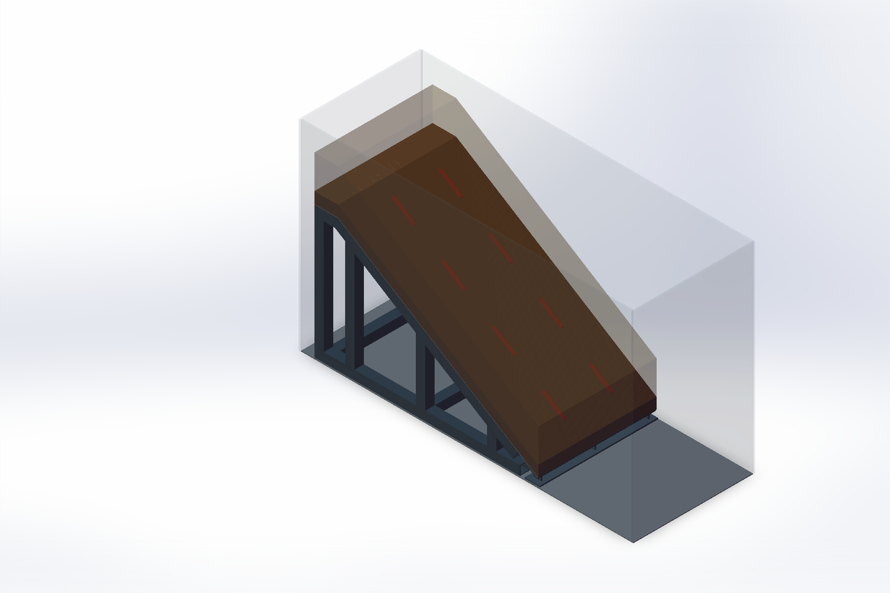
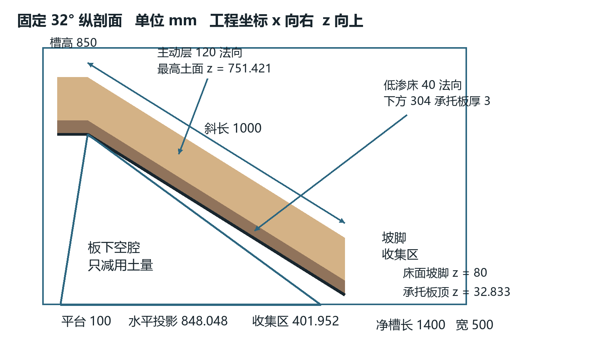
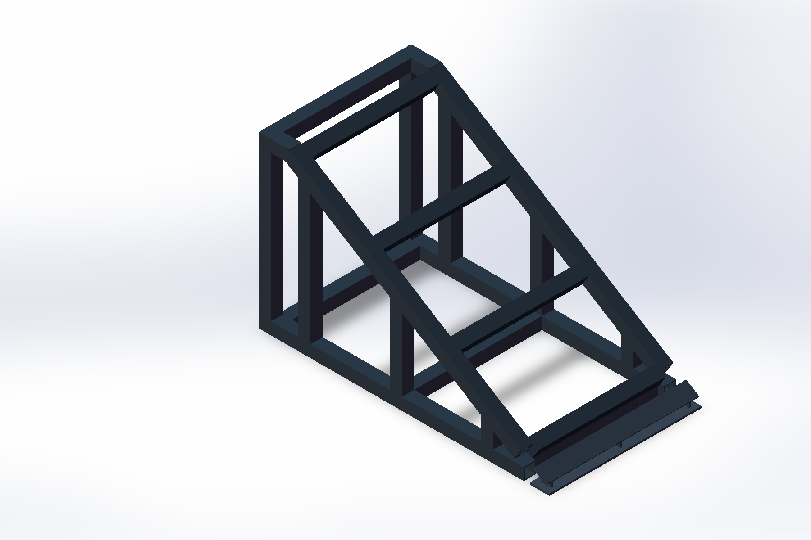
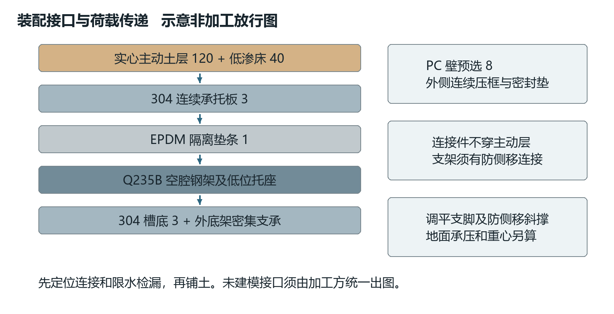
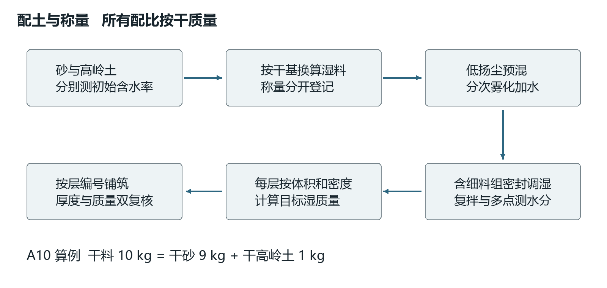
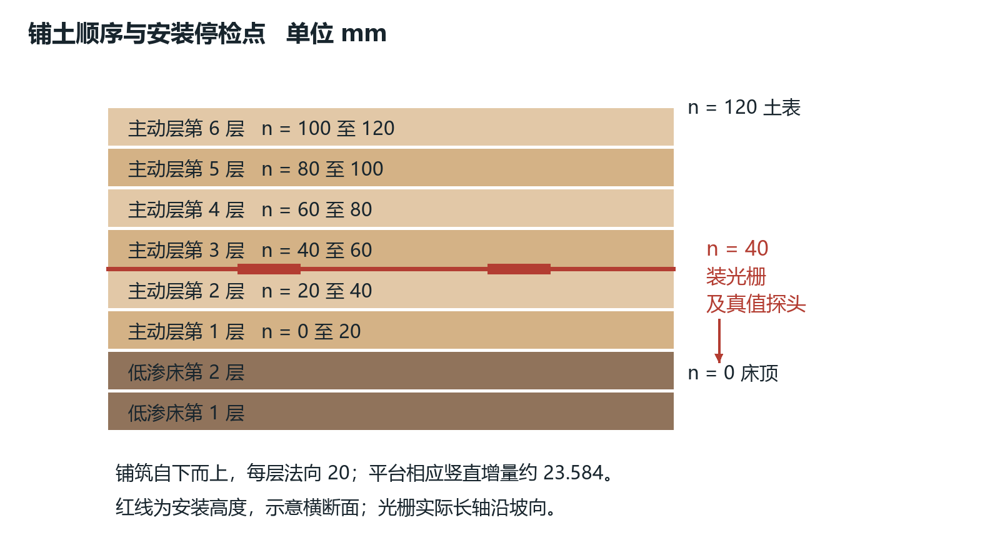

# 室内边坡模型制造与装配手册

V2.6　2026年10月15日　配套固定32°三维模型

本手册用于制造能够开展降雨滑移、坡脚局部塌落和光栅阵列监测的室内土坡。推荐结构为连续承托板上的实心分层土体，板下采用空腔钢架减小用土量。土体采用可追溯石英砂和高岭土，不采用太空砂或橡皮泥作为降雨失稳主试验材料。

制造顺序为材料小试、加工图确认、空槽装配、限水检漏、无纤试坡、有纤对照。本文给出几何基准、建议接口和操作细节，但结构承载、PC侧壁、焊缝连接和材料参数仍须由实际加工方与试验负责人签认。未经签认不得装满土水或直接下料。建议值不等于已达到的性能。

阅读路径：第1至4章确定尺寸与材料，第5至8章用于加工装配，第9至12章用于配土铺土，第13至15章用于验收和交接。光纤点位、每次水量和数据记录详见配套《边坡监测试验操作手册》。两册参数不一致时暂停作业，按同一版本更正。

图M1　已有SolidWorks总装　透明土体仅便于观察　不表示实物透明

<!-- page -->

## 1 制造边界与尺寸基准

采用1g室内机理模型，研究浅层土坡从稳定到变形、滑移或塌落的过程。尚无指定真实边坡原型，不标注严格1∶20。桥梁荷载、地震和长期风化不在本次制造基准内，不能从本模型直接推算现场预警阈值。

| 项目 | 制造基准 | 说明 |
|---|---|---|
| 槽内净空间 | 长1400 × 宽500 × 高850 mm | 不含壁厚、压框和支脚 |
| 坡角与床面 | 固定32°，斜长1000 mm | 床面指低渗土床顶面 |
| 坡肩水平平台 | 长100 × 宽500 mm | x从50到150 mm |
| 后部间隙 | 水平50 mm | 封边，防后部旁渗 |
| 主动土层 | 法向120 mm，实心 | 分6层，每层20 mm |
| 低渗土床 | 法向40 mm，实心 | 分2层，每层20 mm |
| 坡脚床面标高 | z = 80 mm | 不等于承托板标高 |
| 坡脚收集区 | 水平401.952 mm | 另配可取出的接土盘 |
| 最高土面 | z = 751.421 mm | 至槽顶尚余98.579 mm |

工程坐标以槽内后端底角为原点：x向坡脚，y横坡，z竖直向上，单位mm。沿坡坐标s从坡肩向坡脚增加；n从低渗土床顶面向主动层表面增加。CAD轴为X=x、Y=z、Z=y，读图时不能把Y误认为横坡。

水平跨度为1000 × cos32° = 848.048 mm；高差为1000 × sin32° = 529.919 mm。120 mm法向厚对应141.501 mm竖直厚；40 mm法向厚对应47.167 mm竖直厚。平台为水平面，其竖直填筑厚按对应偏移面保持连续。

图M2　统一剖面尺寸　法向厚度与竖直厚度不可混用

<!-- page -->

## 2 比例选择与几何复核

Schenato等的降雨试验采用约5 m长、32°坡面及60 cm松砂覆盖低渗床，说明这种分层坡体可用于研究降雨诱发浅层失稳[1]。本模型斜长与厚度分别约为该试验的五分之一，宽度并非同一比例缩放，故属于参考机理后的紧凑设计，而非整机等比例复制。

| 比例或尺寸 | 本模型数值 | 对制造和解释的影响 |
|---|---|---|
| 主动厚度与斜长 | 0.12 | 关注浅层变形，不能代表深层滑坡 |
| 宽度与主动厚度 | 4.17 | 仍需观察侧壁效应，不能宣称无边界影响 |
| 两排光栅横距 | 200 mm | y = 150和350，距侧壁各150 mm |
| 同排光栅纵距 | 250 mm | 离散点之间存在盲区 |
| 厚度与粒径比 | 约600 | 仅以d50为0.2 mm举例，不是通用合格线 |
| 坡体土量 | 0.089433 m³ | 含平台，不填板下空腔 |

若仅拿10 m现场高差与本模型0.529919 m床面高差相比，得到约1∶18.9，但这只是一项几何比。1g下使用同类土，并不能同时满足重力应力、黏聚力、渗流时间、粒径和振动频率相似。实验报告应使用本模型实测单位，不能按一个比例换算成现场滑速或预警时间。

以土重度17 kN/m³估算，120 mm法向土层在32°坡上的床面法向应力约1.73 kPa，顺坡剪应力约1.08 kPa。仅1 kPa量级的黏聚力就可能明显改变失稳条件。因此细料不是越多越好，应优先完成约1至3 kPa量级的低应力剪切或可达到的最接近工况试验。

放样时先标x = 150和998.048的坡肩与坡脚床面，再校正32°及法向厚度。不得把上部表面的法向偏移误当成同一x位置的层厚。记录端部按竖直边界截断的几何约定，后续称量沿用同一约定。

<!-- page -->

## 3 构件材料与采购清单

| 构件 | 预选材料及规格 | 数量或范围 | 采购检查 |
|---|---|---|---|
| 内部支架 | Q235B方管40 × 40 × 3 mm | 1焊接框架 | 壁厚、直线度、材质单 |
| 低位坡脚座 | Q235B钢板厚6 mm | 1组，含3腹板 | 切口、平面度、防腐 |
| 连续承托板 | 304不锈钢厚3 mm | 斜面及平台1套 | 折线及平面顺直 |
| 板架隔离 | EPDM名义厚1 mm | 沿实际支座铺条 | 相容性、压缩回弹 |
| 槽底 | 304不锈钢厚3 mm | 1套 | 不作为无支承跨板使用 |
| 透明壁 | PC板预选厚8 mm | 四面，含压框 | 侧压力验算后定厚 |
| 外部底架 | Q235B型材候选 | 1套 | 截面、支脚和斜撑另算 |
| 密封与压条 | EPDM及相容密封胶 | 连续边界 | PC应力开裂相容测试 |
| 排水件 | 可维护的底排及溢流 | 分路布置 | 有滤网、阀和接头 |
| 接土盘 | 304或HDPE候选 | 收集区可拆 | 不顶住土坡，不跨滑面 |
| 独立附件架 | 喷淋架、相机架 | 各1套 | 不与土槽传感构架硬连 |

PC轻于玻璃且抗冲击较好，但8 mm仅为几何预选，不能据此判断850 mm高侧壁能承受满水压力。不要改成满高蓄水箱。严禁用“材质强度高”代替板跨、压框、孔缘与连接验算。

钢材与不锈钢接触处设置隔离垫，优先可拆压接；不在现场直接把304板焊到Q235B框架。钢架先除锈、防腐、充分固化后入槽，涂层不得污染土料。PC不接触未经验证的有机溶剂、厌氧胶或高碱清洗剂。

采购另备：同批次砂和高岭土、带盖混料桶、称量秤、含水率取样盒、筛具、量水器、限深刮板、轻型压实板、角度仪、钢尺、靠尺和底部防漏接水盘。试验室应具备通风与防尘设施，避免干砂及高岭土扬尘。

<!-- page -->

## 4 支架结构与低位坡脚制造

图M3　实际CAD空腔钢架　低位坡脚采用板式托座

| 位置 | CAD几何值 mm | 加工说明 |
|---|---|---|
| 左右斜梁 | s = 5至900，轴向长895 | 共2条，端部依实际相交修剪 |
| 倾斜横撑 | s = 25、300、600、900 | 管净段420，共4条 |
| 左右底梁 | x = 50至920，长870 | 共2条 |
| 两侧立柱中心 | x = 70、200、500、800 | 共8处，顶端随斜面斜切 |
| 底横撑中心 | x = 100、500、880 | 另有x = 70平台横撑 |
| 坡脚底板 | x = 940至1004 | 64 × 500 × 6 |
| 坡脚腹板 | y = 20、247、474 | 厚6，形状按模型深化 |

坡脚承托板顶面标高只有32.833 mm，下面放不进40 mm方管。因此主斜梁在s = 900处结束，s = 950至1000由低位托座承压。不得把斜梁直接延长到坡脚，否则发生几何冲突。表中的轴向长不是最终锯切长度，CAD没有焊件自动切割表。

加工方先按STEP或原生草图提取实际端角和柱高，形成二维切割图，再在水平胎具点焊两侧框，装横撑、复核对角线后对称施焊。焊缝型式、焊脚和检验等级须按荷载、管壁和焊接工艺定稿，不在3 mm管壁上任意加大焊缝。封闭方管焊接须预留工艺排气，防腐完成后封口，不能对密闭腔连续加热。

装配前去除锐边、焊渣和毛刺；框架应能稳定放置，无明显翘曲。EPDM只设在承压接触面，不在土内设硬横杆。内支架当前缺少专门的侧向斜撑和防滑移连接，必须结合外底架深化，不可把CAD固定关系当成真实抗侧移约束。

<!-- page -->

## 5 箱体与外底架装配接口

图M4　新增接口的推荐构造　压框和外底架尚须加工深化

槽内净长宽必须在安装密封和压框后仍为1400 × 500 mm。PC板开料尺寸应在选定搭接或嵌入方式后反算，不能直接把净尺寸当外板尺寸。透明长侧壁外侧设置连续上、下压框及立向压条，压条不得进入净槽挤压土层。立向分格可先以不大于350 mm作为验算初始方案，最后按板变形、孔缘应力和视野调整。

侧壁优先采用金属框加连续橡胶垫的压紧式安装。若必须穿PC孔，孔径与热膨胀余量按板材商建议，使用大垫片及限压套，不用沉头螺钉直接压PC。M6紧固件、6至8 mm孔等只能在选定连接方案后写入图纸，不能把候选孔径直接交车间。压紧扭矩由密封样段试装确定，拧紧后板不得出现白化、裂纹或局部波浪。

3 mm槽底必须由外底架上的连续支承或足够密集的横梁托住，不能作为1.4 m无支承悬跨板。建议外底架先以约1550 × 650 mm平面包络、接触面离地约400 mm讨论布置，最终高度根据重心、搬运、排水和人体操作确定；此包络不是验算后的放行尺寸。土槽最大土面距地约1151 mm，仅为400 mm台高情况下的操作高度估算。

外底架设可锁定调平脚、防侧移斜撑和可承接漏水的底盘。脚轮只能用于空槽移动，满载前转换为稳定支脚；不能坐在未锁定脚轮上做试验。明确支脚数量、位置、垫板面积、楼板允许荷载和局部承压，由场地管理方确认。

承托板用压板或耳板与框架连接，紧固件位于土体之外或板下可维护区域，不穿入120 mm主动层。连接必须同时抵抗顺坡分力和意外碰撞，不能只靠EPDM摩擦。内钢架通过可拆定位座与外底架传力，避免3 mm槽底局部冲切；相关耳板、孔位和防水穿透节点须统一出图。

<!-- page -->

## 6 承托板密封与水路边界

承托板斜段顶面坡肩z = 562.752、坡脚z = 32.833 mm，均比低渗床顶面低47.167 mm。3 mm板厚沿斜面法向计。平台与坡段优先工厂连续折弯；若分片拼焊，打磨土侧焊缝并检漏，不留会产生局部水头和滑动台阶的凸起。

低渗床完整铺在承托板上，板作为不透水底界，主要排水在土床顶界面向坡脚流出。不得随意在承托板上打孔“提高排水”，这会改变试验机制。床层实际渗透系数须测量，“低渗”不是绝对不透水。板下检漏水单独收集，不能算作正常坡体渗流。

| 水路 | 位置与建议接口 | 必须保持的边界 |
|---|---|---|
| 土表径流 | 坡脚土表下游接槽 | 不顶住主动层，不形成挡土坎 |
| 床面渗流 | 坡脚床面z约80处接薄型导流口 | 口部齐平，单独计量 |
| 收集区落雨 | 坡脚裸露区域独立盘 | 不计入土坡径流 |
| 槽底检漏排水 | 收集区底部可维护排口 | 不贯穿承托板与有效坡体 |
| 紧急溢流 | 经校核的安全水位处 | 排量大于最大实际来水，须试验 |

出口管内径可先以12至16 mm讨论，最终按含沙堵塞、坡度和排量试水确定。滤网置于可拆卸下游容器，不把厚滤布铺到滑面上。接头穿槽处用法兰和密封垫，软管独立固定，避免拉扯PC板。

床身两侧和后端旁渗采用连续薄封边，位置与材料固定记录。不能将塑料膜铺满床面又声称是土土界面，也不能为防侧漏把主动层胶粘到壁上。侧壁保持同一清洁状态，正式对照试验不随意涂润滑剂；要改变侧壁摩擦时单列试验组。

空槽检漏仅在承载已确认后采用限定低水头。例如槽底50 mm水深等于35 L，应计入支承验算；这不是默认允许试验水深。上部接缝用局部喷淋逐段检查，不把850 mm高槽灌满检漏。排口堵塞试验须有备用排水和人工停泵人员。

<!-- page -->

## 7 荷载预算与加工验收

| 项目 | 质量估算 kg | 适用范围 |
|---|---|---|
| 主钢架与坡脚座 | 36.11 | 33.28加2.83，按CAD体积 |
| 承托板与EPDM | 13.26 | 13.07加0.19 |
| 槽底与PC壁 | 48.20 | 16.93加31.27 |
| 已画构件合计 | 97.57 | 未含压框与外底架等 |
| 土体湿质量 | 134.15至169.92 | 湿密度1500至1900 kg/m³ |
| 非孔隙储水预算项 | 暂取不超过35 | 不是允许积水或承载承诺 |
| 已画部分运行预算 | 266.72至302.49 | 还必须加全部未画附件 |

孔隙水已经包含在土体湿密度中，不再重复相加。最终设计还需核算堵排时的意外水量、集土与水箱是否落在同一底架、偏心、试验扰动及地面局部反力。水箱若在独立地面，其荷载不能遗漏但也不应重复算到土槽支脚。300 kg不是本装置额定承载。

| 检查项 | 首件建议工艺目标 | 检查方法及处置 |
|---|---|---|
| 槽内长宽高 | 图纸值，试装尺寸偏差先取±2 mm | 钢尺，密封后复测 |
| 坡角 | 32°，先取±0.3° | 数字角度仪，前后两侧 |
| 土床与主动层 | 40和120 mm法向厚，先取±2 mm | 至少3断面，每断面3点 |
| 承托面局部平整 | 300 mm靠尺下间隙先取≤1 mm | 排除台阶和尖角 |
| 框架稳定与连接 | 无松动、翘曲、无可见裂纹 | 按签认图检查，异常返工 |
| 密封和排水 | 限定工况无外漏、无溢流 | 记录水头、时长及排量 |

以上尺寸偏差是项目首件目标，不是引用规范的统一限值。若加工或量测达不到，不应直接放宽，应评估对层厚、坡角和对照试验的影响后修订同一版本。结构验收按加工图、材料与连接计算执行，不以目视无变形代替强度和稳定验算。

<!-- page -->

## 8 硬件装配顺序与停检点

1. 清点原材料、原生CAD及STEP，确认全部单位为mm；加工方签认焊缝、底架、侧壁、连接、排口图。图未齐不得下料。
2. 空载组装外底架，校平支脚并安装斜撑与漏水盘；场地确认楼板和供电条件。确认土槽可安全进入预定位置后再上壁板。
3. 安装槽底、压框和PC壁，按对角顺序逐步压紧，测净尺寸。此时完成局部密封和底排试水，避免之后土层遮挡缺陷。
4. 放入已防腐固化的内钢架和低位坡脚座，采用定位连接限制移动。检查坡脚板座不翘起，EPDM连续贴合，无土粒垫在支座上。
5. 安装304承托板与平台，复测板面标高及坡角。装可拆压紧件，确认板下没有悬空接触；不得用螺栓硬拉变形板补偿支架误差。
6. 安装封边、坡脚分路接槽、底排、溢流和独立接土盘。用清水检查实际流向，标出正常出水与异常板下检漏的差别。
7. 完成有签认限值的空槽检漏和支承验收，排干、清洁、拍照。硬件验收单通过后才开始铺床，不用土掩盖漏点。
8. 按第9至12章配料和铺床；主动层第2层完成后留给光纤与真值探头安装。线缆检查通过后继续覆土。
9. 完成坡形、厚度和称量复核，进行无触发观察。将制造卡、称量、照片及异常交接实验负责人；异常未关闭不得开始正式降雨。

停检点分别为加工图确认、硬件检漏、床身完成、传感器覆土前、整坡放行。每次停检记录日期、检查人、照片号和不符合项，禁止仅以“基本完成”签字。

搬运仅针对排干且卸土后的装置，起吊位置由加工方指定，不从PC上沿、喷淋架或光纤引线提起。含土湿坡不整体搬动或倾斜调角。

<!-- page -->

## 9 土料选择与候选干配方

主试验使用同批次洗净石英砂与原生未煅烧高岭土。砂建议d50落在0.15至0.40 mm，最大粒径控制在2 mm以内，记录完整级配；该范围用于小模型和埋纤施工筛选，不是论文证明的最优级配。高岭土应核对矿物、粒径、塑性和批次，不采购含胶、香料或油的工艺黏土。

| 编号 | 砂与高岭土干质量比 | 每10 kg干料的砂及高岭土 | 用途 |
|---|---|---|---|
| A0 | 100∶0 | 10.0及0 kg | 基础降雨、松砂流动对照 |
| A5 | 95∶5 | 9.5及0.5 kg | 轻微细料效应筛选 |
| A10 | 90∶10 | 9.0及1.0 kg | 可成块局部塌落候选 |
| A20 | 80∶20 | 8.0及2.0 kg | 储备组，慎防过黏不失稳 |
| B30 | 70∶30 | 7.0及3.0 kg | 低渗土床首轮候选 |

上述配方是本项目待验证的试配矩阵，不能写成文献已证实的最佳配方。B30若收缩开裂、界面强度或渗透不合格，可在砂与高岭土80∶20、60∶40之间另行筛选，不在已开始的正式试验中临时更改。A0不一定在32°下初始稳定，不能仅凭配方保证滑坡。

水泥、石膏和胶会引入固化与脆断机制；太空砂常含疏水包覆或聚合物，橡皮泥多含油/蜡，均不适合作为降雨渗流主数据源。膨润土强膨胀，不列首轮细料。若研究特殊材料，必须单列数据域和本构性质，不能混入普通土坡训练集。

图M5　干配比和目标含水率分别控制　禁止按一桶土加一桶水估配

<!-- page -->

## 10 含水率与密度控制

含水率按水质量除以干土质量定义。实收湿料质量除以“1加初始含水率”得到干土质量；所需新增水等于干土质量乘以“目标含水率减初始含水率”。含水率在计算中用小数。两种原料含水率不同应分别换算，不能先按湿质量配砂与高岭土。

例如需要A10干料10 kg，其中干砂9 kg、干高岭土1 kg；若砂初始含水率1%、高岭土2%，应称湿砂9.09 kg、湿高岭土1.02 kg。混合料初始水0.11 kg，目标含水率4%需要总水0.40 kg，因此只新增0.29 kg水，约0.29 L。水温和计量精度记录，水质量优先于体积估算。

| 对象 | 首轮筛选条件 | 锁定方式 |
|---|---|---|
| A0主动层 | 初始含水率2%、4%、6%；相对密度Dr可试35%、50% | 实测最大及最小干密度后求Dr |
| A5或A10 | 初始含水率2%、4%、6%，干密度分组 | 不直接套用纯砂Dr |
| B30土床 | 按击实及渗透小试确定水分与压实状态 | 不把主动层4%直接照搬 |

含水率2/4/6%、Dr35/50%均为筛选起点，不是论文保证值。土床需要在成型性、渗透、干缩和界面强度间选状态，可能需要明显高于4%的含水率。不能仅看手握成团就放行。

采用称量法控制每层干密度：分层体积乘以目标干密度得到干质量，再乘以“1加目标含水率”得到铺入湿质量。纯砂相对密度按最松与最密孔隙比或相应干密度试验计算，压实系数必须注明参考最大干密度来源。不得把相对密度、干密度和压实系数混称“压实度”。

若原料水分超过目标，先摊铺调湿并重新测水分，不得计算负加水量后继续。用于测水分或散落在槽外的土应从批次质量中扣除；为取样另备余料，不要现场额外从其他批次补土。

<!-- page -->

## 11 批量配料与拌制工艺

以下仅为算例：主动层目标干密度1400 kg/m³、土床1650 kg/m³。这两个数用于展示称量，不是已确定施工密度。正式卡必须用通过小试的目标值重算。

| 土层 | 体积 m³ | 干质量 kg | 配方拆分 kg |
|---|---|---|---|
| 主动层全量 | 0.06707507 | 93.905 | A10砂84.515，高岭土9.391 |
| 主动层每20 mm层 | 0.01117918 | 15.651 | A10砂14.086，高岭土1.565 |
| 土床全量 | 0.02235836 | 36.891 | B30砂25.824，高岭土11.067 |
| 土床每20 mm层 | 0.01117918 | 18.446 | B30砂12.912，高岭土5.534 |

体积已含100 mm平台的竖直延续段，采用固定x端界。每层体积相同并不代表平台竖直厚也是20 mm：20 mm法向增量在平台处对应约23.584 mm竖直增量。边界改变、凹槽或部件占土明显时重新核算，不擅自减掉一层的土量。

1. 分别取砂和高岭土代表样测水分，筛去杂质，登记粒径及批号。按干基换算称湿料，称量秤建议分度不大于批质量的0.1%，用标准砝码核查。
2. 在有盖容器中低扬尘干混或低水分预混，直至不同位置颜色与细料分布一致。混合时避免高落差倾倒，任何粉尘暴露按实验室要求处理。
3. 将计算加水量分多次雾化加入，边加边翻拌，刮净桶底与桶壁，不一次倒水形成泥团。混匀终点以多点水分而非单纯固定分钟数判断，记录混料机及时间。
4. 含高岭土组可先密封静置12至24 h进行调湿均化，再复拌、复测。这个静置区间是首轮工艺建议，不等同于固化；纯砂不要求照搬，最终由均匀性试验定稿。
5. 至少上、中、下3处取样测水分，首轮可用目标值±0.5个百分点作为工艺目标。超差先复拌和调湿；不通过则停铺。待铺料密封，避免边铺边蒸发。
6. 按每层目标湿质量分装并编号。留样、称量和洒落分别登记；额外准备的5%至10%周转料单独标记，不全部倒进坡体。

<!-- page -->

## 12 铺土顺序与层内安装

图M6　土床2层与主动层6层均为法向20 mm　光栅在主动层n = 40 mm处

先安装可拆厚度标尺，标尺沿侧壁外测或使用临时限深尺，不在坡体内永久留钢条。所有法向层线均以低渗床顶面为n = 0，避免从304板上错误量取光栅埋深。

土床先铺下部20 mm，再铺上部20 mm。使用固定工具、固定分区和预定遍数轻压至目标体积，称量控制干质量。压实遍数由小试确定，正式记录压实板接触面积、质量、方法和遍数，不用“压实即可”。表面轻微均匀拉毛可作为候选工艺，但不能铺塑料膜或形成深沟；界面粗糙度和含水率在各次重建保持一致。

主动层从n = 0铺至20，再至40 mm。称量、轻整平和厚度合格后，暂停安装8个短光栅、2个温度参考和必要真值探头。短条长轴顺坡，底部托住后薄覆细土，避免悬空；安装位置和引线检查详见实验册。不得为固定光栅把两端连到框架或横杆。

完成覆土前光谱检查与照片后，再铺n = 40至60、60至80、80至100、100至120 mm四层。封装占据局部空间时用同批材料填实周边，不能用硬块顶住；光栅上方不夯击，先用软刷和少量土覆盖，再以相同轻型工艺整平。禁止跳过安装点直接一次倒80 mm土压实。

平台随对应层同步铺筑，避免后补造成竖缝。每层至少取3个纵向位置和两侧及中心检查厚度，记录局部低洼；测厚取样若扰动坡体，应使用旁置同状态试样或在非正式先导坡验证，不能留下孔洞继续采正式数据。

最终表面不得用水冲平，也不要为了成型把局部湿土反复抹成硬壳。撤走临时尺和模板，保留侧壁外部标尺。等待时间、水分、外观和初始位移记录后进行无触发观察。出现自然流砂、裂缝快速发展或床身变形时，停止正式试验，回到材料与初始状态筛选。

<!-- page -->

## 13 材料小试与返工规则

| 试验 | 建议首轮样本 | 主要记录与选择依据 |
|---|---|---|
| 基本物性 | 每批原料与各混合配方 | 级配、水分、颗粒密度、塑性及有机杂质 |
| 密度及压实 | A0测最松最密；混合料测成型关系 | 目标密度可实现且可重复 |
| 低应力剪切 | 候选湿态及界面，实际低应力 | 峰值/残余、吸力条件、试样尺寸 |
| 渗透和湿润 | B30及主动层候选状态 | 方法、水力梯度、裂缝和浑水 |
| 无纤小坡 | 每候选至少3次独立重建筛查 | 初始稳定、真实滑移或塌落机制 |
| 土纤拉拔 | 干态及目标湿态各独立样件 | 锚固、脱耦和土体扰动 |
| 有纤无纤对照 | 选定配方同状态成对试验 | 是否因缆和封装改变失稳 |

至少3次只是发现明显缺陷的先导起点，不保证统计充分。强度试验应区分不饱和表观黏聚力和有效应力参数；低应力试验设备若不具备分辨率，应如实说明并先以整体小坡验证，不能把50至200 kPa试验拟合线外推当作本坡精确强度。

无纤降雨试验中先分清整体滑移、局部塌落和表面冲刷。若只有冲沟或坡脚散粒滚落，不能标成滑坡。若一直不动，先检查初始密度、细料、排水和边界，不直接加大到无法标定的暴雨。若一铺好就流散，先提高初始可稳定性，不靠钢网或暗埋支撑强行维持坡形。

床身渗漏、干缩开裂或上层先沿光滑塑膜滑动时，修正材料和界面后整坡重建。任何返工不得只局部挖补关键滑面并继续沿用同一独立试验编号。回收土可能发生细料流失、粒径离析和含水率漂移；正式数据优先新料，回收料须重测并另设批次。

材料参数的试验方法可按GB/T 50123《土工试验方法标准》适用现行版本确认。采购与执行前核实版本及设备适用性；本手册不引用未经核对的具体条款，也不把工程边坡安全系数标准直接作为室内模型失稳判据。

<!-- page -->

## 14 制造记录与交接清单

每次独立重建建立一张制造卡，不能只保留第一次装置照片。制造卡与实验trial_id绑定，发生配方、传感器或边界变更须升级配置编号。

| 记录组 | 必填内容 | 交付证据 |
|---|---|---|
| 硬件 | CAD版本、加工图号、净尺寸、角度、连接与承载 | 图纸、实测表、材料单 |
| 水路 | 正常出口、检漏、溢流和接土盘边界 | 检漏视频、排量及水头 |
| 配料 | 原料批次、干配比、初始及目标水分 | 称量原始单、留样号 |
| 分层 | 2层床身及6层主动层的干湿质量 | 每层厚度、工具、遍数和照片 |
| 安装 | 点位坐标、封装批次、引线及真值探头 | 覆土前俯视及侧视照片 |
| 放行 | 初始稳定、密封、光谱及观测系统 | 检查人、时间和待关闭项 |

加工图包至少包括总装尺寸、外底架与支脚、方管下料端角、焊缝与斜撑、低位托座、承托板折线、压框与PC、连接孔位、排水溢流、密封剖面及线缆过边节点。当前V2.5原生CAD和STEP提供构造基础，不含这些完整二维放行图，制造前应由加工方据实完成。

制造与实验衔接条件：结构签认、空槽检漏、目标配方与状态锁定、无纤机制确认、土纤耦合样件通过、全通道采集与真值同步可用。任何一项未完成，只能继续相应先导验证，不能宣称已经建立可供训练的合格数据集。

拆卸先断泵并排水，确认土体不再运动后分区卸土，逐步暴露传感器，不拉着引线抽出。土层拆解照片应保存滑面、细料迁移和床层变形。固体土和含沙废水按实验室要求处置，禁止直接冲入下水管。

后续如改为25°或35°，需替换支架并重新核算体积、点位、水量和侧壁余量，不将本32°固定模型整台倾斜后继续照表使用。

<!-- page -->

## 15 制造依据与适用限制

[1] Schenato L等，2017。Distributed optical fibre sensing for early detection of shallow landslides triggering。Scientific Reports 7，14686。https://doi.org/10.1038/s41598-017-12610-1 。已核对正文相关方法与结果、补充材料。约5 m长32°松砂坡覆盖压实低渗床，支持分层机理选择；原试验60 cm层厚、约160 mm/h雨强不直接作为小模型参数。

[2] Fang H等，2012。Model testing on rainfall-induced landslide of loose soil in Wenchuan earthquake region。NHESS 12，527至533。https://doi.org/10.5194/nhess-12-527-2012 。已核对公开全文相关方法。3 m × 0.35 m × 0.35 m装置及多坡角试验支持室内对照思路，不证明本模型最小尺寸。

[3] Do H等，2024。Mechanism of a rainfall-induced landslide in a large-scale flume experiment on a weathered granite sand。Geoenvironmental Disasters。https://doi.org/10.1186/s40677-024-00280-x 。已核对正文土料、装置与失稳描述。9 m × 1 m × 1 m装置、50 mm/h雨强及不完全饱和失稳，说明不能将饱和当作必要失稳条件，不照搬其粒径和预湿时长。

[4] Wang G及Sassa K，2001。Factors affecting rainfall-induced flowslides in laboratory flume tests。Géotechnique 51，587至599。https://doi.org/10.1680/geot.2001.51.7.587 。本轮核对元数据，前期读取摘要。密度、层厚和细料影响机理可用于选变量，未将其作为A10或B30精确配方来源。

[5] Zhu H H、Shi B、Zhang C C，2017。FBG-Based Monitoring of Geohazards Current Status and Trends。Sensors 17，452。https://doi.org/10.3390/s17030452 。前期已读相关全文，支持FBG封装、温补与岩土耦合要求，不给本模型现成安装阈值。

[6] Bastianini F等，2019。Optical Fiber Sensing Cables for Brillouin-Based Distributed Measurements。https://doi.org/10.3390/s19235172 。前期已读相关全文，仅借鉴传力和护层机理，不移植解调系数。

文献实测、本项目几何计算和待验证建议须分开使用。32°分层概念有直接试验依据；1000 mm长度、120 mm主动层、A0至A20、B30和全部制造偏差目标属于本项目建议。不存在已确认的通用最佳土配方或无需小试即可保证失稳的固定加水量。
