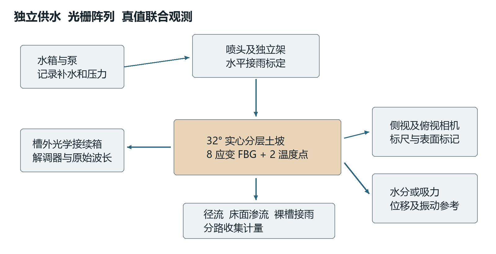
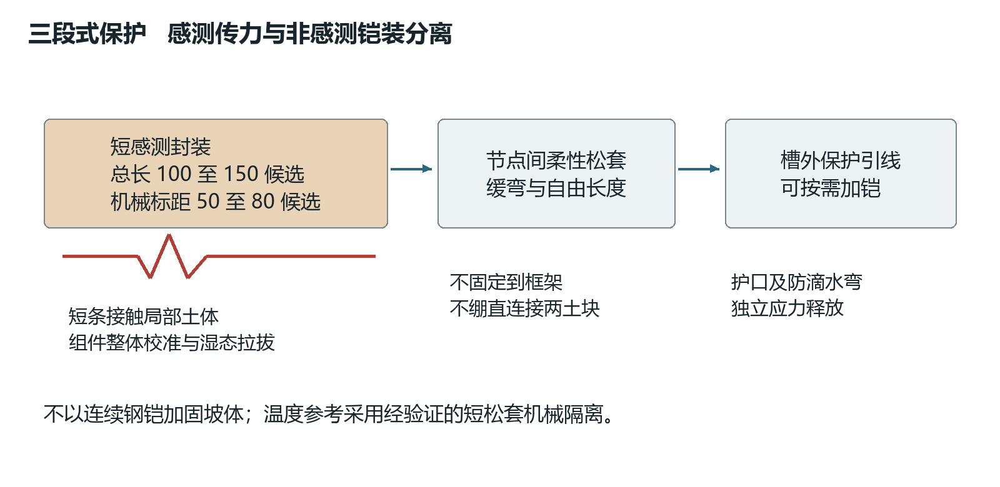
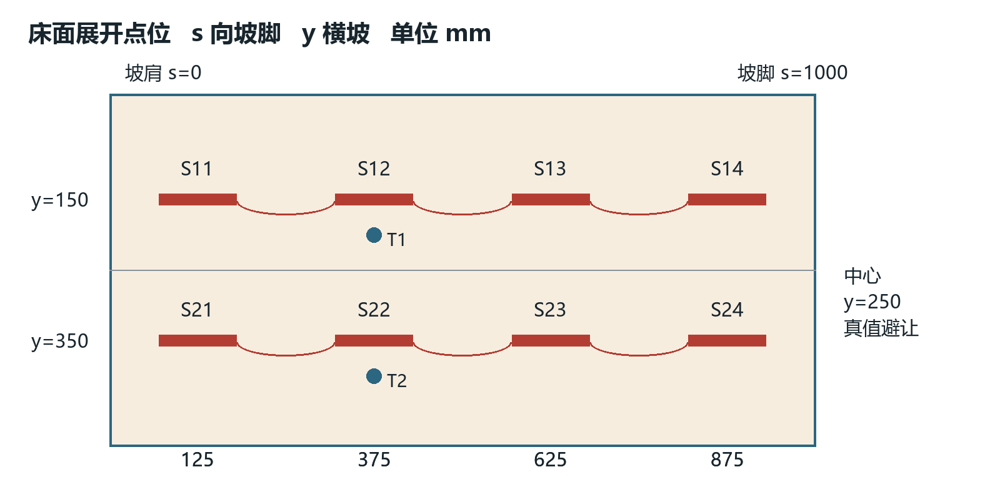
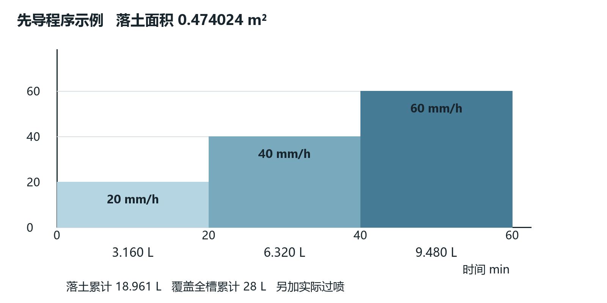
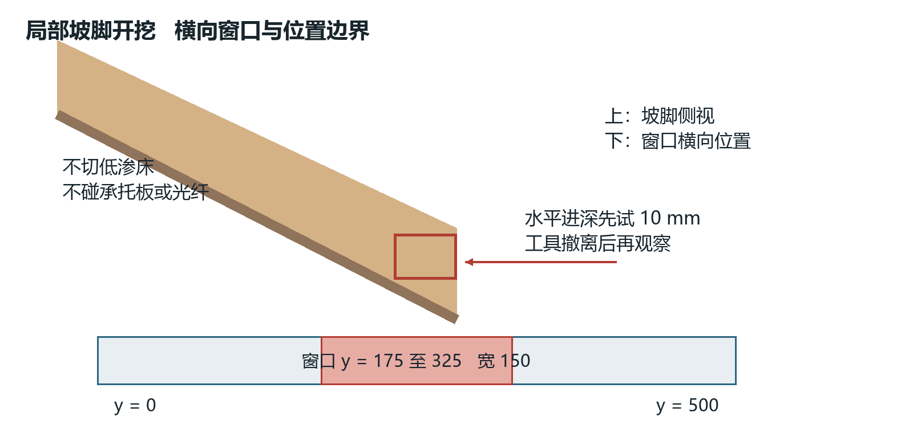
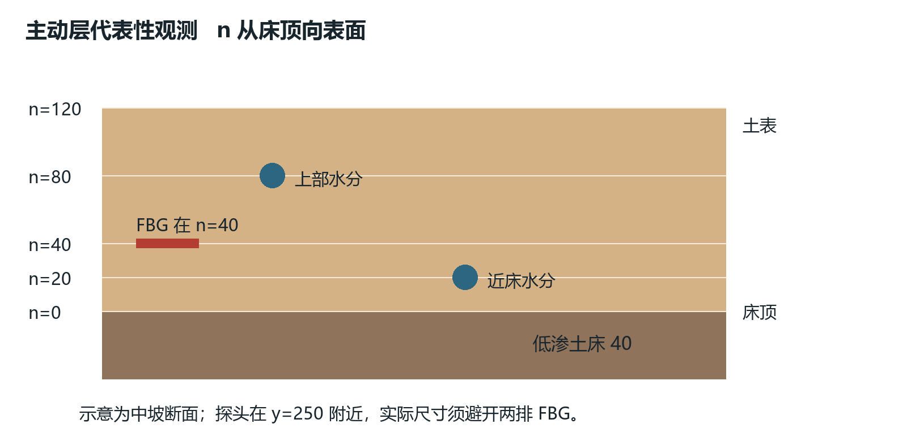
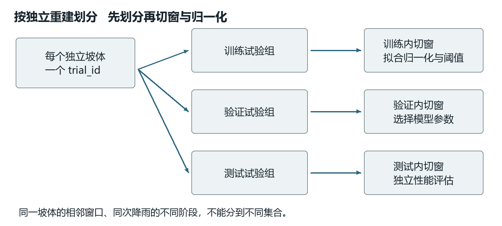

# 室内边坡监测试验操作手册

V2.6　2026年10月15日　光栅阵列与独立真值联合采集

本手册用于固定32°室内坡体的光纤布设、降雨用水、坡脚开挖、观测与数据验收。目标是获得能区分滑移、局部塌落、侵蚀、外部扰动和传感故障的独立试验数据，为后续CNN-LSTM提供可信样本。光纤信号变化不能单独作为滑坡标签。

先做材料与无纤试坡，再做传感器耦合和有纤对照，最后扩充正式样本。试验前确认《模型制造与装配手册》的硬件放行和制造卡。本文水量表为固定几何下的计算计划，实际输入以喷淋标定和每次量测为准，不保证达到指定水量一定失稳。

图E1　喷淋和相机独立支架　光学数据须与视频位移及水分共同解释

本册顺序：第1至5章准备、采购与安装，第6至10章标定及触发，第11至14章观测、标签与验收，第15至16章记录及依据。两册共用几何：槽1400 × 500 × 850 mm、沿坡1000 mm、平台100 mm、主动层法向120 mm、土床40 mm。

<!-- page -->

## 1 实验变量与土层配置

每个trial_id对应一个独立重建坡体。一次坡体上的多段降雨、多次坡脚取土和多个时间窗都属于同一次试验，不能计作多个独立样本。

| 组别 | 初始土层 | 触发方式 | 应回答的问题 |
|---|---|---|---|
| R0无纤先导 | B30候选床40 mm，A0或A5主动120 mm | 标定降雨 | 能否初稳后出现可确认滑移 |
| R1有纤对照 | 与R0配方密度水分一致 | 同一降雨程序 | 光纤是否改变机制或触发时间 |
| C局部塌落 | B30床及A10候选主动层 | 分步坡脚开挖 | 能否形成可辨局部塌体 |
| N降雨不失稳 | 与目标工况同域土层 | 较低或同雨强有限时长 | 识别湿润和泵启动背景 |
| D扰动对照 | 已验证稳定坡体 | 泵、工具或独立轻振动 | 避免把操作噪声当失稳 |

所有配方按干质量比：A0砂100%；A5砂95%高岭土5%；A10砂90%高岭土10%；B30砂70%高岭土30%。均为待小试配方，不是已验证最佳组合。A20仅作储备，未经筛选不并入主矩阵。

主动层水分2/4/6%可用于先导筛选；纯砂Dr35/50%仅在已测最松最密状态后采用，混合土用实测干密度控制。床身水分与密度按其独立成型和渗透试验确定。每次记录实际值，不能只写“湿砂”“夯实”。

滑移、塌落和振动属于不同任务。降雨滑移一般关注低频发展和快速运动；振动识别需额外确认采样带宽、封装频响及独立加速度真值。不得用慢速静态FBG解调器承诺高频振动检测。

<!-- page -->

## 2 光栅阵列与采购接口

首轮采用两条光路，每条4个短应变FBG加1个机械隔离温度参考，共8个应变点和2个温度点。温度参考可置于同路或独立通道，前提是峰预算和全通道速率满足要求。现有CAD只画8个110 × 8 × 6 mm占位，不是封装制造图。

| 采购项 | 首轮数量 | 必须取得的厂家文件 |
|---|---|---|
| 短应变组件 | 8个及按风险准备的备件 | 全组件结构、标距、量程、刚度、温度系数 |
| 温度参考 | 2个 | 机械隔离结构、温度系数、响应滞后 |
| 预制跳线与引线 | 2路，长度按路径实测 | 动静态最小弯曲半径及允许牵引 |
| 解调器 | 1套 | 波段、峰宽、反射率、点数、全通道采样 |
| 外部接续箱 | 1套 | 接头、应力释放、防水和检修说明 |
| 耦合验证样件 | 每候选至少3件 | 湿态拉拔与全组件标定曲线 |

短封装建议先讨论总长100至150 mm、厚度不大于10 mm、机械标距50至80 mm。必须由厂家确认可制造性、拉压能力和土内传力；不能把几何占位直接当成可采购成品。栅长、栅间距、机械标距和解调有效区间分别注明。

普通波长型FBG与超弱光栅相位阵列不是可无条件替换的同一系统。先明确用户实际主机路线；若为相位型阵列，按厂家区段量定义重新标定，不能直接套波长应变公式。无法确认主机前可以完成土槽，不宜批量定制光栅。

波长预算例：成品应变系数若为1.2 pm/με，量程±2500 με，温度系数10 pm/°C，温差±20°C，则每点至少需要约6.4 nm漂移窗口，另加峰宽、制造偏差与防碰撞间隔。它是询价算例，不是本项目已确定系数或波长表。四个应变点加温度点应一起核算。

<!-- page -->

## 3 光纤制造封装与铠装分区

图E2　感测段传力与引线保护分开设计　示意非厂家内部结构定稿

感测段由与土接触的短封装或锚耳将局部变形传到敏感元件；节点之间采用柔性松套跳线，槽外引线才按抗压、抗磨需要加铠。不得把连续钢丝铠装贯穿整坡并固定在框架上，否则可能加固土体且分流传感应变。

优先采购成熟光栅和工厂预制串，不在实验室自行刻栅、剥纤寻栅或拼装未经标定的金属管。制造流程应含写栅与复涂记录、封装胶层控制、成品光谱、固化应力、预制接续、过渡保护和最终组件校准。裸栅标定不能替代带基片、胶、护套和锚耳的成品标定。

短条候选可比较薄GFRP或薄金属传力片配柔性防水层，但需测等效轴向刚度、拉压响应与湿态漂移。土内锚耳不追求无限刚硬和巨大面积，尺寸应兼顾拉拔稳定和加固效应。保护罩不能跨两端承力旁路敏感件，不能将松套引线误当连续应变缆。

50 mm标距直接伸长1 mm相当于2%即20000 με，远超许多组件量程。对大位移可增加经标定的减敏位移组件或设置不拉扯主坡体的可脱离保护，不能指望短FBG持续跟踪厘米级滑程。断纤前后的标签与有效性必须区分。

试验室接头留在槽外稳定接续箱，箱口设防滴水弯、护口和独立应力释放。引线过PC边缘加圆滑护槽或合适半径的护管，不能用8 mm壁厚当作转弯半径。实际最小弯曲半径取厂家工作与施工要求中更严者，动态移动时使用动态限值。

温度参考以短松套腔机械隔离，外部支承不跨接土体相对运动区域，不灌满硬胶后宣称应变隔离。其热滞后与应变敏感件可能不同，需温变试验确认温补可用频段。

<!-- page -->

## 4 点位坐标与布设路径

图E3　展开床面坐标　光纤短条顺坡　连接线仅表示柔性光路

两排应变点横向y = 150与350 mm；各排s = 125、375、625、875 mm，全部位于n = 40 mm。转换为工程坐标时，x = 150加s乘cos32°加40乘sin32°；z = 80加“1000减s”乘sin32°加40乘cos32°。表中坐标取0.1 mm用于定位，不代表施工能达到0.1 mm精度。

| 点位 | s mm | y mm | x mm | z mm |
|---|---|---|---|---|
| S11及S21 | 125 | 150及350 | 277.2 | 577.6 |
| S12及S22 | 375 | 150及350 | 489.2 | 445.1 |
| S13及S23 | 625 | 150及350 | 701.2 | 312.6 |
| S14及S24 | 875 | 150及350 | 913.2 | 180.2 |

T1、T2建议在s约375 mm、相应排附近侧向错开，坐标以不接触应变条和水分探头为准，安装后测量登记。不得从表格复制一个与应变组件重叠的坐标。土体真值探头优先位于中心y = 250 mm，具体避让根据探头实际体积安排；与光栅先以至少30 mm净距讨论，30 mm不是文献通用无扰动阈值。

跳线沿同排节点间缓弯走向，不与短条端部绷直连接，不形成横贯全宽的硬绳。两路分别从近侧安全出口引到槽外，出槽位置由实际引线余量确定并拍照。服务弯应有自由长度而不悬挂在敏感标距上，不埋接头，不在滑面上固定连续硬护管。

<!-- page -->

## 5 埋设步骤与耦合验收

1. 安装前逐点拍摄成品编号并记录无载光谱。核对厂家定义的量程、允许压缩和弯曲半径，轻弯跳线时不得出现失栅或异常峰碰撞。
2. 完成40 mm低渗床及主动层前两层，各20 mm法向。用临时可移定位尺标s和y，核对n = 40，不从钢板表面起算。
3. 用同批细土轻整组件下方，不挖深沟、不铺刚性底座。短条长轴顺坡，端部土体接触状态一致；把引线释放到松弛状态后再覆土。
4. 安装温度参考和独立水分/吸力探头，记录其代表土层。探头不夹压光纤、不与同一锚件共固；土内夹缆可造成假应变，文献[1]已有类似干扰提醒。
5. 保存俯视与侧视照片及埋设后光谱，填写每点实际坐标和轴向。允许定位偏差首轮建议±5 mm；超差应据实际位置修订，不伪造设计坐标。
6. 软刷薄覆土后分4层铺至n = 120。每层复查光谱与引线余量，禁止在组件正上方夯击。完成后再保存零点，不把埋设预应变全部抹掉不记录。

土纤拉拔先在同配方、相近低覆土应力和干湿状态中开展，分别测组件输出、两端相对位移和土体移动。输出稳定、可标定且不明显加固土坡才可入整坡。拉出过程中的FBG应变不能直接解释为均匀土应变。

成品放行可先采用项目目标：校准后静态最大误差不大于有符号全量程跨度10%，迟滞不大于5%，同工艺样件标定斜率变异系数不大于10%。这些不是文献统一标准，须结合本任务分辨率签认；近零输入不用比值评价传递率。湿态复测、温补和全通道峰分离必须同样通过。

对照坡不允许用钢丝或刚杆代替光纤以“保持条件”，因为它们本身可能改变失稳。应明确无纤坡与完整有纤坡的真实区别，对触发时间、首动位置、滑面和运动范围成对比较并记录不一致。

<!-- page -->

## 6 喷淋标定与水量定义

本手册的注水优先指均匀喷淋降雨，不是直接向坡顶倒水或针管灌水。若研究定点注水，应另定位置、压力和流量，单列试验组，不与降雨组混标。

| 面积口径 | 面积 m² | 使用场景 |
|---|---|---|
| 坡面及平台水平投影 | 0.474024 | 计算真正落在土坡上的雨量 |
| 整个槽平面 | 0.700000 | 喷头覆盖全槽时的接雨预算 |
| 沿坡面加平台实际表面积 | 0.550000 | 不能直接用于竖直降雨体积换算 |

雨强以水平接雨面标定，1 mm降雨落到1 m²等于1 L。落土流量等于雨强乘0.474024。喷头总出水还包含裸槽区和槽外过喷，所以泵设定流量、水箱减少量和落土雨量一般不相等。除非校准证明，不把水箱减少量直接当作土坡入水。

将接雨杯放在与土坡水平投影相应的区域，先以3 × 5网格标定，再根据喷头图形加密边缘。每杯记录面积、收水质量、时长和位置。按面积加权求平均雨强及均匀度。Christiansen均匀系数可用“1减各杯雨深偏差绝对值之和除以杯数和平均雨深之积”，再乘100%；零均值时不计算。

首轮均匀系数可试以不低于80%为项目筛选目标，并报告局部范围与重复性；不是滑坡论文统一门槛。无法达标先调整高度、喷头和遮挡，不用平均值掩盖局部集中冲刷。喷淋在空槽或假面上完成标定，接雨杯不留在正式坡面挡雨。

喷头建议先从距最高土面600至1000 mm范围调试，最终由覆盖、滴径、冲蚀和室内高度决定。喷头高度、供水压力、喷型、覆盖边缘和水温锁定并记录，管路与泵采用减振及独立固定。降雨开始时刻以水实际到达土面为准，另存泵启动时间。

<!-- page -->

## 7 每次降雨量与补水预算

下表为真正落到0.474024 m²土坡水平投影上的计划水量，单位L。若失稳提前停止，填写实测时长和累计量，不把计划总量当实际总量。

| 雨强 mm/h | 落土流量 L/h | 10 min | 20 min | 30 min | 60 min |
|---|---|---|---|---|---|
| 20 | 9.480 | 1.580 | 3.160 | 4.740 | 9.480 |
| 40 | 18.961 | 3.160 | 6.320 | 9.480 | 18.961 |
| 60 | 28.441 | 4.740 | 9.480 | 14.221 | 28.441 |

若喷淋均匀覆盖整个0.70 m²槽，20、40、60 mm/h分别对应整槽14、28、42 L/h。60 mm/h连续1 h即使无槽外过喷也需42 L，20 L水箱只够周转，不能保证整次供水。水箱补水时应称量或量取并打事件标记，避免把补水振动和压力变化当土体异常。

图E4　先导阶梯例　这是一场试验不是三个独立样本

建议先导例为20 mm/h持续20 min，随后40 mm/h持续20 min，再60 mm/h持续20 min；落土累计3.160加6.320加9.480，共18.961 L，覆盖全槽时共28 L，另加实际过喷。该例用于寻找可用工况，不是每次必须执行的强制标准。正式对照优先采用先导确定的恒定雨强和统一终止时限，减少雨强与累计湿润的混淆。

需要更高雨强时重新标定并验证冲蚀与供排水，不能因参考论文用了160 mm/h就直接照搬。坡体初始含水率、密度和排水不同，同样水量可能产生不同结果，不存在通用的“每次倒几升就滑坡”。

运行前核对最大瞬时排量、总供水、污水接收及非孔隙储水。制造册中的35 L是临时荷载预算项，不是允许在槽内积水35 L。达到经结构和边界确认的限位水位、异常渗漏或排水堵塞时立即停泵，不能等到表中水量用完。

<!-- page -->

## 8 降雨单次试验流程

1. 试验前完成制造卡和光谱检查，锁定配方、干密度、初始水分、32°坡角、两层法向厚度、侧壁和坡脚边界。试验至少安排操作与安全观察两人，明确停泵权限。
2. 检查接土与分路排水，量取水箱初始量，清空称量容器。固定相机、标尺和灯光，确认高程不被溅水遮挡，土坡周围设置挡水和防触碰区域。
3. 全系统先采不少于10 min无触发基线作为首轮建议，并继续到位移、光谱和水分达到预先约定稳定条件。若自行变形发展，停为“初始不稳定先导”，不进入正式触发。
4. 给出同步事件并核对所有通道。开始喷淋，记录泵启动、落雨到面、每次调压、补水、排水称量和工具接触时间。操作员不靠在槽壁上。
5. 按计划持续恒定雨强或执行已登记的先导阶梯，实时观察独立位移、裂缝、湿润锋及出水。雨强变化须有独立标记，不在发现异常后临时无记录加水。
6. 达到预定最长时限、真实失稳完成、超限水位、结构异常、断电或严重失栅时停泵。发生传感失效但土体继续运动，优先安全并保存视频，后续标无效光学区间，不直接删除整次数据。
7. 停雨后继续采集，首轮可先设10 min，必要时延长至无继续运动且排水安全。保存末次同步事件，记录坡形、剩水、出水和沉积。
8. 完成备份后排水和分区拆坡，拍摄实际滑面与细料迁移。取坡肩、中坡、坡脚的主动层及床身样，登记取样时间和深度；拆解结果回填事件解释。

正式试验不重复使用已滑移坡体补平后继续算“独立重复”。同一坡体若做二次触发，只能保留为有历史状态的连续过程，并明确前次触发与变形。

最长降雨时限由先导结果、供水及排水能力确定并预先登记；参考论文的137 min或6 h不能当成本模型统一时限。未失稳结果同样有价值，应原样保留，不为凑正样本擅自改动坡脚或拉动承托板。

<!-- page -->

## 9 坡脚塌落及振动对照

图E5　开挖在局部主动层坡脚进行　不切低渗床及承托板

局部塌落组先筛选具有可重复初始形态的A10等材料。建议起始窗口横向y = 175至325 mm，宽150 mm，顺坡位于最下游约100 mm主动层内；每步水平向坡内进深先试10 mm。记录窗口高度、实际取土边界与体积，不能只记“挖一下”。具体深度与最大步数由先导安全和机制确定，不能挖到低渗床、托座或光纤。

开挖前拍照并采基线，工具缓慢进入固定窗口取土，完全撤离后再设统一观察期，例如先导60 s。工具接触时段单列“施工扰动”；撤走后出现自发局部塌体才可标塌落。若仅工具带走几粒砂，不标失稳。若开挖侵入光纤位置或引线，应记录该次传感耦合可能失效。

每步称量取出湿土，记录初始与末次坡脚形状；收集盘不顶着坡脚，避免形成额外支挡。同一坡体的多步开挖仍是一个trial_id。无降雨开挖与降雨后开挖分组，湿润历史不同不能当同条件重复。

振动对照用于确认外部扰动及传感带宽，不用敲打PC壁或搬动含土整槽。可在稳定参考结构上设置受控低幅激励源及同步加速度计，先确认不会改变土坡状态。频率与幅值以设备和安全验算为限，逐频扫测幅相响应；未经校准不写“覆盖0至500 Hz”。

泵启动、喷头冲击、环境脚步、工具轻触与连接器松动分别登记，故障样本可在槽外备件或稳定试件上采集，不为了模拟断纤故意破坏坡体中的有效组件。训练时按任务决定区分“振动事件”和“滑坡”，不强行用四类覆盖所有混合机制。

<!-- page -->

## 10 采样温补与时间同步

| 数据源 | 首轮设计目标 | 必须核对的限制 |
|---|---|---|
| 8应变加2温度FBG | 全点500至1000 Hz候选 | 主机全通道速率、掉点和实际频响 |
| 侧视及俯视视频 | 60 fps候选，固定曝光 | 一帧约16.7 ms，不能声称毫秒真值 |
| 水分及孔压或吸力 | 1至10 Hz候选 | 传感器自身响应常慢于采样 |
| 加速度参考 | 按目标频带独立选型 | 抗混叠、量程、噪声和同步 |
| 排水及水箱 | 连续称重或固定间隔 | 操作扰动与称量时间戳 |

所有速率是设计目标，不是现有设备已达性能。若主机只能低速测波长，可开展缓变试验，但应缩小振动目标；全点速率不能用单通道宣传值替代。动态频带还受土体耦合与封装传递函数限制，采样1000 Hz不等于有效带宽500 Hz。

波长型应变按“波长变化减去成品温度系数乘温差”，再除以成品应变系数换算。系数和符号由全组件标定提供，保存原波长及峰质量；温度参考热滞后较大时，快速温变区间应标记温补不确定，不对其强行滤平。

优先用解调器和参考采集器支持的共同硬件触发或时钟。视频同步可使用同一控制器产生可见LED脉冲，同时将电事件写入采集；运行前后各给一次，必要时中间加入，估计时钟偏移与漂移。不能仅以电脑显示时间认为各设备同步。

先在不扰动坡体的状态验证同步链，登记实际误差及相机帧区间。硬件不支持时，可用共同可见且可记录的事件离线对齐，但时间分辨率不得超过视频与参考链实际能力。对快速运动，使用事件起止区间而非虚假的单一毫秒时刻。

原始数据按各自原始时间和时钟保存，另产对齐表。重采样、去噪、温补和归一化不得覆盖原数据。丢包、失栅、量程饱和与峰碰撞保存质量标识，不能填零当正常值。

<!-- page -->

## 11 真值观测与水土状态

图E6　断面位置示意　探头尺寸与埋深最终按实际设备避让

| 观测量 | 建议布置或方法 | 解释限制 |
|---|---|---|
| 位移与裂缝 | 侧视及俯视标定相机、表面轻质标记 | 不用刚杆穿透固定滑动层 |
| 湿润锋 | 透明侧壁定时成像 | 侧壁现象不一定代表中心 |
| 主动层水分 | 例如中坡s = 500、n = 80及n = 20 mm候选 | 尺寸过大时用独立先导或减点 |
| 床面水力状态 | 邻近n = 0布置合适微型探头 | 正孔压不一定发生，需吸力量测 |
| 土床变化 | 床内或拆坡后取样 | 探头不得贯穿40 mm床造成旁渗 |
| 径流与渗流 | 分路收集称重、采浑水和沉积 | 裸槽接雨与异常漏水分开 |
| 末态含水率 | 坡肩中坡坡脚分层取样 | 时间、深度及是否已失稳注明 |

水分传感器须针对砂与混合料校准，不能把默认矿质土曲线直接当精确体积水分。高岭土、盐分与密度改变响应；正孔压计测不到负吸力，并不意味着未湿润。2024年试验[3]表明失稳可发生于未完全饱和状态，不能把“达到饱和”作为所有事件标签前提。

体积水分和质量含水率不同，换算需要实测干密度及水密度；饱和度还需孔隙率。不能仅根据加水总量反推均匀水分。雨水可能径流、排出或局部聚集，土层状态应结合探头、出水与取样。

水量平衡按落土来水约等于表面径流加床面渗流加土中储水变化加蒸发及未测损失。记录称量与面积标定误差，不强行使平衡闭合。出现板下检漏单列异常；裸槽直接接雨不能混入床面渗流，不用总排水曲线声称土层渗透系数。

<!-- page -->

## 12 事件标签与有效数据判据

| 实际事件 | 最低独立证据 | 不能替代它的现象 |
|---|---|---|
| 无失稳湿润 | 视频无可辨运动，水分及出水记录 | 仅FBG信号平稳 |
| 滑移 | 可辨土体相对位移及范围，最好有滑面 | 仅水流或单点应变尖峰 |
| 局部塌落 | 局部土团脱离、形态与落区 | 工具直接带走的土 |
| 侵蚀 | 表面冲刷、细料流失与沟槽 | 不自动升级为整体滑坡 |
| 外部振动 | 已知激励或独立加速度证据 | 泵开关引发的未知尖峰 |
| 传感故障 | 失栅、峰冲突、脱耦或连接异常 | 不填为稳定土体零应变 |

每次记录稳定、缓变发展、快速运动和运动后阶段，阶段边界按独立证据定义。未出现可确认前兆时不填“提前预警秒数”；光纤异常早于视频可见运动也不自动证明地质前兆，需要排除温变、滴水、夹缆和脱耦。

事件表至少含trial_id、event_id、起止时刻或区间、机制、位置范围、触发类型、土层状态、视频帧号、独立位移、标注置信度和光学有效性。一个事件可同时含滑移和侵蚀，保留混合标签或排除出单机制评估，不按研究者想要的类别强行改名。

初始稳定和正式事件阈值先在先导数据中按视频分辨率、位移噪声和持续时间确定，然后锁定。不能把未经验证的1 mm或某个微应变阈值称为规范标准。试验结果评价包括起始位置、运动体积或面积、滑程、触发时间区间、峰值运动、光学有效率及故障。

至少由两名标注者复核关键事件，出现分歧时回看原始视频和测量，将无法确定的边界标为区间或低置信度。只有FBG变化而无独立真值的片段标“传感异常待核实”，不得计入已确认滑坡正样本。

<!-- page -->

## 13 样本矩阵与训练数据放行

先导可用4类工况各至少3个独立重建，共12次，检查采集链和机制是否可行。这12次不是足够训练CNN-LSTM的证据，且只有实际出现并确认的事件才计为相应类别。

正式矩阵可针对每种目标机制设置2种配方 × 2种初始状态 × 2种触发水平 × 3次独立重建，共24次计划。必须先确认各水平确实可制造且安全；24次计划不保证24次失稳，未失稳和混合机制都保留。试验顺序尽量随机，跨天或材料批次采用区组记录，有/无纤对照另计。

图E7　完整坡体试验先分组　时间窗不能跨训练验证测试集合

按完整trial_id及材料批次划分训练、验证和测试，再做切窗、归一化和增强。可先讨论60/20/20等比例，但每类独立数量和跨批次留出比比例本身更重要；数量不足采用分组交叉验证并如实报告不确定性，不凑齐窗口数量冒充独立样本。

先比较简单阈值、传统特征分类与CNN-LSTM，报告宏F1、事件召回、每小时误报、提前量或检测延迟及定位误差。测试集的阈值和归一化参数不能反过来调训练。跨配方或新含水率留出用于泛化检验，小模型数据不能直接声称现场有效。

放行要求包括原始文件齐全、制造卡可追溯、实际水量可还原、全点映射正确、同步误差已知、独立事件标签可信、故障区间明确和完整试验隔离。任一未满足时可作调试数据保存，但暂停计入正式性能测试集。

<!-- page -->

## 14 安全终止复位与异常处理

| 情况 | 立即措施 | 数据与返工处理 |
|---|---|---|
| 侧壁变形、开裂或连接松脱 | 停泵，人员撤离风险区，受控排水 | 禁止带载拧螺栓，结构复查 |
| 水位超限、排水堵塞或外漏 | 停泵，按备用水路排水 | 登记异常入出水，检漏后重建 |
| 光栅失效或引线拉紧 | 停止人工接近，保留独立录像 | 标失效时刻，安全后检查 |
| 预期外大块滑落 | 停泵，勿用手挡土 | 接土盘清理前拍照称量 |
| 采集丢帧或同步失效 | 能安全时终止触发 | 保存原始记录，不补造时刻 |
| 初始自行失稳 | 不开始正式降雨 | 归先导失败，重新筛选状态 |

电源与解调器位于防溅区域，使用实验室合规漏电保护，泵的紧急开关可直接触及。湿手不插拔电源，光连接器不直视端面；断纤按锐利玻璃纤维处理。任何时候不把手伸入仍在运动的土体下方，不爬坐土槽框架。

停雨后待运动稳定并完成末态观测，再排水、分区取样和卸土。暴露传感器时软工具去土，握持封装而非拉引线，逐点复测光谱。重新使用的光栅需检查湿态零点、封装破损和耦合一致性；换件生成新的calibration_id。

清理沉积和管路滤网，含沙水不得直接入室内排水。PC用已确认相容的清洁方式，不用强溶剂擦拭。检查床身是否需要全部重铺，正式独立重建原则上按同一完整工艺，不把上次受水开裂的床当新床而不记录。

完整记录终止原因；安全终止不是可以删除失败试验的理由。若制造或水路边界已经改变，该次不与原配置合并分析，修复后重新确认无触发基线、雨强和同步。

<!-- page -->

## 15 单次实验记录模板

以下字段在每个trial_id目录下保留原始记录、配置及照片。电子模板见本版本templates文件夹，空白项明确填“未测”或“不适用”，不能默认已通过。

| 记录卡 | 必填字段 |
|---|---|
| 试验身份 | trial_id、batch_id、operator、日期时区、手册/CAD/配置版本 |
| 几何土层 | 实测角度、尺寸、主动及床层厚度、封边和排水状态 |
| 材料制造 | 干配比、原料含水率、目标/实测水分及密度、各层质量 |
| 传感安装 | 点名、实际坐标、方向、标距、序列号、calibration_id |
| 主机采集 | 解调路线、原始单位、全点实际采样、质量标识、同步误差 |
| 水量计划 | 目标雨强、标定号、面积口径、各阶段时长和计划落土量 |
| 实际触发 | 落雨起止、实测雨强、加水/补水、出水、开挖步骤及扰动 |
| 土层观测 | 主动层与床的探头位置、湿润锋、水分/吸力、末态取样 |
| 事件证据 | 视频帧区间、位移、机制、位置、置信度、光学有效时段 |
| 结束验收 | 终止原因、异常、备份校验、重建和返工决定 |

建议目录为metadata、optical_raw、reference、video、events、photos及derived。原始数据只读保存，派生数据注明脚本版本和参数。每次试验结束核对文件大小、起止时间、连续性和哈希，至少保存到两个独立存储位置。

每阶段用水日志填写：阶段号、计划与实际起止、标定雨强、实际水平接雨量、推算落土量、泵箱初末量与补水、径流、渗流、裸槽接雨、异常漏水及计量误差。不能用一个“注水10 L”字段代替整个水路。

重复条件指配方、密度、水分、几何、边界、传感结构和触发程序都明确的独立重建；并不要求每次都出现同样标签。保留不失稳与失败结果，才能判断模型的可重复性和光纤识别的误报水平。

<!-- page -->

## 16 实验依据与解释边界

[1] Schenato L等，2017。Distributed optical fibre sensing for early detection of shallow landslides triggering。https://doi.org/10.1038/s41598-017-12610-1 。已读相关正文及补充材料，支持分层土槽、同步水力与变形观测及夹缆干扰检查。其分布式光纤不等于本项目离散FBG阵列，原雨强和失稳时刻不能照搬。

[2] Fang H等，2012。Model testing on rainfall-induced landslide of loose soil in Wenchuan earthquake region。https://doi.org/10.5194/nhess-12-527-2012 。已读公开全文相关方法，支持坡角与土料条件对照，不能据其84 mm/h雨强确定本模型每次固定水量。

[3] Do H等，2024。Mechanism of a rainfall-induced landslide in a large-scale flume experiment on a weathered granite sand。https://doi.org/10.1186/s40677-024-00280-x 。已核对相关正文；初始与失稳饱和度不同且未必完全饱和，支持记录真实水分状态，不以饱和作统一前提。

[4] Zhu H H、Shi B、Zhang C C，2017。FBG-Based Monitoring of Geohazards Current Status and Trends。https://doi.org/10.3390/s17030452 。已读相关全文，用于光栅温补、传力和封装设计；未给本土槽现成布点与动态性能保证。

[5] Bastianini F等，2019。Optical Fiber Sensing Cables for Brillouin-Based Distributed Measurements。https://doi.org/10.3390/s19235172 。已读相关全文，借鉴护套与机械耦合概念，不混用不同解调技术的系数。

[6] Wang G及Sassa K，2001。Factors affecting rainfall-induced flowslides in laboratory flume tests。https://doi.org/10.1680/geot.2001.51.7.587 。摘要层证据用于选择密度、细料和层厚变量，不作为A5/A10/B30精确比例依据。

20/40/60 mm/h、每段20 min、n = 40 mm点位、500至1000 Hz采样和80%均匀度目标均是本项目先导建议，未经过实物验证。正式试验以标定与先导结果锁定；任何性能结论须报告实际独立重建数和失效区间，不能从文档设计推导识别准确率。
