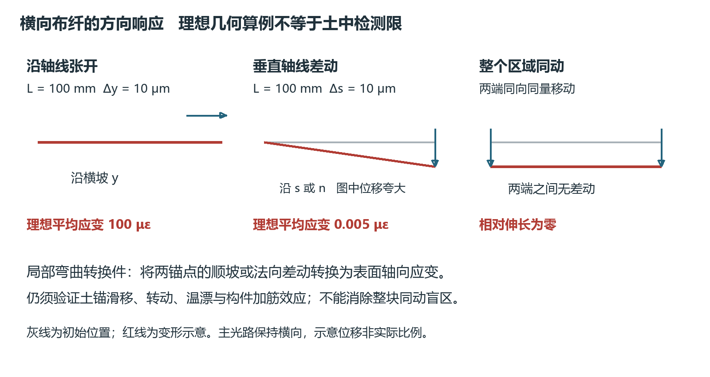
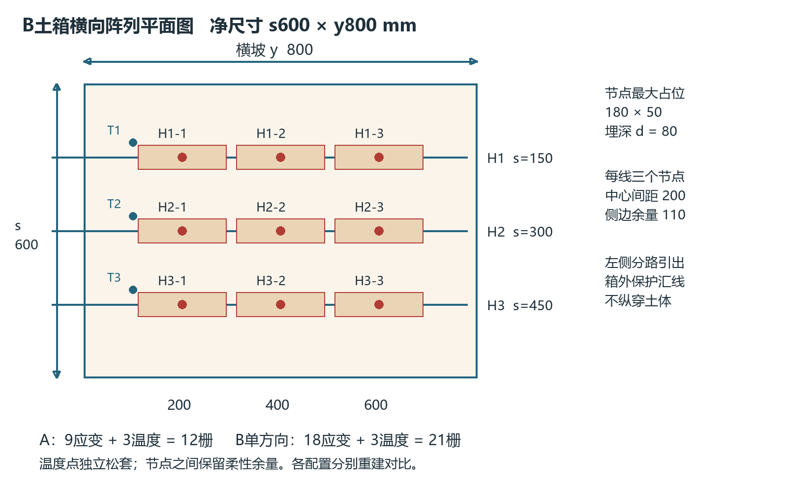
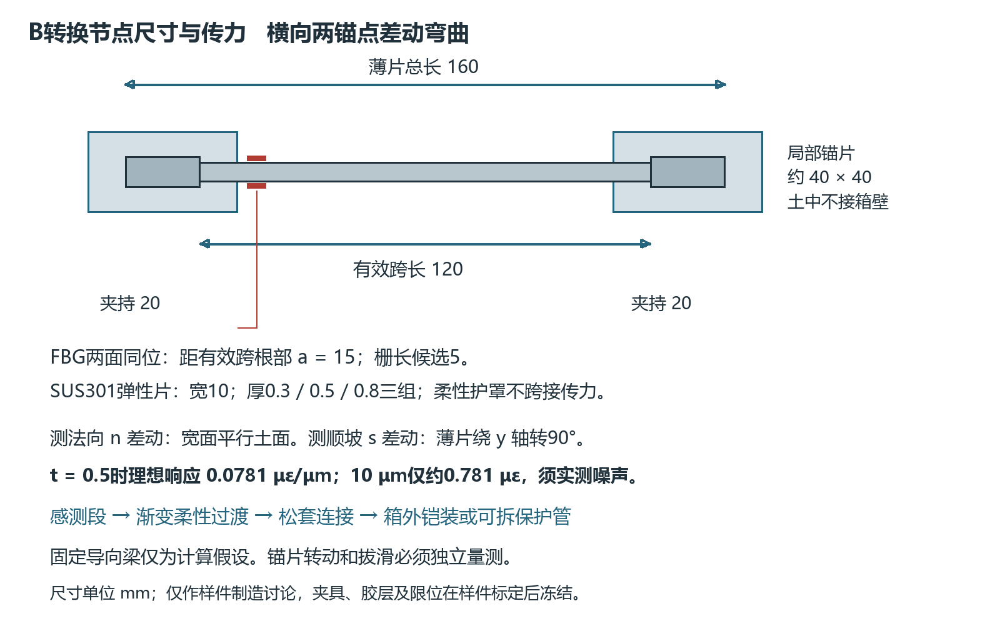
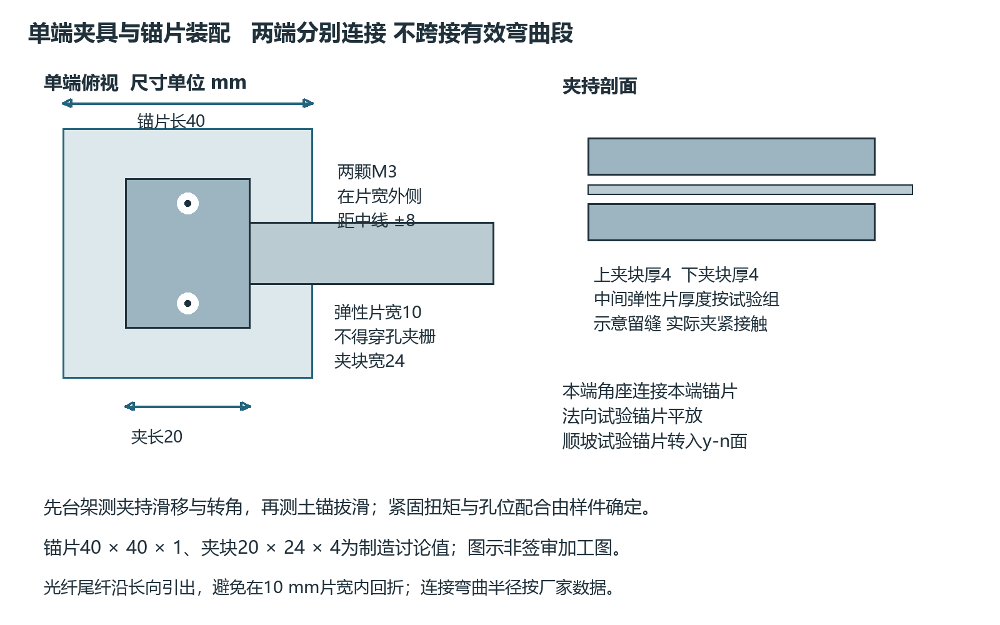

# 横向光栅阵列布设与微变形转换设计

V4.0 研究设计版　2026年10月28日　样件与工程参数须实物验证

主线沿横坡近等高线布设。首轮比较直埋轴向应变件和局部差动位移转换件；所有光路的主走向保持横向，回线沿槽外或现场侧边保护通道进入接线箱。设计目标是测量局部相对运动，不将整块刚体运动等同于微应变。引用R编号见《病害与文献证据》。

## 1 坐标与方向可观测性

s为沿坡向下坐标，y为横坡坐标，n为坡面法向向外；平土箱阶段s仅表示预定顺坡加载方向。d为从局部土面向下的法向覆土深度，与V3从床面向上的n不同。所有图纸以mm为单位。

小变形下，沿y的直纤主要感受y方向位移对y的变化率。纯顺坡位移若沿y均匀，则没有一阶轴向伸长。裂缝与测线近似平行时，测线可能完全不跨缝。滑面深于埋设层时，两锚点可能一起运动。以上是几何盲区，不能靠提高采样率或CNN-LSTM消除[R02、R04、R09]。

对无滑移且两端固定的直线段，端点发生垂直于纤维轴线的差动δ时，路径长度增量为两端新间距减去原长L。小变形近似平均伸长比为δ²/(2L²)。以L=100 mm、δ=10 μm为例，理想平均应变仅0.005 με；同样10 μm沿纤维轴线伸长则为100 με。该推导是理想两端几何算例，不适用于直接把土体位移反演为每个光栅的局部应变。

图1 横向布纤对不同位移方向的响应路径及盲区

## 2 土箱首轮横向阵列

土箱净空间沿s为600、沿y为800、法向高300 mm；初始铺土厚160 mm。三条测线位于s=150、300、450 mm；每条设三个节点中心y=200、400、600 mm。默认d=80 mm，分次重建比较d=40、80、120 mm，不在同一小箱叠放三层传感器而增加加筋效应。

每个节点横向占位不大于180 mm，顺坡占位不大于50 mm；中心距200 mm。节点间至少留20 mm几何净距。实际胶层、锚片和引线过渡不能越界；若需更大锚片，先减少节点数或增大箱宽，不挤进既定间距。光栅间距不是可保证的定位精度，局部响应可能扩散，需盲测定位。

图2 三横线九节点的土箱平面布置 所有尺寸为候选设计

| 配置 | 应变栅和温度栅 | 主要任务 |
|---|---|---|
| A 直埋轴向件 | 9应变+3温度，共12栅 | 测轴向伸长及方向盲区基线 |
| B 单方向弯曲转换件 | 9节点×2面应变+3温度，共21栅 | 每次测顺坡或法向差动 |
| B双方向扩展 | 9节点×4应变+3温度，共39栅 | 通道预算及扰动允许时再做 |

三种配置按独立重建对比，不在同一土体同处堆叠。每条光路配置A为3应变+1温度；配置B为6应变+1温度。主机峰预算不足时拆分通道或先在单测线三节点运行，不能让串接点数超过解调范围。

节点编号H1-1至H3-3，前项为s测线号，后项为y节点号。温度T1—T3置于各测线附近、避让应变件的独立短松套腔，先验候选位置s=120/270/420、y=100、d=80 mm；实际按探头体积避让并复测坐标。温度参考不承担两土块间拉力。

## 3 配置A 轴向感测件

采购工厂写栅、复涂、谱线可追溯的波长型FBG串；裸栅栅长5 mm可作为询价起点，最终由主机及厂家确认。有效锚距建议100 mm，感测段连同锚耳的总占位不超过180×50 mm。感测件与两端土体必须可靠耦合，光纤不直接被金属夹口、扎带或探头压住。

保护与应变传递分别说明：感测段用薄柔性护层和厂家认可的应变传力结构；过渡段保留渐变刚度及应力释放；槽外引线采用松套、抗水护套和可拆保护管。全长硬钢管或完全松套均不能同时假定为有效土体应变传感缆。试验记录成品外径、轴向刚度、标距、湿态拉拔与滞后。

初始预张力只用于消除可测松弛，须在标定后以测得的零位应变记录；不指定未经检验的统一预拉力。局部压缩可能使细缆松弛或屈曲，此时负应变能力需单独验证。

## 4 配置B 局部柔性弯曲转换节点

节点使用横向弹性薄片连接两个局部锚片；在薄片两面贴FBG，利用差动弯曲产生一拉一压。薄片长轴沿y，薄片的薄厚方向朝目标位移方向。测法向沉陷时薄片宽面平行坡面；测顺坡剪切时薄片转90°，宽面沿y-n平面。更改的是节点姿态，主光缆仍横向。

图3 双面FBG弯曲件的候选尺寸与引线分区

| 构件 | 样件候选值 | 制造和验证事项 |
|---|---|---|
| 弹性片 | SUS301弹簧状态不锈钢160×10 mm；厚0.3/0.5/0.8 mm三组 | 材质及热处理证明，实测厚度；无切割热损伤、毛刺和翘曲 |
| 有效弯曲段 | 两端各夹持20 mm，净跨120 mm | 标定夹具验证转角约束；土中夹持不会自动达到固定导向条件 |
| FBG对 | 两面同侧距有效跨起点15 mm处，标称栅长5 mm候选 | 胶层对称、位置误差留记录；避开中点零曲率区 |
| 锚片 | 每端约40×40 mm，薄片端部横向占位内配合 | 首先台架刚夹；土中用可更换粗糙/穿孔锚片比较拔滑 |
| 保护 | 不接触活动段的软护罩及柔性出口 | 防颗粒压栅，不用硬壳跨两锚点形成旁路受力 |
| 限位 | 可更换挡块，初始候选±0.5 mm | 后续大变形设脱开或熔断式连接；保护动作后数据标失效 |

上述为待样件检验的加工起点。胶型号、底涂、厚度和固化按供应商数据执行；记录胶层，不能把软胶覆盖和硬胶粘贴看成同一传力体系。成品应包含光谱、温度及双面机械校准记录。

理想固定导向、小挠度、均匀梁条件下，夹持根部表面应变量级为3tδ/L²，距根部a处乘以(1−2a/L)。取L=120 mm、t=0.5 mm、a=15 mm，灵敏度约0.0781 με/μm。10 μm输入仅约0.781 με；双面半差仍约0.781 με，不能把两面差值加倍后再称单面灵敏度。该算例显示必须先测主机噪声，不能预先声称1 μm可检出。

调短跨或增厚可提高应变转换，但反力增大、土中更容易锚片滑动或改变土体变形。土中两锚点转动、不同温度、胶层非对称和薄片黏弹性连接都会偏离理想梁；最终采用实测多方向标定矩阵。两面温度补偿后的半差反映弯曲，半和辅助判断共同轴向分量；不得从两路信号同时反演全部三维位移与转角。

上述数值是金属基片表面应变，FBG纤芯中心因光纤半径和胶厚位于表面外侧，中性轴也可能受复合截面影响；不能直接把基片表面计算当作纤芯实测灵敏度。应变片与FBG对照须按各自安装高度和有效标距校准。理想固定导向梁反力为12EIδ/L³，矩形截面I=bt³/12；三厚度的反力应实际量测，不能只比较波长变化大小。

### 4.1 夹持与锚片接口

以H2-2中心y=400为例，薄片沿y占320—480 mm；夹持区320—340及460—480，净跨340—460，锚片中心330及470。两片40 mm长锚片分别占310—350及450—490，组件总占位180 mm。FBG中心取y=355，两面对齐；不要把a=15误从薄片外端起量。

首轮夹块候选每端上下各一片，沿y长20、横向宽24、厚4 mm；两颗M3螺钉轴线在夹持区中点、跨片宽方向距中线±8 mm，位于10 mm宽弹性片外侧，不在有效跨内钻孔。两端共4夹块、4螺钉。夹块可选机加工铝合金，表面去毛刺并绝缘隔离异种金属；紧固扭矩由防滑移与不压伤的样件试验确定，记录数值，不凭手感统一拧紧。以上是接口起点，螺纹啮合、沉头和连接螺钉长度由加工图核定。

土锚片先比较304薄板40×40×1 mm的光面与粗糙面，禁止在同组同时改变面积和表面处理。测n向沉陷时锚片主面在y-s面，测s向错动时转入y-n面，使主面法向对准目标差动；采用单端角座连接本端夹块，角座不能跨接两端。顺坡方向占位≤50 mm，法向占位也按≤50 mm检查；换向后的n向锚片高度不能碰上下边界。土锚转角不受刚架强制约束，须用独立参考测量。

图7 单端夹持与锚片结构候选 不在有效跨或纤维上直接施加螺钉压力

### 4.2 写栅 封装与引线工序

交给厂家的是光路和机械需求单：栅型、长度、波长分配窗口、每路栅数、反射率和峰宽范围、复涂材料、温度及应变范围、纤维与尾纤弯曲半径。先接收1个A件和三种厚度B件的样件，不先定制整箱阵列。写栅及复涂由具备对应工艺的厂家完成；本项目制作外部传力结构，不能以普通现场胶封替代写栅后的涂覆恢复。

样件工序为核对裸栅谱线 → 金属去毛刺与清洁 → 在定位治具中贴合双面同位FBG → 按胶数据表控制胶层和固化 → 逐面温度及机械校准 → 安装非承载护罩 → 接松套过渡和外部保护 → 湿态复测。记录胶牌号、批次、涂层相容性、实际厚度与固化条件；任何打磨、等离子或溶剂处理先在废样验证，不直接处理光栅。

两面栅可用两条近直线支路各串接三个节点，另一路接温度栅；此接法增加光通道数。若主机允许每横线7栅单路，优先请厂家用足够长度的尾纤在箱外或宽裕的侧边通道连接两面支路，避免在10 mm宽薄片端部折返180°。文中21是总栅数，不是主机必须具备21个独立光口；通道数随实际接法冻结。节点间20 mm几何间隙不等于可容纳任意弯曲半径的余纤环，余量可在非感测走线带展开，但须复核与相邻线、温度探头的距离。

护罩采用只固定于单端、另一端自由滑移的薄柔性挡砂套或罩，先留出覆盖目标位移及安装误差的间隙。遮挡砂粒与隔绝水不是同一要求：密封封装的内部压力、吸水和滞后均须实测；双端封死的套管可能形成额外弹簧。通过有罩/无罩台架对照测灵敏度与反力变化，再决定厚度和开口，不把护罩假定为零刚度。两端引线设置渐变应力释放，严禁硬胶把活动跨连成刚块。

## 5 波长预算和解调采购

首轮核心是准静态微应变，优先确认波长型FBG解调器的长期漂移、重复性、有效带宽、所有栅同时采样率和原始谱线导出。超弱阵列相位型DAS可另作振动支线；名称同为光栅阵列不代表可直接互换[R14]。

索取每栅中心波长、反射率、峰宽、容许应变和温度范围、串接损耗、接头及保护弯曲半径。漂移窗口须用成品应变系数乘实际应变范围，加温度系数乘温度范围，再加峰宽和间隔；不得先填一张固定波长表后强配仪器。

采样先以全点10—100 Hz考察缓变，记录实际带宽和平均时间；振动扩展按目标频带增加速率。固定带宽下比较噪声、迟滞和漂移，不能用深度平滑后的FBG对比未滤波的电测数据。

## 6 现场安装的对应做法

步骤1 勘查预计滑动方向、裂缝、侧缘、地下水和可进入的横向作业路线，建立稳定基准。横向测线应覆盖局部变形区及两侧参考区；全线都在同一刚体内时不能观测其整体平移。

步骤2 每次开短段横向浅槽并及时回填，避免形成长连续软弱切口或集中排水通道。深度由目标变形层、根系、侵蚀深度与现场条件确定，不将模型d=80 mm按比例用于现场。

步骤3 放置薄层筛除尖石的本地相容细料，按节点图安装感测件，锚片与目标层耦合；引线出口用圆滑过渡和应力释放，保护管仅用于非感测连接段。填料不能形成比周围高得多或低得多的渗透通道。

步骤4 侧边保护通道汇线至可检修接线箱，预留维修余长。横向各线分路可测，故障段可定位；防水、防鼠和转弯半径按产品安装要求，不假定不锈钢铠装能替代端头防水。

步骤5 回填前后测谱线、零点、湿态及已知微位移响应，记录三维坐标和照片；降雨、温度和维护扰动独立留档。深层滑动须配置深部节点或测斜参考，不能扩大浅埋线的声明范围。

现场阶段先选稳定、可许可的非破坏性试段，检验安装、温漂、通信和可维护性。室内端点夹在刚架上的增敏结果不能作为现场土锚性能的证明。

## 7 技术决策顺序

先做一个A件和三种厚度B件台架标定；若B件在目标微位移下低于噪声或反力使土锚滑移，调整柔性结构和检测目标，不批量制造九节点。确定一个可重复节点后才扩展三条横线，最终以病害检出概率、误报和安装重复性选择方案。
