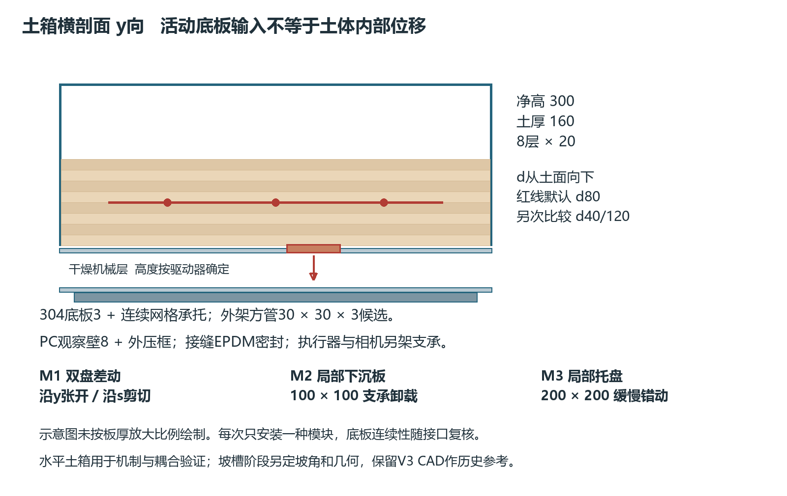
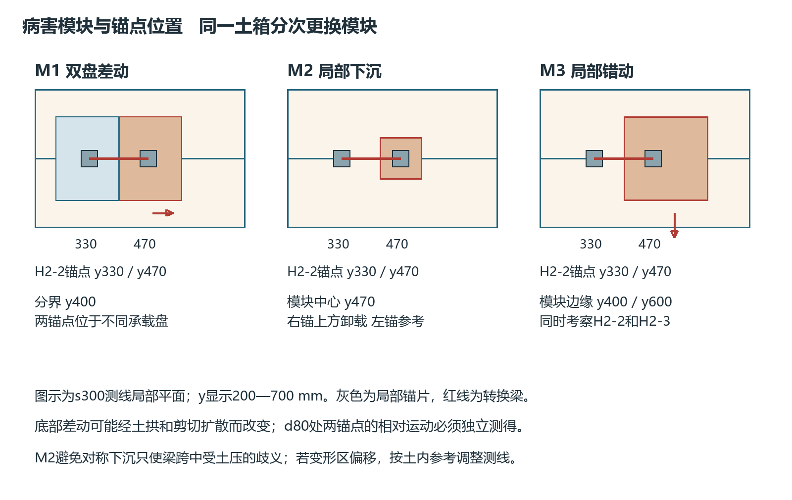

# 边坡早期病害模型制造与装配方案

V4.0 工作稿　2026年10月27日　内容已保存 最终复核待完成

制造分为A微位移台架、B土中传力箱、C坡槽病害演化三步。A和B优先制造，用于确定横向布纤能否检测目标微变形；C在前两步得到可用传感结构后实施。本版尺寸为功能设计及加工讨论基准，承载和连接按实际材料、设备及场地复核。

## 1 模型对应关系与尺寸选择

A台架给出确定输入，检验光栅和转换件。B箱加入低围压土体，检验锚固、脱耦及扰动。C坡槽用降雨、坡脚卸载等诱发真实变形带，才评价提前检测。不能把执行器的运动历史当作自然滑坡的预测结果。

B箱净尺寸s×y×n=600×800×300 mm，土厚160 mm；横向800 mm容纳三节点中心200/400/600 mm、每节点180 mm以内占位和两侧110 mm余量。沿s方向600 mm容纳三测线及局部模块。尺寸由传感装配需求推导，不宣称论文证明其为最小模型。

本版不是指定真实边坡的1∶N缩尺复制。A验证传感转换，B验证土中局部机制，只有后期选定原型地层与目标破坏模式后才能确定C的相似比。以相同密度的1g重力模型为例，几何缩小会同比降低自重应力量级，材料黏聚力、吸力、刚度及颗粒尺度不会自动同步；因此不能把室内1 μm按几何比例直接推算成现场检测限，也不能按同一比例换算降雨历时。离心模型R07的应力相似条件与本箱不同。

需记录的无量纲几何关系包括节点占位/箱宽≤180/800=0.225、节点间距/箱宽=0.25、默认埋深/土厚=0.5、土厚/箱宽=0.2及锚片尺寸/代表粒径。若土箱边界改变响应，在单线试验后用不同边距或更大宽度复验；本尺寸只通过装配几何检查，不等于通过边界无影响验证。

图4 模块化土箱剖面及可替换病害模拟模块

## 2 A台架的加工与安装

底板候选600×400×15 mm铝合金工具板，支承于刚性实验台。固定夹座和带导向的移动夹座形成可调80—180 mm标距；移动座以电动微位移台或差动微分头驱动。设置沿纤维、顺坡垂直纤维、法向三种加载姿态，避免以同一方向的一次标定代表三轴。

执行器候选总行程5 mm，先研究1—500 μm区间。最小步进只是命令分辨率，必须用独立电容/激光位移仪或合适LVDT测得真实移动，参考仪扩展不确定度宜不超过欲验证最小位移的三分之一；达不到时提高声明检测限。丝杠回差、夹具滑动和热膨胀单独记录。

标定梁两侧FBG与电阻应变片共用受力段但互不覆盖胶层；布置温度探头。能测反力时加微型力传感器，给土锚设计提供反力上限。不把两个夹具都固定在桌面上的曲线称为土中传力。

加工清单为底板1件、固定夹座1件、导向移动夹座1件、两轴可换向座1套、微位移驱动1套、独立位移参考1套、限位1套、传感样件至少A1件及B三厚度样件。孔距随已选位移台外形冻结，先出孔位配合图再钻孔，不预设未知设备安装孔。

## 3 B土箱的结构和材料

| 构件 | 预选结构 | 装配要求 |
|---|---|---|
| 箱体内底 | 304板厚3 mm，净600×800 mm工作区 | 连续托底，不作800 mm无支承跨板 |
| 外底架 | Q235B方管30×30×3 mm候选 | 角部及内部网格支承，控制底板局部挠度 |
| 观察壁 | PC板厚8 mm，净高300 mm | 金属上下压框和约200 mm分格立框，最终校核板跨及密封 |
| 密封 | EPDM垫及PC相容密封材料 | 不用溶剂破坏PC；分段低水位检漏 |
| 模块接口 | 可换底板槽或内置模块底盘 | 执行器在土箱外独立支承，活动缝加柔性隔膜防漏砂 |
| 量测架 | 独立相机及位移架 | 不固定到移动模块或喷淋架 |
| 排水 | 侧边可控出水及收集瓶 | 分开旁路漏水与土体出水；不用开孔形成无记录排水边界 |

按160 mm填土，体积0.0768 m³。取干密度1500 kg/m³作称量示例，干土115.2 kg；若干基含水率4%，湿土119.808 kg，不含箱体及附件。若仅以颗粒密度2650 kg/m³估算饱和，则孔隙比对应孔隙率约0.434，满孔水约33.3 kg，土水合计约148.5 kg。颗粒密度、可蓄水量和运行质量以实测及最大供水边界重算，场地不能只按干土重量选台面。

箱体承载、观察壁、压框、螺栓、焊缝和底架由加工方按满土和意外水位校核。这里没有把薄PC壁设计成全高300 mm长期蓄水水箱。框架限位及台面水平在空载、加载后分别实测。

## 4 三类病害模块与真实机制边界

M1开裂/错动模块：两块承载盘先按各200×150 mm讨论，位于s=200—400 mm，分别覆盖y=250—400及400—550 mm；分界y=400经过H2-2中心。两盘初始齐平、间缝加柔性薄膜防漏砂，一侧固定、一侧沿y微张开或沿s微错动。H2-2锚片中心候选y=330和470 mm，分居两盘。薄膜刚度、盘边界位置及作用范围写入元数据。第一阶段在无土夹具确定输入，第二阶段覆土并测内部标记；表面尚未开裂时的底盘运动不自动构成内部裂缝。

M2局部卸载模块：100×100 mm下沉底板中心设在s=300、y=470 mm，覆盖s=250—350、y=420—520 mm。它有意偏离H2-2中心，使右锚片y=470在作用区上方、左锚片y=330在区外；不能把小下沉板对称放在两锚片之间后假定一定产生端点差动。外侧执行器从下方缓慢降下，周边柔性薄膜防漏砂。侧壁观察或内置标记测土拱、土体运动和沉降传播。底部位置对应并不保证d80处仍保持同样位移分区，须以内部参考验证，必要时移动测线或改变模块作用宽度。它模拟支承损失及沉陷；要声称内部侵蚀，必须另加入实际颗粒迁移、流量和浊度/出砂量记录。

M3缓慢差动模块：200×200 mm托盘中心设在s=300、y=500 mm，覆盖s=200—400、y=400—600 mm，沿s微移。其两条横向边界分别穿过H2-2和H2-3；相邻土体作为局部参考。再做整个承载面一起平移的负对照。匀速、阶跃和加速程序用于传感方向验证，不能被当作土材料自身蠕变。真实蠕变另用恒应力加载、温湿稳定及长时独立位移记录[R13]。

模块一次只装一种，先让变形区与测线相交，再测试位于相邻测线之间的盲区。执行器停机保持段用于区分电机振动和残余变形。相机不具备内视能力时，透明侧壁只能代表边界区域，内部真值用微型位移标记或专门剖面验证，不能外推整个三维土体。

模块接口采用内置可拆托盘优先：下部保留完整集水底，托盘下设置干燥机械层，活动面齐平作为土层n=0基准；土厚160及d80均从该面/土面计算，不从外槽最底面计算。下置机构高度会增加总装高度，600×800×300仍指土试验净空间。若加工方采用穿底执行器，必须改为独立密封套管、接水盘和可检漏接口，禁止把开孔后的底板仍算成连续密封底。托盘实际厚度、导轨、行程和孔位按驱动器型号出接口图后冻结。

图6 模块边界与H2测线锚点的对应 避免两端同动或对称沉陷造成方向误判

## 5 土料候选与制样

首轮使用同批次可追溯石英砂及高岭土。砂级配先筛分记录，候选以0.1—0.6 mm主粒级讨论，不假定某粒径能保证失稳。配方按干质量：A0砂100%，A5砂95%+高岭土5%，A10砂90%+高岭土10%。它们用于改变土纤耦合、黏聚和收缩，不沿用“高岭土越多越好”的假设。

B箱第一阶段不设置低渗床，以减少未识别的水力边界。后期降雨坡槽需要阻水界面时，B30砂70%+高岭土30%只能作为候选，需测渗透和低应力强度后决定；太空砂和橡皮泥可用于装配演示，不进入土体水力/剪切机理证据。

每批记录原料含水率。目标干土质量Md由实测目标干密度乘实填体积计算；原料湿质量为其干质量乘(1+原含水率)，补水为目标总水质量减去原料已有水质量。若计算为负，不加“负水”，先晾干或重选目标。混合后密闭均化，取多点含水率确认一致再铺，不把统一静置小时数当成均匀保证。

首轮初始干基含水率候选2%、4%、6%；干密度先用小样确认，纯砂可按实测最松/最密状态计算相对密度，混合料用干密度，不把相对密度公式强用于黏土混合料。参考干密度1500 kg/m³仅用于预算和首批试配，不是统一放行标准。

土厚160 mm按8层×20 mm铺设。以箱体整层600×800×20 mm计算体积0.0096 m³，干密度1500时每层干土14.4 kg；若干基4%，湿土14.976 kg。实际模块、锚片排土体积和局部空腔须扣除，不能照搬整层质量。

安装默认d=80 mm测点时，先铺到土面下方所需高度，再放组件并用同配方细料轻填接触区，按剩余层厚补齐。传感器附近使用限深轻压板，不敲击光栅、不把引线拉直当作压实。每层记录质量、厚度、压实工具和实际测点位置。

候选土需测试级配、含水率、干密度、低应力直剪及锚片拉拔；浸水组增加渗透、湿态拉拔、吸力或水分校准。标准采用GB/T 50123相应方法，执行记录须写清采用版本和条款；项目控制偏差由先导实测确定，不能把旧版±2%等建议当作规范条文。

## 6 装配顺序与可更换性

步骤1 复核场地承载、结构及仪器尺寸，出箱体、模块和执行器孔位配合图。步骤2 空架调平、底板连续支承、PC压框密封。步骤3 模块空载全行程检查，独立参考仪量回差及刚架变形。步骤4 分层称量铺土并安装横向节点，逐点测光谱、温度及基线。步骤5 覆土完成后做小幅已知输入，确认土中耦合和装配偏差。步骤6 进行正式加载；拆土时握封装而非拉纤维，重复使用必须重新校准。

土中锚片不与箱壁或底架刚接，避免人为提高传力；台架刚接仅用于标定。相机标尺、位移支架与土箱的连接关系明确留图。端部过渡留松弛，不由槽边支承将土体应变引入非感测引线。

## 7 C坡槽与旧模型的处理

V3的1400×500×850 mm、32°坡槽及空腔支架保留历史CAD；500 mm宽不能放入本版800 mm横向阵列。若已有实物，可只作单横线或减少节点数的迁移试验，重新评估边界和空间分辨率。若尚未制造，先完成B箱，不先订购扩大后的整槽。

后期坡槽坡角由材料实测初始稳定性及目标病害选择，可把既有32°作为对照工况；沿坡长、宽度、层厚需能容纳确认后的节点并出现目标变形带。C阶段的几何冻结输入是B箱实测的锚固长度、影响区及无纤/有纤扰动结果，当前不虚构已经完成的整体缩尺设计。

本版提供SVG/PNG功能及尺寸图，未新建SolidWorks零件和签审加工图。旧原生CAD不能在文件名改成V4后冒充已修改的三维模型。
