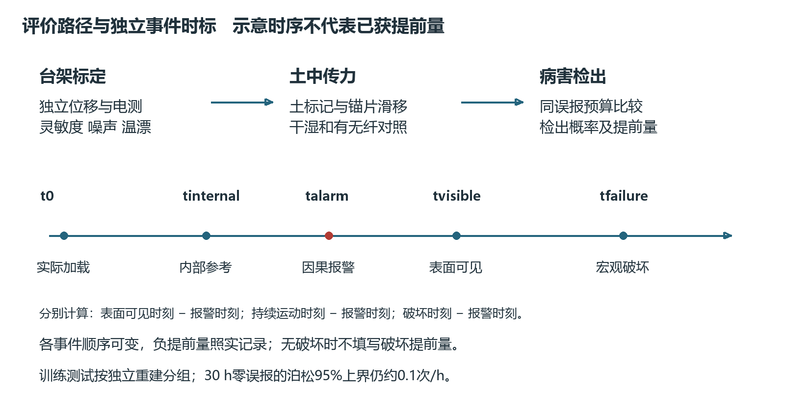

# 横向光栅微变形试验与提前检测评价

V4.0 研究设计版　2026年10月28日　样件与工程参数须实物验证

试验需要证明指定病害、方向、埋设及环境条件下的检测能力。先报告最小可检出应变和位移，再报告病害发生前的检测提前量。优势可以是更低检测限、更早发现、埋入式观测、多点同步或更好的环境适应性，须逐项与明确对照比较；若电测或位移参考更好，应如实保留。

## 1 输入输出和独立真值

输入为执行器实际位移、相对转角、载荷或后期水力加载，输出同时保存每个FBG原始波长、谱线质量、温度及解算应变。位移单位μm/mm，应变单位με，1 με为百万分之一的相对伸长；同一应变对应的位移随有效标距不同而变化。光栅栅长、节点有效跨长、土锚间距三者分别记录。

台架独立参考用已校准微位移仪，不能用执行器命令值代替。土箱测至少两个局部土体标记的位移差，并量测锚片相对土体滑移；执行器位移只能作边界输入。自然开裂/滑动标签由视频、位移和必要的水力/颗粒观测组成。没有内部参考时只声明可观测层面的运动，不声明已提前识别内部裂缝。

### 1.1 土中参考的可实施路线

首轮先在透明侧壁邻近的专门验证剖面做摄影测量，拍摄土颗粒/标记及锚片运动，使用共同坐标解算土—锚差动。它用于验证界面传力，不把壁面平面应变当箱体中心三维真值；中央阵列测试另行记录边界影响[R18]。

若需中心d80的定量参考，可先试制独立小面积埋置标靶与细刚杆，把标靶位移传至土外光学或位移读数端；套管仅在出土通道隔离侧摩擦，杆不得固定在底盘。该参考本身可能加筋、滑移、转动和导水，必须经过无土标定、有无参考构件土箱对照、回差及反力测量后才可用。未通过时不得给它冠以真值，只报告边界输入和表面运动；缺内部参考的试次不进入“内部病害提前检出”评价。不得用FBG信号自身生成其验证标签。

### 1.2 病害位置与独立土体梯度

先测两土标记之间的相对位移与其间距，给出沿y的局部平均轴向应变或s/n差动及标距；不能将顺坡差动除以标距后都称为轴向微应变。对B弯曲件，报告土体差动μm、传感件表面/纤芯应变με和波长pm三个层次，避免以金属梁弯曲应变代替整块土体应变。

## 2 阶段A 成品静态标定和方向扫描

每个样件留编号、胶批号、固化日期、厚度、实际跨长和光谱。仪器热稳定后采至少30 min空载基线；记录室温及样件温度，基线持续漂移时先定位原因再设阈值。30 min为首轮计划，不是所有主机的标准预热时间。

先做沿纤维轴向直接标定。直接应变件可用已知应变梁，目标覆盖0、1、2、5、10、20、50、100、200、500 με的可达范围；不能达到的点不硬填为测量结果。以参考仪能力确定最低点，加载/卸载至少5循环，单点保持60 s起步；持续蠕变者延长保持并报告时间依赖，不删掉慢漂。

B弯曲件位移初始网格0、1、2、5、10、20、50、100、200、500 μm，依独立参考分辨率删去不可实现点。先小范围再增大，不超过应变或机械限位。做沿y、沿s、沿n三个方向及夹角0°、30°、60°、90°方向扫描；单方向件只在可测方向解算，其余为交叉敏感性。做两端同向同量移动负对照，明确刚体移动盲区。

双面件先校准每面温度系数，再使用经温度修正应变的半差和半和；两面系数不同须分别修正。标定拟合使用训练/校准循环，独立循环验证残差、零点回归和迟滞。只报告R²不足以证明微量程准确性。

## 3 阶段B 温漂和土中传力

温漂对照：无机械输入，围绕工作温度做可控约±2°C缓变和稳态保持，传感件与参考仪同测温度；水温变化、胶层热应力和引线拉力单列。温度上下限随设备和材料限定，箱内外真实温差均记录。差分抵消程度以残差测试，不用理论同温条件代替。

土纤对照：A0与A5优先，A10作为开裂/增强黏聚候选；初始含水率4%先做基线，再分次比较2%、6%及湿态；同批干密度、20 mm分层和d=80 mm保持一致。通过后再逐项比较d=40/120 mm、锚片面积、覆压、薄片厚度。采用先固定多数因素再扩展的顺序，避免首轮全因子数量失控。

无纤组、A直埋组、B转换组分别独立重建。记录相同边界输入下的土内位移场、表面裂缝起点和所需反力，检查传感器是否加筋或提前诱发裂缝。对比前先报告施工密度和水分偏差；传感器不能与槽壁刚接。

土中拉拔给定一个锚片/缆端的微位移，独立测土标记、锚片、纤维响应和反力；确认滑移起点、有效耦合长度、卸载残余和湿态差异。单独量裸纤波长不足以获得土纤应变传递率[R18、R19]。

首轮无外加覆压时，若实际干密度1500 kg/m³、干基含水率4%，d80处竖向总自重应力估算约1.22 kPa。此值不包括吸力、侧向应力、压实残余和锚片局部集中，不等于有效围压。R19外加0—16.85 kPa的拉拔结果应按试验边界理解，不能把高覆压抗拔优势直接移植到本浅埋箱。额外压板只能作为单独围压对照组，不能为了信号好而偷偷加压。

## 4 B箱病害模块试验矩阵

| 组别 | 实际操作与真值 | 要回答的问题 |
|---|---|---|
| C1 横向张开 | M1两盘沿y差动，内部及表面标记量张开 | A与B可检测下限及裂缝前响应 |
| C2 顺坡错动 | M1局部沿s移动，两侧土标记测剪切差 | 横向直缆与转换节点的方向差异 |
| C3 局部沉陷 | M2底板阶梯下沉，测土拱和局部沉降 | 法向节点能否在表面可见前检出 |
| C4 缓慢差动 | M3低速/阶梯位移；执行器及土标记分别计时 | 小幅慢变检测及速率效应 |
| C5 整块同动 | 全承载面同向运动，锚点随土一起移动 | 记录无局部差动时的漏测边界 |
| N1 无病害静置 | 同环境长时记录，无输入 | 基线事件误报率及长期漂移 |
| N2 工具和电机干扰 | 电机运行但加载解耦，工具远离土体操作 | 不把电机频率或操作时刻当病害 |
| N3 温度和湿润 | 温变或喷淋但独立参考无持续变形 | 区分温补残差、水力扰动与运动 |
| N4 传感故障 | 安全模拟引线松紧/接头异常，记录故障 | 报传感异常，不能强分为滑坡 |

机械组由参考仪给出实测位移平台，速度候选0.1/1/10 μm/s仅用于设备可达范围内的速度扫描。不能将人工设定的加速规律用于证明模型能预测自然滑坡。失稳类别应依据实际观察，预期塌落但只沉降的试验仍标沉降。

先每个选定配置/机制做不少于5次独立重建探索重复性；5次不是高置信性能验证样本量。优先C1—C3和C5，配置固定后扩C4。无需首轮把所有材料×水分×深度×节点组合全部做完。探索阶段不对外给稳定的准确率排名；正式样本量依据检测概率置信区间、病害稀有度和预期效果计算。

### 4.1 单次模块试验顺序

确认trial_id、重建批号、配方和配置 → 复测谱线及独立参考 → 无输入基线 → 预先选定的小位移阶梯与保持 → 卸载回零 → 记录残余/拔滑 → 摄影及分层拆解复核。先做纯机械不注水组；进入湿态后，注水按质量计量且单列含水测值，不在同一试次任意改变所有因素。达到传感器保护动作、参考超量程或漏水条件立即标记有效数据截止时刻。

M2中心y470而非y400；H2-2的锚片中心y330/470。M3覆盖y400—600，两边界分别经过H2-2及H2-3。测试前用内部参考确认实际变形区是否到达d80；若未到达，结果应解释为该条件下无差动或未检出，不把执行器命令直接贴成光纤漏报标签。

## 5 后期降雨和坡脚扰动

自然演化阶段才使用喷淋。B箱若水平铺土，水平面积0.48 m²，20 mm/h每20 min计划落土3.2 L；它用于湿态耦合或供水标定，不代表斜坡入渗破坏。坡槽雨量必须按实际土体水平投影面积乘雨强乘时长计算，V3的0.474024 m²不能套到B箱。

候选20/40/60 mm/h先通过接雨盘验证空间分布，再选择一档恒定雨强做对照。累计雨量、径流、渗流、裸槽接雨和漏水分开记录。不能为了凑正样本在试验中临时拉缆、增雨或挖坡脚；改变程序则另设试验ID和标签。

坡脚取土设置预定窗口和步长，单次取土后工具撤离并保持观测；同时留纯工具扰动组。真实内部侵蚀需实际出砂、颗粒质量/级配、浊度和流量证据；M2下沉底板结果不得直接替代该病害研究。

## 6 采集和同步

准静态首轮：FBG全点10—100 Hz候选，独立位移不低于目标有效带宽所需采样，侧视/俯视视频60 fps候选，水分/吸力1—10 Hz按探头实际响应；温度参考按设备采样并记录滞后。高采样不等于高有效频响。需要振动时另行确定频段、抗混叠、加速度参考和全通道速率。

用公共触发或可在视频和采集系统同时识别的同步事件记录开始、结束以及中间漂移；日志记录UTC或带时区时间和单调时钟。60 fps的帧间隔约16.7 ms，不能宣称毫秒级视觉起动时刻。总时间不确定度包含时钟偏移、采样和判读区间，不只填一个主机采样周期。

原波长、峰位置/峰质量、丢栅、温度及所有独立真值完整保留。滤波参数和代码版本记录，离线双向零相位滤波会利用未来数据，不能用其结果宣称实时提前预警；实时算法使用因果处理并计入延迟。

## 7 检测限与优势的评价

图5 标定 土中传力 事件时间及独立测试的评价关系

| 指标 | 计算和报告口径 | 对照或限制 |
|---|---|---|
| 波长/应变噪声 | 固定带宽和平均时间下标准差、峰峰值、漂移；可加Allan偏差 | 裸栅、成品、土中三级分别测 |
| 标定灵敏度 | 信号对独立参考输入的斜率及置信区间 | 明确με/μm或pm/με，不混单位 |
| 理论估计检测限 | 基线标准差的3倍除以局部灵敏度作初筛 | 仅近似线性和平稳噪声；不是已验证检出概率 |
| 实证检测限 | 预先锁定报警规则后，最小输入在留出试验的检出概率和误报 | 报告概率置信区间及独立试验数 |
| 偏差及迟滞 | 独立循环误差、正反加载差、零位回归 | 同载体电阻片及独立位移仪 |
| 土中传力 | 同输入下土、锚片、FBG和反力的关系 | 不把刚夹台架曲线当土体曲线 |
| 空间定位 | 报横线及节点区间，已知病害中心的定位误差分布 | 200 mm点距不等于200 mm分辨率保证 |
| 提前量 | 指定独立事件时刻减去首次有效报警时刻 | 分可见/持续运动/宏观破坏三个终点 |
| 误报与漏报 | 正常组误报事件数/有效小时；病害检出率 | 相邻窗口合并为事件，保留设备异常 |
| 现场实用性 | 安装时间、失栅率、维护、埋设存活率及单位覆盖成本 | 不引用旧文献价格作为当前采购价 |

应变和位移检测限都必须给出温度范围、带宽、标距、土料、覆压和耦合条件。近零输出不计算无意义的百分比相对误差。对照若无法达到参考精度，说明比较能力受限；不能故意用低分辨率位移尺证明FBG优于精密电测。

## 8 提前量的事件定义

定义t0为实际加载/降雨开始，tinternal为独立内部参考确认变形的时刻，tvisible为视频在预注册分辨率和判读规则下确认表面裂缝/沉陷的时刻，tmotion为持续运动判据首次满足，tfailure为预定义宏观塌落/滑动终点，talarm为因果算法首次满足持续报警规则的时刻。

分别报告tvisible−talarm、tmotion−talarm及tfailure−talarm。t0至tfailure是试验历时，不能写成光纤提前量；talarm晚于某终点应报告负值或检测延迟。不能因为FBG先于肉眼而宣称先于所有高精度传感器。

若没有宏观破坏，只报告变形检测，tfailure为空并注明观察结束时间；不把“实验结束仍未破坏”当正提前量。事件真值为时间区间时保留上下限。只在提前量下界超过同步及判读不确定度时，才支持相对该终点的提前检出。

可见裂缝尺寸、持续运动最小位移/速度和持续时长先由独立仪器噪声及先导试验确定，然后在正式测试前锁定；当前不指定未经验证的统一1 mm或1 με报警线。

## 9 算法与数据划分

先对比固定阈值、斜率/变化点检测，再用特征分类和CNN-LSTM。输入包括温补应变、跨节点差分、因果时间变化等；标签来自独立真值。执行器命令、预定加载顺序、文件名和操作提示不作为病害识别特征，防止模型识别试验脚本。

按trial_id独立重建和material_batch分组，再在每组内切窗；同次加载循环、同次重建的相邻窗口不得跨训练/验证/测试。归一化、滤波选择、报警阈值和超参数只在训练/验证定，跨土料/含水/埋深留出检验泛化。

宏F1、精确率和召回为补充指标；核心是同一误报率预算下各方法的检测概率、检测限和提前量。V3宏F1≥0.80等数字在V4不作为预定优越性证据。可先以误报预算0.1次/h、目标检出概率0.95作探索设计讨论，最终在正式试验前按用途冻结并报告置信区间；不能测几分钟就宣布满足低误报目标。

若正常观察期间零误报，泊松近似下95%单侧误报率上界约3/T；观察30 h仍只能把上界压到约0.1次/h。该估算依赖平稳/近似独立事件，重复相关扰动时需分工况或区组估计。独立重建次数不足不能靠切更多窗口补齐。

## 10 标准适用范围与研究放行

土样含水率、密度、级配、渗透和剪切方法以GB/T 50123-2019《土工试验方法标准》作为已核实发布依据。住建部2019年第131号公告载明2019-05-24发布、2019-10-01实施，同时废止1999版；2026-10-28已核对官方公告。该历史公告不能单独证明2026年无新增修订，执行人仍须在开试验前核对现行状态及选用方法条款，不把公告核对写成逐条合规验收。官方出处：https://www.mohurd.gov.cn/gongkai/zc/wjk/art/2019/art_17339_241309.html

仪器校准采用相应量值溯源记录及实验室不确定度评估，注明覆盖因子、带宽和环境条件。测量模型和不确定度报告可参考JCGM GUM-1:2023及GUM-6:2020；BIPM官方目录已核对，实际使用时记录下载的具体版次与修订。它们说明如何表达测量不确定度，不规定边坡的FBG报警阈值。目录：https://www.bipm.org/en/committees/jc/jcgm/publications

GB 50330《建筑边坡工程技术规范》仅在实际对象属于其适用范围时作为工程稳定性设计参考；道路、天然斜坡及实验模型须另判适用性。安全系数是给定强度、孔压、几何和计算模型下的稳定性指标，不是FBG通用报警阈值。本项目低应力强度未测、潜在滑面未确定前，不填入一个安全系数宣称模型安全或即将滑坡。

试验放行分别核对三项：传感链具有可追溯标定且目标输入超过实测噪声能力；病害标签具有独立位移、图像或水力证据；统计评价使用冻结的事件规则与独立测试组。缺任一项的记录可用于调试，不能进入正式性能结论。具体误差、误报、检出概率和定位目标由先导数据及用途确定，再于正式留出测试前冻结；不得用标准名称给项目自定阈值背书。

已从住建部原始扫描附件核对目录页，供执行人定位正文；下表列出2019版章节，不代替逐条选择方法和设备条件。

| 测试工作 | 2019版章节 | 本模型的使用边界 |
|---|---|---|
| 扰动土制样 | 第4章 4.3至4.4 | 先确认试样制备方法 再另记箱内分层工艺 |
| 含水率 | 第5章 5.2烘干法 | 干基含水率及原料水分修正 |
| 密度及颗粒比重 | 第6章 第7章 | 选适合粒径和试样状态的方法 |
| 粒径与级配 | 第8章 8.2筛析法等 | 细料按适用方法补测 不只报主粒级 |
| 无黏性土相对密度 | 第12章 | 纯砂适用性先判 混合料不强套 |
| 渗透 | 第16章 16.2常水头 16.3变水头 | 按渗透范围选法 记录温度和边界 |
| 低应力剪切 | 第21章 直接剪切试验 | 仪器低荷载分辨率及应力范围另核 |

目录核查位置为官方PDF第4—7页，对应目录印刷页1—4；未上传标准全文。锚片拉拔、双面光栅差分、误报事件和CNN-LSTM评价是另行定义的项目试验，不属于上述土工标准的现成验收条文。

## 11 分阶段判定与交付记录

A阶段输出每个样件方向灵敏度、噪声、温漂、反力和真实可达检测限；无有效响应则调整结构或缩小目标，不扩阵列。B阶段输出干湿传力、锚片滑移、埋设存活及无纤/有纤影响，并完成C1—C5编号的模块工况；工况编号C不等于制造阶段C。制造阶段C指后期坡槽自然演化，输出时序、空间响应及漏测情形；缺独立真值只作调试记录。

每次保存配置JSON、原始波长及参考数据、标定ID、土层称量、同步事件、病害事件区间、失败原因和图像。templates目录提供空表，不预填任何测试成绩。

最先执行的工作包：单个A件加三厚度B件 → 三轴台架标定 → A0土d80单线埋设与干湿对照 → C1/C2/C3与整块同动负对照 → 确认可用后扩三横线。先完成可观测性和微量程比较，再进入降雨坡槽和CNN-LSTM。
