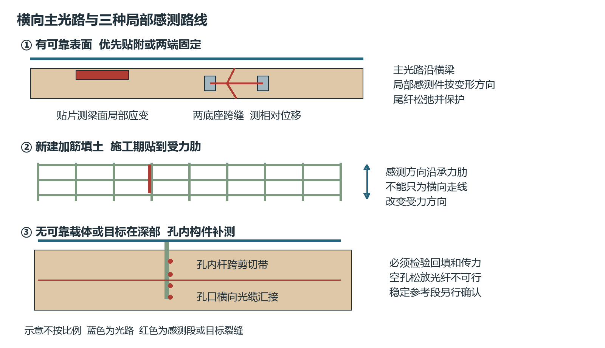
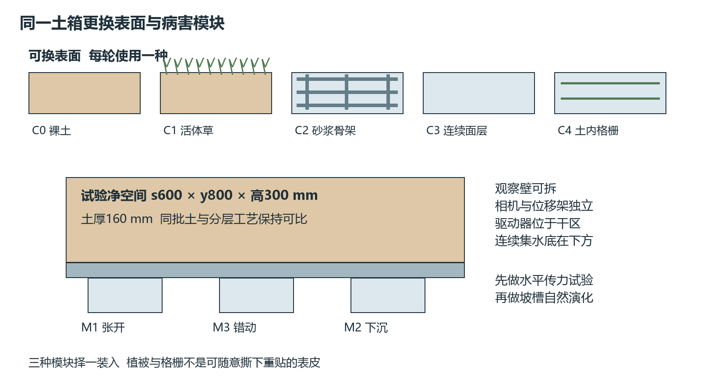
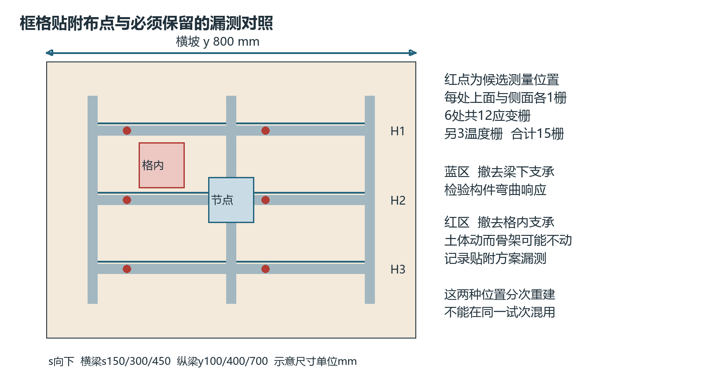

# V4.1 边坡类型与贴附光纤专项方案

2026年11月12日。基于V4.0，补充高速公路、高铁、隧道洞口的边坡分类，比较表面覆盖与加固形式，落实“优先贴附、必要时钻孔”的FBG安装路线。当前是研究设计，尚无样件实测或现场监测结果。

## 文件入口

- [完整方案 Markdown](边坡类型表面防护与贴附光纤试验方案.md)
- [完整方案 Word](边坡类型表面防护与贴附光纤试验方案.docx)：14页，8张对比表，3张原创示意图。
- [核查与需求对应](核查与需求对应.md)
- [设计计算](设计计算.json)：量级与数量核算，不是实测性能。
- [V4.0四册基础方案](../v4.0-transverse-microstrain/README.md)

## 研究对象与实验调整

首先研究可接近框格或框架梁的土质、强风化岩质坡体，比较土体运动与构件响应；不据此声称它是最危险的边坡。浅层护坡骨架、锚杆框架、连续喷层分别建组，不能混同。

表面分C0裸土、C1活体植被、C2砂浆骨架、C3连续面层四组；C4土工格栅属于土内加筋分支。用开裂、错动和局部下沉模块重复输入，增加格内土动但框格不动、构件整体同动、温漂和脱粘对照。

安装分P1构件表面应变贴片、P2两端固定跨缝位移计、P3施工期格栅承力肋贴纤、P4孔内柔性传感构件。主光路横向汇集；局部感测方向须与目标变形匹配。空孔中松放裸纤不能保证传力。

## 与旧版参数的关系

| 项目 | V4.1采用方式 |
|---|---|
| 土箱 | 保留净空间s600×y800×高300 mm、土厚160 mm；先做水平传力，再研究坡槽自然失稳 |
| 光栅 | 框格贴附专组12应变栅＋3温度栅＝15栅；增加2只单栅位移计时17栅。与V4埋设阵列分别编号，不累加混用 |
| 下沉模块 | 节点下方与格内中心分别重建；不沿用V4偏心锚片M2坐标 |
| 位移 | 0—3 mm只是扩程候选；重新设计并校验转换件、光谱窗口和限位前，不能越过旧±0.5 mm限位 |
| 土料与降雨 | 95/5砂/高岭土、4%干基含水率及20 mm/h为候选控制量；土工性质、供雨与入土水量实测 |
| 加工图 | 本版提供研究示意及装配候选，未生成新的加工CAD，也不构成结构签审 |

## 图示

## 证据边界

正文S1—S13为13组标准、指南和论文来源，不是13篇新增论文。公路及隧道相关条文已查官方扫描原文；铁路来源目前核对题录与发布公告，完整条文及修订仍需补齐；植被综述取得摘要，其余所引光纤论文按正文或V4原文核查记录使用。具体边坡风险等级、最佳模型配方和预警提前量均未定案。

build_v41.py生成示意图、DOCX和计算JSON，依赖同仓库V4.0的基础构建脚本。render_v41.ps1及raster_v41.py用于Windows Word与Poppler页面核查；research.py用于公开来源抓取。研究下载与页面缓存保存在被Git忽略的_qa目录，不随成果发布。
