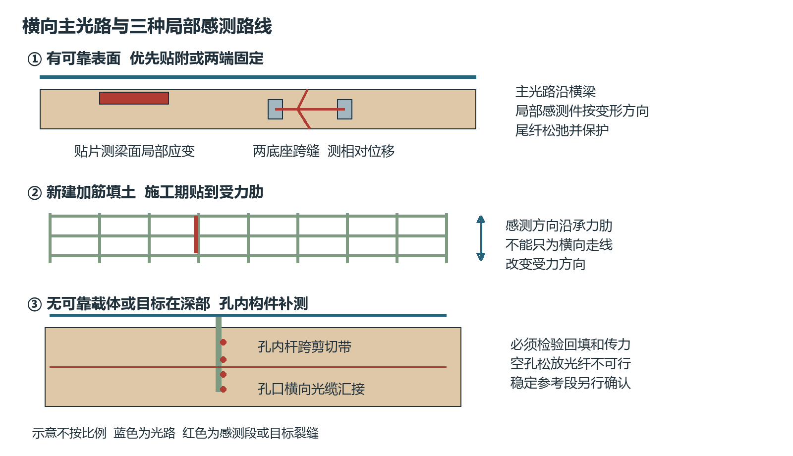
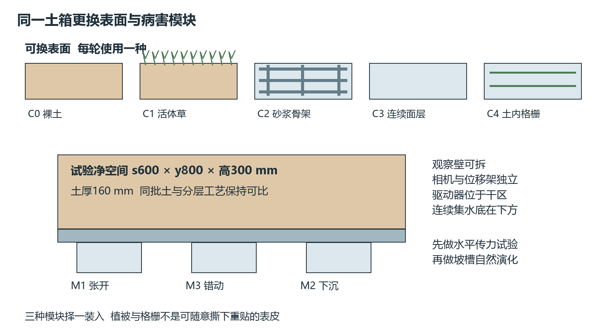
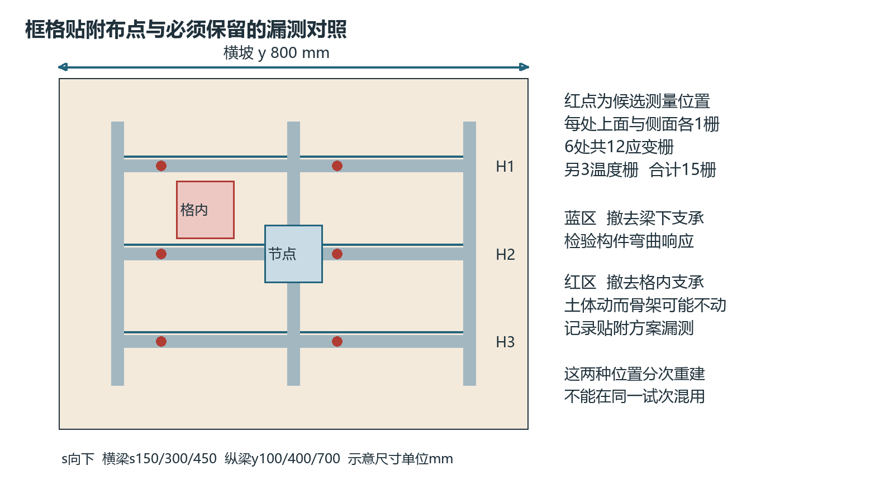

# 边坡表面防护与贴附光纤试验方案

V4.1　2026年11月12日

建议优先研究有可接近混凝土框格或锚杆框架的土质、强风化岩质边坡，以贴附式FBG测构件应变、跨缝位移计测相对运动，并通过土体独立位移对照验证两者的联系。裸土和植被坡作为必要对照；土工格栅另设施工期贴纤分支；深部滑移或表面与土体脱耦时，使用有确定传力路径的孔内构件补充。

这一选择是研究对象与安装条件的匹配，不是“混凝土坡最危险”的风险评级。公路、高铁和隧道是工程场景，土/岩、挖方/填方是坡体属性，植被/框格/格栅是覆盖或加固措施，必须分层描述。图示和尺寸是室内机制试验候选，未获得现场许可、材料实测参数或传感性能数据。

## 1 工程场景与实际边坡类型

| 工程场景 | 实际可能遇到的类型 | 应核查的问题 |
|---|---|---|
| 高速公路路堑 | 土质、全强风化岩质或较完整岩质挖方坡；可能为多级坡 | 入渗和排水、浅层溜塌、滑移；岩坡看结构面和落石路径 |
| 高速公路路堤及桥头 | 压实填土/填石、半填半挖、加筋填方、支挡边坡 | 压实及差异沉降、坡脚冲刷、加筋层拉伸拔出、桥路过渡变形 |
| 高铁沿线路堑和路堤 | 同样包括土/岩挖方、填方、加筋和支挡形式；上方还可能有自然山坡 | 既看失稳物是否进入线路，也看路基变形是否影响轨道几何；不存在统一“高铁混凝土坡” |
| 隧道洞口 | 洞口两侧边坡、洞门上方仰坡及影响洞口的自然斜坡；可为土、岩或混合地层 | 开挖卸荷、偏压、碎落落石、坍塌、排水及与洞门衔接 |

公路分类依据[S1]第2章和第3章；铁路标准范围由[S3]核对。隧道洞内围岩与衬砌监测是另一问题，本版仅讨论洞口边仰坡。上述为可遇到的类型，不是各行业占比统计；未找到可靠普查数据时不声称某一形式占多数。

## 2 重点关注的依据与选择

[S1]第5.1.2条明确坡面防护应设在稳定边坡上，稳定性不足时应采用必要支挡加固；第5.1.6条要求将防护与排水结合。[S2]第7.1.3—7.1.4条要求洞口排水，并防止边仰坡碎落、滚石、坍塌物直接落入路面。这些条款支持关注相应机制，不给本项目统一危险等级。

| 重点场景 | 具体依据 | 本项目处理 |
|---|---|---|
| 变形区可能影响车道、轨道或桥台的坡体 | 应结合失稳规模、速度、传播路径和受影响对象；[S5]维护评估要求考虑破坏后果，[S12]说明不同运动方式 | 有历史开裂/滑动、排水异常、坡脚支承变化时优先调查；未取得现场资料不作高低风险打分 |
| 洞口及岩质路堑的落石或岩滑 | [S2]明确落入路面问题；[S12]记录美国滑坡伤亡主要与落石、岩滑及碎屑流有关 | 后续岩块分支；不以砂箱代表岩体结构面，也不把美国统计当中国现场排序 |
| 已有硬质防护的开裂和脱空 | [S5]第4.2节要求检查硬质覆盖与土体接触及覆盖下隐藏裂缝 | 本轮主线：土体运动—框格/面层响应—贴附FBG，专设漏测对照 |
| 新建或维修的加筋填方 | [S6]讨论筋材拉伸、拉拔与排水；[S9]有FBG加筋砂坡实验 | 第二分支：施工时贴到受力肋；既有深埋格栅不能假定可接近 |

试验先后为：框格贴附与脱耦 → 裸土/植被对照 → 格栅贴附 → 孔内补测与洞口岩块。排序同时考虑病害关联、可控性和现场安装，不表示风险由高到低。

## 3 表面覆盖与加固形式的作用

| 形式 | 对边坡的作用与局限 | 对光纤安装的影响 |
|---|---|---|
| 裸土坡 | 无人工表面保护，易受雨滴、径流及干湿变化影响；“纯土”不意味着所有裸坡都不稳定 | 土粒和湿土不能作为长期可靠粘接面；不把光纤直接粘在泥上 |
| 植被覆盖 | 冠层截留、蒸腾、根系加筋和水路变化共同作用；草、灌木、树的根深和力学差异明显[S8] | 不粘在草叶、根或松散表土上；施工引线需避开养护及根系扰动 |
| 混凝土或砌石骨架植草 | 框格限制表面冲蚀并组织坡面排水，格内仍可变形；一般护坡骨架不能等同深部抗滑支护[S1] | 横梁和节点可提供贴附面，但感测区域主要在构件上，格内溜塌可能弱响应 |
| 锚杆或锚索框架梁 | 梁与锚固体共同受力，作用依赖锚固深度、边界及整体设计 | 可贴梁面或夹持可接近构件；不能切削锚具、改变预应力或把锚头当绝对稳定点 |
| 连续喷浆或喷混凝土面层 | 表面防护和渗流边界改变；可能开裂、脱空，必须结合泄水及支护设计[S1][S5] | 可贴附或跨缝，但土体先动而面层悬空时可能不响应；面层热缩也会产生信号 |
| 土工格栅加筋 | 通常分层埋设于填土，靠受拉、土筋摩擦和咬合工作；也可能用于包裹式面层[S6] | 施工期可贴到筋肋，沿受力方向测筋材应变；既有格栅不能靠一条表面横线充分监测 |
| 三维植被网 土工格室 | 植被网主要保护表层，格室通过蜂窝约束保持填料；不能与承力格栅混称 | 载体柔软或节点可动，必须先检验变形传递；不是现成稳定粘接基底 |
| 柔性钢丝网 砌石或挡墙 | 钢丝网可贴坡约束或拦截落石，砌石/挡墙的整体功能各异 | 网绳要消除松弛并校准；砌体分清石块与灰缝；挡墙测墙体，不自动代表整个边坡 |

植被的水文作用不是一律降低入渗。综述[S8]指出根系、覆盖和植物类型共同影响侵蚀与稳定；雨滴能量降低与入渗增加可以同时发生。不能用人造草皮结果证明真实根系加筋或蒸腾效应。

混凝土框格也不等于把土全部“固化”。应先看现场竣工图：是浅层护坡骨架，还是与锚杆/锚索联接的受力框架；两者的试验边界、传感响应和风险含义不同。

## 4 各表面如何在室内模拟

| 编号 | 可重复制作方式 | 必须控制或测量的量 |
|---|---|---|
| C0 裸土 | 同批砂/高岭土，统一含水、干密度、160 mm厚度和表面整平 | 级配、强度、含水率、密度、初始粗糙度 |
| C1 植被 | 与裸土同配方同厚度，在可运输底托上预种同一种草，根系留在连续土体内；试验时不得把浅盆留在滑移面 | 覆盖率、根深、根量、龄期及试验时水分；假草仅作覆盖对照，另编号 |
| C2 浅层骨架 | 用模具浇筑可更换砂浆骨架，格内填同批土；干态先不种草，之后加入植被 | 实测梁尺寸、弯曲刚度、连接、接触及排水；不冒称等比例钢筋混凝土 |
| C3 面层 | 单独制作连续砂浆薄板或喷层试片，设置有/无接缝与可控制的局部支承撤除 | 收缩、刚度、粘附、脱空面积、排水孔状态；不能把薄板试验当框格试验 |
| C4 格栅 | 选定可追溯格栅材料，分层铺设；先做单肋拉伸、胶接和土中拉拔 | 肋方向、孔径、节点、拉伸刚度、锚固长度、层间距；原尺寸商业格栅仅作构件试验 |

所有尺寸和土配方属于候选控制量，不由规范推定“最佳”。真实根系、结构加固和水力试验逐步加入，避免一次改变覆盖、配土、坡角和水量。

## 5 贴附与钻孔两条安装路线

导师提出的“先贴、必要时打孔”可以落实为四级选择。判断顺序是目标变形发生在哪里、是否有可接近且会响应的构件、两点是否存在相对运动，再决定安装方式。安装容易并不证明能测到病害。

| 路线 | 固定在哪里 | 实际测量量 | 主要使用边界 |
|---|---|---|---|
| P1 表面应变贴片 | 框格梁、喷层、可接近岩面或钢构件的完整基底 | 该表面局部轴向应变 | 同一构件整体平移可能几乎无应变；表面脱皮及土体脱耦会漏测 |
| P2 两端固定的FBG位移计 | 裂缝、接缝或不同运动区两侧的粘接底座，必要时浅孔固定底座 | 两底座之间相对位移，经转换件变成FBG应变 | 感测段不能被胶整段灌死；先核验底座滑移、转角和位移方向 |
| P3 施工期格栅贴纤 | 加筋格栅实际受力肋，铺土前安装 | 格栅轴向应变 | 格栅方向与主光路可不同；本体粘接兼容性必须先验证[S9][S10] |
| P4 孔内传感构件 | 有确定锚固/回填的测斜杆、柔性梁或分段锚固测量杆 | 深度分布的弯曲应变或分段相对运动 | 空孔中松放光纤不可靠；两锚点均在滑体内仍可能一起移动 |

P2的浅孔只用于固定底座，不是深部监测孔。P4用于目标在深部、贴附载体缺失或试验表明表面脱耦的情况。孔底或参考段是否位于稳定层须由地质资料及位移剖面确定，不给所有边坡一个固定孔深。

主干光路沿横坡或既有横梁布置，转线放在侧边保护通道。局部应变片按构件受力方向、位移计按目标张开/错动方向布置。若裂缝与等高线平行，局部短跨缝件必须沿坡跨过去；若连这种局部非横向安装也不允许，则保留相应盲区，不能承诺全方向检测。

图1 横向主光路与局部感测方向分开设计

## 6 贴附构件的安装与校准工艺

先拍照标注目标裂缝、梁节点、空鼓和泄水口，选择完整可接近的基底。贴附前清除浮浆、浮尘、松层和油污，确认含水与底涂条件符合胶厂数据；不得把“混凝土看起来硬”当成粘接可靠。应变片按应变传递长度满粘，位移计只固定两端底座，两种胶接方式分别施工。

采用工厂预制、带标定记录的FBG应变贴片和位移转换件优先。胶型、胶层厚度、固化时间、温度及基底状态记录；不以普通硅胶包住裸栅就声称可靠传力。至少进行干态、湿态、温度变化、保持及卸载循环校验。用相邻电阻片或独立位移参考检查实际传递，比较胶接前后的构件刚度变化。

玻璃光纤只在传感段建立受力联系；尾纤设置应力释放、厂家认可弯曲半径和柔性过渡。外部引线放可拆保护管，接头位于箱外干区。护罩固定在同一运动区，不跨接位移计两端，不堵泄水口。应变片脱粘、谱峰畸变或断纤单列传感故障，不标注为滑坡。

温度参考应接近感测件并与其热环境匹配，至少覆盖每条横线。松套温度栅补偿光学温敏项不一定消除基底热胀、约束热应力和胶层变化，需做无机械输入的温度对照。框格表面向阳和背阴面应分别核对温差。

对于聚合物格栅，先确认材质、表面处理及胶兼容性。Drusa等[S10]报告不合适粘接导致格栅肋破坏，因此不能直接套用混凝土用胶。记录胶后单肋强度与刚度、循环残余和湿态粘附；实际筋材受力方向上的FBG不能为了横向串线而旋转90°。

## 7 孔内方案的设计与限制

在模型内先预留可取出的成孔芯棒，使孔位和直径可重复，用于比较传力；这种方法不代表现场钻孔扰动。后续另用试验土中的实际钻孔对照，记录孔壁扰动和密度变化。孔径由构件外径、回填需要和可操作性确定，孔中不得悬空松放裸纤。

候选为沿深度布置FBG的细柔性杆，采用两相对面测一个弯曲方向，或四面测两个方向；另设温度参考。构件刚度及回填材料先做横向加载和拉拔试验，避免粗硬杆或大块水泥浆成为加筋桩。不能只因“灌浆更牢”就默认位移传递更真实。[S7]支持钻孔灌浆土钉的工程传力说明，但不验证本项目传感孔设计。

预定局部剪切界面上下都要有测量位置；若需要反演绝对位移，须给出参考端位移/转角、边界条件与积分误差。模型固定底座只能作为台架标定边界，在土箱中不能把杆根刚固到箱底后宣称现场自然稳定层已经复现。

孔内弯曲监测不保证检测纯轴向下沉；沉陷需另用分段位移锚或相应轴向转换构件。现场从既有工作平台进孔，孔口间用横向光缆连接。水平钻孔若不跨滑移带也可能失效，不为保持光路横向而强制所有孔水平。

## 8 优化后的模块化模型

保留V4土箱净空间s600×y800×高300 mm、土厚160 mm。s为预定顺坡方向，y为横坡方向；水平箱用于控制位移和传力，后期坡槽才研究自然重力失稳。本版增加可换表面、独立载体标记和孔位接口，不重新宣称箱体具有严格原型缩尺关系。

| 部件 | 候选设计 | 实验便利性及限制 |
|---|---|---|
| 底架和箱体 | V4的Q235B方管底架、304连续集水底、金属压框PC观察壁；侧壁至少一侧可拆 | 驱动区保持干燥，相机和参考仪另设架；承载、水密和孔位由加工方校核 |
| 病害盒 | 开裂M1、错动M3、局部下沉M2分别整盒拆装，工作面齐平，四周可更换柔性防漏砂层 | 每盒记录空载摩擦、隔膜刚度、回差；先归零再铺土 |
| 表面组件 | 裸土、活体植被、砂浆框格、连续面层分别制作；格栅是土内分层分支 | 可用吊装托架搬运，试验前撤去临时支架；不把四周刚固的装饰框当实际护坡 |
| 标记与孔位 | 土面、骨架及锚点分别编号；一侧设置可更换成孔定位模板 | 孔内参照与表面数据同步；模板定位后撤除，不能限制土体 |
| 水路 | 土箱外供水，坡顶配水、坡脚分流收集；排水口可检查 | 记录输入、径流、排水、旁路漏水与出砂；不直接向胶点冲水制造假病害 |

框格候选平面为三横梁s150/300/450 mm和三纵向联系梁y100/400/700 mm，横梁跨y100—700 mm，纵梁跨s75—525 mm。初始截面宽20 mm、厚15或25 mm作两组砂浆样件，节点整体浇筑；测实物三点弯曲刚度和开裂荷载后选组。该尺寸只是箱内装配与刚度对照，不是现场混凝土梁的缩尺定案。

浅层护坡骨架组不将框格刚固到箱体；锚杆框架另设可测反力、可替换锚固边界的一组。锚固长度与刚度单独记录，不在同一组悄悄改变。连续面层用单独板件，不能用框格组结果代替；开裂后的面层及剪切后的土层每次独立重建。

图2 相同病害输入下更换表面和安装路线

## 9 横向布点与变形可观测性

框格主线沿三条横梁铺设，横梁上的候选应变位置为y175和475 mm，分别位于两跨内部，避开梁柱节点。每处在上表面中线和侧表面中高各贴一个FBG，分别加强对法向弯曲与坡内弯曲的观测；不以两点信号直接反演完整三维位移。位置最终由单梁与整框标定调整，不能盲目放在理论零曲率位置。

核心配置为6个位置×2表面＝12应变栅，另每线1温度栅，共15栅；每线5栅。候选跨缝位移计2只各1应变栅，可合用经验证的附近温度参考，总计17栅。主机波长窗口、峰宽及连接方式确定后再冻结，不等同17个光学端口。孔内试验另组编号，不先把所有传感形式叠满同一小箱。

开裂M1边界y400位于中间纵梁下方，可能被框格约束，这是要测量的结构作用。跨缝位移计两底座候选分处y350和450附近，分两种配置记录：若同贴一根初始完整横梁，测的是梁段伸长及后续开裂；若要测两个土体运动区的差动，则用各自随动的独立砂浆底座，并检验底座与土体滑移。不能把前者当土体位移真值，也不能把完整框格预先切断后仍称为完整框格基线。预制缝组另编号，安装区按实物基底调整并实测。对照再将变形带移到一个格内，检验“框格未裂但格内土已动”的漏测情况。

下沉试验设置两种位置：一是下沉板在框格交点(s300,y400)下方，使梁明确受弯；二是置于格内中心(s225,y250)，覆盖100×100 mm范围，不直接支承横梁。后一组用来检查骨架桥接、土体脱空时贴片是否失效，不能只选信号最强的位置。模块与V4的偏心锚片版M2需分开编号，不混用坐标。

图3 横向贴附线和格内支承损失的独立对照

若预期裂缝平行于横梁，应在相邻横梁间或相邻运动区域设置局部顺坡跨缝转换件；主干仍横向。格栅分支则把感测段顺着主要承力肋布置，尾纤横向汇集。仅测横向肋而不验证其应变响应，不能评价整个加筋层抗滑状态。

## 10 试验顺序与毫米级加载

先台架校准、再土箱传力、最后自然演化。以下数值是首轮研究计划，不是规范验收阈值，也不是实测性能。

| 阶段 | 操作 | 主要回答的问题 |
|---|---|---|
| T0 粘接及方向标定 | 砂浆梁贴片做已知应变和两方向弯曲；跨缝件用独立位移仪标定；格栅做单肋拉伸 | 胶层、温度、转角和交叉方向是否掩盖目标信号 |
| T1 受控差动 | C0与C2分别做横向张开、顺坡错动、局部下沉；先干态，不注水 | 有无骨架改变了多少土体运动，贴片响应是否跟随土体 |
| T2 脱耦与干扰 | 格内土动框格静止、整体同动、局部接触丢失；无输入温变、胶点湿润、电机空转 | 无信号是稳定还是盲区，温漂能否被误判成病害 |
| T3 表面与水文 | 增加C1植被与C3面层；分别先做受控位移，再做相同降雨条件 | 植被和防护如何改变入渗、侵蚀、变形及可检测性 |
| T4 补充路线 | 对T2漏测情形增加孔内构件；格栅C4单独分层试验 | 孔内是否弥补表面盲区，贴格栅是否确实测到承力肋 |
| T5 坡槽演化 | 选定土料和坡角后，逐步坡脚卸载或降雨至自然开裂/滑移 | 相同误报预算下能否早于独立病害事件检出 |

位移计目标量程先设0—3 mm单向，用0、0.1、0.2、0.5、1、2、3 mm阶梯候选，低端加密按参考仪能力决定；每级保持60 s起步，至少5个加载卸载循环做台架滞后检查。三方向分别校准、正反方向分组。位移量程不是把全部位移直接拉到裸光纤上。

100 mm自由标距若直接拉伸1 mm，平均应变为10000 με，3 mm为30000 με；会涉及纤维、胶、封装和光谱范围，禁止直接照此加载裸栅。使用机械减敏或弯曲转换件，检查厂家应变和谱峰窗口，依据实测设置机械限位。

沿用V4理想梁作量级检查：L120 mm、t0.5 mm、a15 mm时，基底表面约78.125 με/mm，1 mm约78.1 με、3 mm约234.4 με。理想反力在E＝193 GPa、宽10 mm时约0.14 N/mm，3 mm约0.42 N。该值不包含胶层、纤芯偏置、夹具转动、保护罩和土锚滑移，只用于选择样件；原±0.5 mm限位必须重新设计和验证后才能扩程。

土箱不要先规定“底板每次动1 mm即土体动1 mm”。同步测执行器、土体、骨架和锚点，目标毫米级是土体/构件相对位移的实测幅值。独立重建与标定循环分开统计，首轮每一选定条件至少5次重建用于探索重复性，不用于承诺高置信预警性能。

## 11 表面影响的比较及评价方法

两类比较必须分开。第一类对各表面施加同样的底部位移，研究结构约束和信号传递；第二类对各表面施加同样降雨/坡脚卸载，研究自然病害的触发与演化。前者不能证明哪种防护更抗滑，后者不能只比较相同时间的波长峰值来评判传感器优劣。

先固定砂/高岭土95/5和干基含水率4%作为候选基线，并做纯砂组核对；密度和强度以小样实测为准。活体植被组在试验前测含水、覆盖率和根深，保持可比初态；干湿不同造成的差异不能全部归因于根系。人造草皮只模拟表面遮挡或粗糙度，不能作为活体植被结论。

喷淋从已校准20 mm/h一档起步，水平箱0.48 m²每20 min理论落水3.2 L；框格/植被截留后实际入土水量必须另外做水量平衡。斜坡供雨量按实际水平投影面积及喷头标定重算，雨强仅是研究候选，不能称降雨灾害等级。先做无雨机械组，避免一开始同时混入侵蚀、湿胀和温漂。

| 记录或指标 | 做法与判读 |
|---|---|
| 四级传递 | 同步记录执行器位移、土体相对位移、构件变形、FBG波长；分清每一环节的滑移及时间延迟 |
| 贴附效果 | 与相邻电阻片及独立位移比较，报噪声、偏差、滞后、温漂、胶层失效和湿态存活率 |
| 空间与方向 | 给出加载区和传感位置；格内运动、整体同动、不同方向均保留，包括未检出的试次 |
| 病害证据 | 裂缝宽度/时刻、土体位移场、接触丢失或沉陷、坡脚移除量；内部侵蚀需真实出砂、流量或浊度 |
| 提前量 | 独立可见开裂、持续运动、宏观失稳三个终点分别减去报警时刻；无破坏则不填写破坏提前量 |
| 误报及算法 | 固定误报预算下比较检出率与检测限；分组按土体重建/材料批次，先简单阈值及变化点，再CNN-LSTM |

表面摄像只看到可见面，透明侧壁也只代表边界剖面。若没有内部独立参照，不声称“内部裂缝已被提前发现”。孔内传感器同时作被测方案时，不把它自身输出当成自己的真值。

实际场地选择先收集剖面、岩土/支护竣工图、锚固与管线、排水、历史变形和可接近性，列出破坏可能影响的交通空间。优先在可封闭管理的教学/试验边坡做贴片和温漂验证，再进入运营场景。贴附、浅孔和深孔都要按管理方及结构条件确定施工方式，不能擅钻既有框架钢筋、锚索或排水管。

## 12 本轮设计取舍

本轮优先交付框格表面贴附、跨缝转换及脱耦对照的可重复试验；裸土与植被检验现场覆盖差别，格栅作为新建加筋工程分支。钻孔方案按已识别的表面盲区加入，不作为所有边坡的默认做法。

首件制造前还需确定解调器谱峰与噪声、FBG厂家成品量程、胶与基底兼容性、砂浆实测刚度、实际土参数及参考仪不确定度。完整铁路条文、现场风险分级资料和本节点的现场耐久证据尚待补齐。所有“可检测”均是待验证假设，当前没有实测优越性、预警提前时间或训练准确率。

## 13 调研依据及其证据范围

以下条目区分原文、标准目录与摘要。设计建议均是从证据推导的研究方案，不冒充规范中的型号、尺寸或检测阈值。技术核查截止2026年11月12日，标准执行前仍需检查适用版本、修改单及场地要求。

S1 交通运输部 公路路基设计规范 JTG D30—2015。取得官方公告与扫描原文，核对第2章、第5.1和5.2节；第5.1.2、5.1.6、5.2.3及5.2.4条用于区分稳定、护坡骨架与排水。原文印刷34—36页，对应官方PDF40—42页。公告确认2015年5月1日实施；不声称本次已穷尽后续修改单。

https://xxgk.mot.gov.cn/2020/jigou/glj/202006/t20200623_3312251.html

S2 交通运输部 公路隧道设计规范 第一册 土建工程 JTG 3370.1—2018。取得官方公告与扫描原文，核对7.1、7.2相关条文，印刷36页对应PDF44页；用于洞口边仰坡及落物路径，不用于铁路隧道的合规替代。

https://xxgk.mot.gov.cn/2020/jigou/glj/202006/t20200623_3313116.html

S3 国家标准馆 铁路路基设计规范 TB 10001—2016与高速铁路设计规范 TB 10621—2014题录。题录显示适用范围和现行标记；本次未取得铁路规范完整正文及全部局部修订，不引用具体坡率、沉降限值或危险等级。

https://www.ndls.org.cn/standard/detail/ede49d5b261506c2fda1d21a15589296

https://www.ndls.org.cn/standard/detail/a30a04c7328089c36859af23ee08e36a

S4 国家铁路局 工程建设标准2019年第7批 国铁科法〔2019〕40号。核对政务服务平台公告，发布高速铁路安全防护设计规范TB 10671—2019，2020年2月1日实施。仅确认发布信息，不以公告推断具体风险条款。

https://zwfw.nra.gov.cn/art/2019/11/7/art_182_7463.html

S5 香港土木工程拓展署 Geoguide 5 Guide to Slope Maintenance 第四版2023。核对原文第4.1—4.3节及后果相关维护内容。特别是第4.2节（印刷40—41页，PDF42—43页）指出硬质覆盖开裂、与下伏土脱离、隐藏张裂缝及植被排水问题。作为技术证据，不是内地强制规范。

https://www.cedd.gov.hk/eng/publications/geo/geoguides/geo-g5/index.html

S6 香港土木工程拓展署 Geoguide 6 Guide to Reinforced Fill Structure and Slope Design 2022版本。核对原文3.3节、拉拔及排水相关内容；支持筋材受力、方向与土筋传递要求，不证明本箱格栅尺寸具有相似性。

https://www.cedd.gov.hk/eng/publications/geo/geoguides/geo-g6/index.html

## 13 调研依据续

S7 香港土木工程拓展署 Geoguide 7 Guide to Soil Nail Design and Construction 2023版本。核对钻孔灌浆定义及监测章节；说明构件、孔壁、回填间传力与扰动，不能直接等同传感孔设计。

https://www.cedd.gov.hk/eng/publications/geo/geoguides/geo-g7/index.html

S8 Lann等 2024 Hydro-mechanical effects of vegetation on slope stability A review。Science of the Total Environment 926，171691。通过Europe PMC核对题录与摘要，未取得出版社全文；摘要支持冠层、根系、水文力学及植物种类差别，不支持量化选种或模型根长定案。

https://doi.org/10.1016/j.scitotenv.2024.171691

S9 Sun等 2017 Application of FBG Sensing Technology in Stability Analysis of Geogrid-Reinforced Slope。核对原始全文，2.05×1×1.2 m、45°砂坡、两层格栅及7个FBG，建立特定试验和计算条件下筋材应变与稳定性的关系。直接支持“贴筋材可监测”，不支持任意表面横向肋都能识别滑坡。

https://doi.org/10.3390/s17030597

S10 Drusa等 2021 Measurement of Axial Strain of Geogrid by Optical Sensors。核对原始全文，报告贴附FBG的格栅测量及不合适胶接导致筋肋损坏。其桩承加筋模型不是普通坡面，所用保护胶带条件也不能直接移植为埋土耐久方案。

https://doi.org/10.3390/s21196404

S11 Zhu等 2017 FBG-Based Monitoring of Geohazards Current Status and Trends；Zhang等 2016 Using Custom Fiber Bragg Grating-Based Sensors to Monitor Artificial Landslides。沿用V4已核正文，支持裂缝/位移转换及杆式弯曲监测的可能性；未证实本版框格贴附在毫米以下必然优于其他传感器。

https://doi.org/10.3390/s17030452

https://pmc.ncbi.nlm.nih.gov/articles/PMC5038695/

S12 USGS Landslide Types and Processes 2004。运动分类与诱因依据，并描述美国落石、岩滑和碎屑流的伤亡背景；不把历史区域统计当作本项目场地风险等级。

https://pubs.usgs.gov/fs/2004/3072/fs-2004-3072.html

S13 Schenato等 2017 Distributed optical fibre sensing for early detection of shallow landslides triggering。已核全文记录显示失稳前应变演化，但采用纵向分布式光纤。用于独立事件时标和前兆试验设计，不作为横向贴附FBG已经验证的证据。

https://doi.org/10.1038/s41598-017-12610-1
