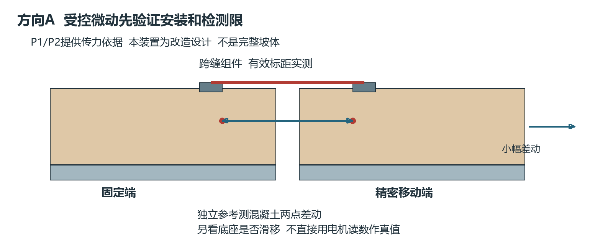
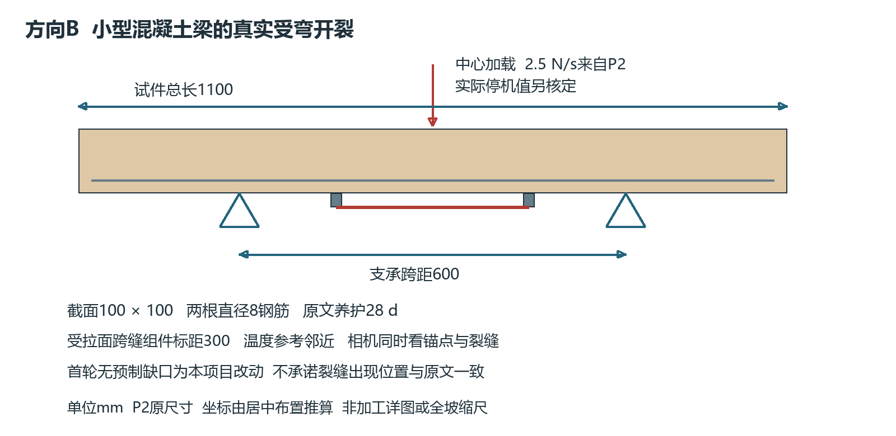

# V4.2 两个重点方向与最小可行试验

2026年11月12日。根据“可行度不足、须有实际论文依据、不必全做”的要求重新筛选。当前只推荐两个方向，先A后B，不再同时制造五种表面坡体。

| 顺序 | 方向 | 最小实验 | 主要原始论文 |
|---|---|---|---|
| 1 | 硬质护坡构件已有裂缝微小开合 | 固定端＋精密移动端＋混凝土试块；跨缝FBG组件与独立位移参考；比较粘接底座与浅孔底座 | Perry 2017，10.3390/s17081925；Perry 2016，10.1088/0964-1726/25/1/015027 |
| 2 | 横向护坡构件受弯开裂前兆 | 1100×100×100 mm梁，600 mm支承跨距；先验证FBG传递，再做真实开裂 | Perry 2016；Li 2019，10.3390/s19092132 |

方向A验证已有裂缝的微动监测，方向B检验构件开裂前的异常。两者都不直接证明整个边坡滑坡预警。前者最易控制变量，后者最贴近“微应变条件下提前感知”的研究目标。

## 成果

- [完整方案 Markdown](重点方向与最小可行试验方案.md)
- [完整方案 Word](重点方向与最小可行试验方案.docx)：10页、4表、3图。
- [证据与核查记录](证据与核查记录.md)：原文定位、改动、未冻结参数及页面检查。
- [设计核算](设计核算.json)：跨距、体积、加载速率与理想位移应变量级。

## 与V4.1的区别

完整土坡、植被、水文、格栅和内部塌陷从首轮矩阵移出；孔内PVC-FBG滑面定位仅保留为储备方向。如果后续明确要内部滑面，应替换主线之一，避免同时增加第三项。

不再将95/5土配方、160 mm土层、20 mm/h降雨、15/17栅和0—3 mm扩程视为当前要求。先用1应变栅＋1温度栅完成测量链，再决定是否扩大阵列。主光路保持横向，局部观测对象须与感测方向匹配。

关键参数分为论文原值、推算值、本项目改动和未知项。无孔底座、无缺口梁和微米级加载阶梯是明确标注的研究改动；胶型号、孔深、载体宽厚及配合比没有足够原文依据时不编造。当前文件可用于选题与首轮实施准备，不能直接代替加工签审。

## 三篇主线论文

1. [Perry等2017 裂缝微动现场监测](https://doi.org/10.3390/s17081925)：观测变化约±5 μm范围，非检测限保证；风机基础场景。
2. [Perry等2016 混凝土梁开裂与前兆分析](https://doi.org/10.1088/0964-1726/25/1/015027)：小梁尺寸、安装及加载来源；锚点损坏是必须排除的混淆。
3. [Li等2019 边坡多参数模拟](https://doi.org/10.3390/s19092132)：用梁弯曲模拟边坡框架梁响应，梁面静态测量为BOTDA，不能写成FBG直接验证。

方案正文另列4篇原始论文作为储备筛选与测量依据。论文全文仅在本地被忽略的_qa目录用于核查，不发布全文。

生成脚本build_v42.py依赖同仓库V4.0基础绘图与Word样式；render_v42.ps1使用独立Word实例导出核查PDF，raster_v42.py使用Poppler生成页面图片。旧版文件保持历史记录，最新阅读入口为本目录。
