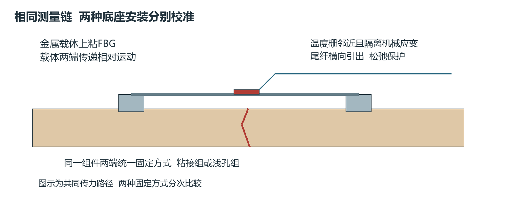
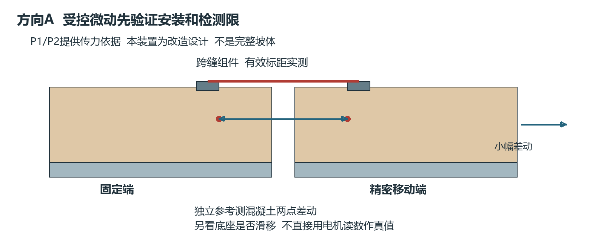
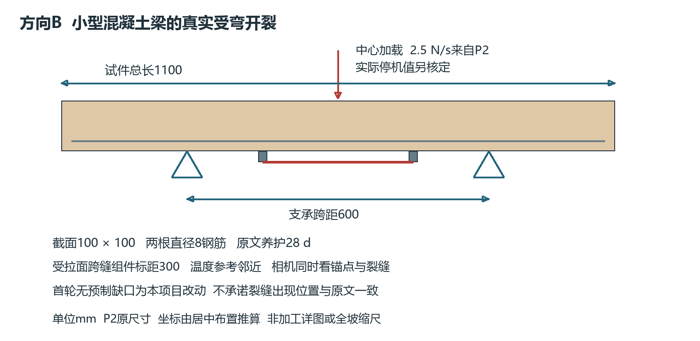

# 边坡光纤监测重点方向与试验方案

V4.2　2026年11月12日　原始论文约束下的收敛版

本轮建议只启动两个相互衔接的方向：A为边坡硬质防护构件已有裂缝的微小开合监测，B为横向护坡构件受弯开裂前的应变异常识别。先做A的传力、温漂和检测限，再做B的真实开裂。两者共用FBG、加载测量、温度补偿及图像系统，不再同时建裸土、植被、框格、喷层和格栅五组坡体。

研究问题收敛为：在可接近的混凝土构件上，贴附或浅孔固定的FBG能否可靠测出微小差动；在构件形成新裂缝之前，能否比指定对照更早给出可信异常。前者是已有病害的微动检测，后者才可能检验开裂前兆，两者都不直接等同整个边坡滑坡预警。

## 1 为什么调整前版

V4.1将安装可接近性作为首选依据，但缺少“600×800小土箱—砂浆框格—微应变前兆”的直接实验验证；土与框格传力不确定，框格不动也可能有格内病害。再叠加植被、水文、孔内杆和多方向加载，会让信号原因难以辨别。尺寸、配方和加载数字虽然标注为候选，仍不足以支持立即制造整个系统。

| 方向 | 原始论文支撑与代价 | 本轮决定 |
|---|---|---|
| A 已有裂缝微小开合 | P1有现场FBG裂缝微动，P2有构件和安装试验；可先用位移台控制两端差动 | 第一优先；先完成安装与检测限 |
| B 构件受弯开裂前兆 | P2有小型混凝土梁FBG开裂实验；P3给出边坡框架梁弯曲模拟依据 | 第二优先；A通过后实施 |
| 内部滑面定位 | P4有PVC管FBG模型，但原件长2 m、强边界约束、土体重建工作大 | 储备方向；本轮不制造 |
| 格栅受拉 | P5/P6有直接FBG证据，但须土筋相互作用和材料胶接研究 | 暂缓；面向新建加筋工程时再选 |
| 植被 水文 落石 侵蚀 | 与本轮贴附微应变目标不是同一变量；前兆、动态事件和失稳机理不同 | 从当前实验矩阵移出 |

这不是危险程度排序，而是论文直接性、可重复加载、独立参考和现有设备的匹配判断。设备按用户反馈“应该都有”规划，解调方式、位移噪声和加载能力仍需核验；不凭设备名称保证微米分辨率。

<!-- PAGE -->
## 2 决定主线的三篇论文

P1 Perry等，2017，Crack Monitoring of Operational Wind Turbine Foundations，Sensors 17，1925。原文第3—5节描述FBG裂缝模块：两条100 mm钢臂、夹角60°，每模块2应变栅＋1温度栅，采用浅孔和灌注环氧砂浆固定；50 Hz采样。报告的两条裂缝开合变化均未超过约±5 μm，侧向位移小到难以可靠辨认。钢臂到FBG的传递率估计为0.7—0.95，现场底座到混凝土的整体传递仍有未知误差。[P1]

该文给出“硬质构件—跨缝载体—微小位移”的直接工程证据，但对象是风机基础。±5 μm是所观测变化幅度，不是经独立真值证明的检测下限；论文没有证明边坡可提前预警，也没有证明只用胶粘底座就可靠。方向A借鉴测量链和量级，并补上独立位移校准。

P2 Perry、Livina、Niewczas，2016，Tipping point analysis of cracking in reinforced concrete，Smart Materials and Structures 25，015027。已读作者机构仓储全文。第3节为2根1100×100×100 mm钢筋混凝土梁、600 mm支承跨距、30 MPa混凝土、2根直径8 mm钢筋、28 d养护；三点弯曲。300 mm钢片载体上粘10 mm FBG，底座孔径6 mm、连接螺栓直径4 mm；2 Hz采样。[P2]

未预损伤梁按0.0025 kN/s加载，另一梁先循环至5 kN后按0.005 kN/s加载。原文报告约40 με处偏离线性，也明确记录锚点开裂导致传力下降。200—500个数据点的前兆针对特定信号不连续事件，并有潜在误报和居中窗口分析，不能照搬成实时预警分钟数。它直接支持方向B的试件尺度与待检验假设，不支持统一报警阈值。[P2]

P3 Li等，2019，A Highly Integrated BOTDA/XFG Sensor on a Single Fiber for Simultaneous Multi-Parameter Monitoring of Slopes，Sensors 19，2132。第5.1—5.2节明确用混凝土梁弯曲代替边坡推力引起的框架梁响应，采用近似四点弯曲，2、3、4 kN三档加载。其梁面静态应变由BOTDA测量，FBG用于另外的锚杆与振动实验，不能说论文已验证了本版梁面FBG。[P3]

证据链为P3支撑“边坡构件弯曲代理”，P2支撑“混凝土梁FBG开裂实验”，P1支撑“跨缝微动与现场安装”。三篇共同形成研究依据，仍不能证明完整组合已经在边坡现场验证。全文链接和定位见第9节。

<!-- PAGE -->
## 3 共用装置与横向安装

两方向使用同一类成品FBG长标距组件：应变栅粘在金属载体，载体两端固定在构件上，尾纤不受拉。优先采购带完整标定的组件；若自制，则依据P2的300 mm载体、10 mm栅长制作讨论图，载体宽厚、胶型号和底座面积在取得厂家数据或完成标定前不出加工定案。[P1，P2]

最小测量单元为1个应变栅＋1个邻近机械隔离温度栅，这沿用P2的功能配置。P1双臂结构用于两方向分离，本轮只测与主测线平行的开合，不复刻双臂。需要加另一位置时，以独立传力问题为理由扩展，不先铺满15或17栅。阵列潜力与单节点精度分别验证。

图1 先核验跨缝传递，再决定是否在硬质边坡构件上扩大阵列

“优先贴”具体指：FBG与金属载体胶接；载体底座优先试验表面粘接。P1/P2的跨缝固定依据实际是钻浅孔灌注，因此无孔粘接作为新增对照，不能冒充论文复现。比较同类组件在粘接底座与浅孔底座上的位移传递、湿后漂移和失效。底座滑移超出目标不确定度时，停止解释为病害位移，改用已验证的固定方式。

主光路沿现场横向框架梁或水平可接近构件布置。方向A只选能被这条横线跨过的裂缝；方向B的梁长轴代表横坡方向。对平行横线的后缘裂缝，以及整块同动但构件不变形的滑坡，不承诺检出。局部跨缝方向不满足时另选位置，不用算法补偿几何盲区。

<!-- PAGE -->
## 4 方向A 已有裂缝微小开合

对象是混凝土护坡或框架构件上的已有裂缝，其开合可能反映局部受力变化；不是模拟土中首次开裂。先在加载台设置一个固定端和一个移动端，两端夹持可更换混凝土试块，中间留缝；让300 mm标距组件跨缝。此为依据P1/P2改造的传力标定装置，试块尺寸由夹具空间和边距核定，不宣称为边坡原型缩尺。[P1，P2]

图2 输入位移、真实底座差动与FBG输出分别测量

首先不装传感器，用独立位移仪检验加载台能否产生并分辨微小往复运动；再装组件，比较反力和位移变化，防止传感载体锁住裂缝。参考仪测两底座附近混凝土的相对运动，另用标记检查底座相对混凝土滑移；执行器读数不直接作为裂缝真值。夹具限制多余转动，但实测并保留转角记录。

待检幅度以P1的微动量级为起点，协议候选为1、2、5、10、20 μm，在可控正预伸长范围内往复。它们是本研究为查检测限设置的阶梯，不是P1加载程序，也不预先保证1 μm可测。先检验5 μm，参考不确定度或噪声不足时提高最小幅度；在信号无异常且载体弹性范围确认后，再向低幅度探索。暂不采用V4.1的0—3 mm扩程。

300 mm有效标距下，1/5/20 μm差动对应理想平均应变约3.33/16.67/66.67 με，仅作量级换算；实际FBG读数取决于结构和粘接传递，不能用裸栅系数代替整体位移标定。也不能把不同标距的传感器直接按峰值大小比较。

每种安装先做完整加载卸载和保持，再重复拆装，分别记录同次循环误差与重新安装误差。加入无位移温变、整体平移、底座松动、胶层受潮四种对照。温度范围依据室内实际条件与器件额定范围确定，整组件校准；P1的0.5—30°C温标试验可作参考，但不要求本室强行照搬温度下限。

先获得安装方式、噪声和传递稳定性的结论，再扩大样本。阶段成果是检测限、滞后、漂移及可用安装条件，不产生“滑坡即将发生”的标签。

<!-- PAGE -->
## 5 方向B 横向构件受弯开裂前兆

用一根混凝土梁代表框架梁的一段，依据P3研究坡体作用传到构件后的弯曲响应，依据P2的三点弯曲方案获得可重复的真实开裂。首轮不加土、不注水、不另造整个框格；这样研究边界清楚，也避免未知土体—框格传递掩盖微应变。[P2，P3]

图3 试件尺寸与跨距来自P2；坐标为对称布置推算，图为自绘示意

| 制造或装配项 | 采用内容与来源 |
|---|---|
| 梁几何 | P2试件总长1100 mm、截面100×100 mm；600 mm是支承跨距，不是试件总长 |
| 对称位置 | 由原尺寸推算：支承距左端250和850 mm，加载在550 mm；300 mm标距居中时两端为400和700 mm |
| 材料 | P2为30 MPa强度混凝土、两根直径8 mm受拉钢筋，图1示意有效高度80 mm；不得用15 mm厚砂浆框格替代后宣称复现 |
| 配合比 | P2未给水泥砂石质量配比，故不编造；由试配/供料证明和同期试件确认强度、骨料粒径及工作性，30 MPa不直接等同未经核对的本地C30验收体系 |
| 养护 | P2为28 d；实际温湿条件和强度另记，不能只按天数认定强度达标 |
| 传感安装 | 长标距组件置于受拉面，温度栅邻近隔离；标记缺陷、底座及其邻域；参考仪独立支承，不挂在加载头上 |

原论文还制作了2 mm宽、30 mm深的预制缺口。其与钢筋、边距和锚点的完整加工关系未充分给出，不能仅凭数字开槽。首轮建议采用无缺口梁，让弯曲自然形成裂缝，并把“去掉缺口”列为工程改动；裂缝位置和开裂荷载会变，不能逐点复刻论文曲线。若需要严格复现带缺口试件，应先取得足够构造信息再制作，不切断受拉钢筋。

梁的标称体积0.011 m³；若仅按2400 kg/m³估算搬运，约26.4 kg，不含夹具且密度须实测。这是工作量预算，不是论文材料参数。该尺寸比完整土坡简单，首轮不再缩小，避免增加未经验证的相似关系。

<!-- PAGE -->
## 6 方向B 操作与判据

先采用P2未预损伤梁的0.0025 kN/s＝2.5 N/s加载速率，核验本机低载控制、零点及回差。承载力、停机值和夹具防护由实物和设备条件确定；论文一根梁约14 kN破坏不能作为我们的保证荷载或安全限值。P2另一梁的5 kN预损伤及0.005 kN/s程序暂不同时引入，先保证单一新梁工况可重复。[P2]

加载前记录空载稳定段；缓慢接触并记录就位阶段，随后连续加载。同步记录荷载、独立挠度、底座两点相对运动、FBG原始波长与谱峰质量、温度以及梁两侧裂缝图像。电阻应变片放在同一载体附近时用于比较传感性能；混凝土表面DIC/引伸计采用与FBG组件一致的标距，以比较整体传递，二者不能互相替代。[P1，P2，P7]

P2采样为2 Hz，P1为50 Hz。优先保留设备可同步实现的原始频率，并留存无滤波数据；复现P2统计窗口时另做抗混叠处理后生成2 Hz序列。若采用50 Hz，仅覆盖该频率允许的变化，不能据此研究高频断裂声发射。实际型号、波长带宽、栅峰间隔、时间戳和采样频率必须写入配置表。

| 事件或指标 | 独立判定与用途 |
|---|---|
| 新裂缝时刻 | 同步图像出现可重复确认的新裂缝，并报告图像最小可辨宽度；称“早于可见裂缝”，不称早于一切微裂纹 |
| 构件非线性 | 荷载—独立挠度或等标距应变偏离基线，误差范围事先固定；不以FBG自身定义其正确性 |
| 锚点/胶层失效 | 底座相对基底滑移、孔周开裂、胶脱粘、谱峰异常；独立故障标签，不计为成功预警 |
| 报警提前量 | 独立事件时刻减报警时刻，连同同步误差报告；负值、漏检和无事件试次均保留 |
| 前兆算法 | 阈值/变化点为基线，AR(1)自相关为P2启发的候选；只使用截至当时可获得的数据 |

P2中200—500数据点的提示不能直接变为本版提前量：采样、窗口、去噪及事件定义都影响结论。尤其不能把居中窗口或整段小波处理用于实时预警验证；若作离线复现，单独标成离线分析。构件峰值应变也不是边坡安全系数。[P2]

先做2根试件作为与P2同量级的探索批，不用2根梁证明统计优势。后续独立试件数根据初试变异、希望识别的性能差异和误报约束设计。若报警只跟随锚点损坏，或参考系统不能确认事件，先修正安装与观测，不扩大CNN-LSTM训练。

<!-- PAGE -->
## 7 参数来源与停止条件

“有论文依据”应落实为可追溯的材料、结构和方法，同时把移植时的改动明确暴露。论文未给出的胶配方、孔深和载体截面，不填成所谓最佳值；本项目新增的控制量也不伪装成论文结论。

| 项目 | 证据性质 | 当前处理 |
|---|---|---|
| 1100×100×100梁、600跨距、300标距、28 d、2.5 N/s | P2直接原文 | 主体沿用；实测材料和装配校核 |
| 跨缝微米级运动 | P1实际现场观察 | 用于选择研究量级；不当作检测限保证 |
| 横向框架梁的弯曲代理 | P3试验；原静态传感是BOTDA | 改用FBG须通过P2式测量验证；不声称直接复现P3整系统 |
| 无孔底座、无缺口梁、1/2/5/10/20 μm阶梯 | 本轮工程改动或实验设计 | 对照及标定后保留；不是文献原参数 |
| 精确配合比、胶厚、孔深、预拉量、载体宽厚 | 现有核心正文不足以冻结 | 以厂家完整图纸/额定值与实测校准补齐，不直接下加工单 |
| 全坡预警、内部坍塌、统一危险阈值 | 两个主方向不能验证 | 从本轮成果承诺中删除 |

继续条件G0：明确设备为可用的波长解调FBG系统，参考仪能在待测幅度下区分信号，光谱无重叠；“设备应该有”不等于该条件已通过。G1：A中真实差动与输出关系可重复，温漂和底座滑移能解释，贴附或浅孔方案选定。G2：B中裂缝事件能被独立观测，故障不混入病害；满足后才开展更大样本比较。三项是本研究管理判据，不是外部规范阈值。

评价报告同时给出检测概率、误报率、偏差、重复性、温漂、滞后和失效率；在同一误报约束、同一时间带宽、同一标距下比较FBG与指定电测/位移方案。光纤多点复用和无源布设是系统特性，是否具有更低检测限或更早报警须实验回答，不预设它一定优于所有电测设备。

训练数据按真实试件和独立安装分组，保存正常加载、真实开裂、温变、底座失效、整体同动等标签。一次试验切成很多窗口不等于很多独立样本。小样本阶段先做标定和可解释基线；CNN-LSTM只在跨试件验证和样本量允许时启动。[P2，P7提供测量/分析依据；本段分组协议为本研究设计]

<!-- PAGE -->
## 8 现场对应与暂缓范围

A面向已有硬质构件裂缝，B面向横向护坡梁的局部受弯状态。高速公路或高铁只是应用场景，最终需确认现场确有该构件、该裂缝方向和可接近安装面。隧道洞口可选同类护坡构件；洞内衬砌的研究不自动算作洞口边坡。裸土与纯植被边坡没有可靠粘接载体，不纳入这两项方法的直接适用范围。

后续只有在需要“构件响应是否能代表土体变形”时，才加一个局部构件—土体耦合试验，并先取得直接模型论文。单梁成功不能跨过这一步就宣布实现边坡预警。因此当前交付是可执行的传感验证路线及加工前参数清单，尚不是全坡监测工程设计。

储备方向C为孔内FBG-PVC滑面定位。Wang等P4以2 m长、外径60 mm、内径30 mm的PVC管，沿一侧布11个FBG，底部固定于稳定层模型；25°坡体、预设水平滑面、千斤顶推力，7种土工状态。滑面辨识结果约高于预设位置1—2 cm，峰值应变约1342—3997 με。[P4]

这些结果支持贴在管上、通过成孔进入土体的思路，但不是横向表面感测，也不是微小应变检测限证据。原管件和土体规模明显大于前版小土箱，固端、土密度和孔壁耦合直接控制应变符号；不能把管长改为300 mm仍沿用1—2 cm定位误差。它仅在导师要求内部滑面研究时替换一条主线，而非额外同时开第三项。

P5的格栅砂坡为2.05×1×1.2 m、45°、两层格栅与7个FBG；P6指出聚合物胶接兼容性和保护限制。两者证据真实，但把它们加进来会新增筋材拉拔、土工、层间铺设和施工期布纤工作，不符合本轮优先贴附既有构件的收敛目标。[P5，P6]

V4.1的95/5土配方、160 mm土层、砂浆框格、20 mm/h降雨、15/17栅和0—3 mm目标不再作为当前首轮要求。历史版本保留可追溯，不能把它们与V4.2梁试验装配、采样或阈值混用。首轮没有注水量和土配方，是因为尚不研究水力失稳，而不是漏写制造参数。

本轮实际待做清单为：核验设备 → 取得成品组件完整数据或补齐自制图纸 → 做A传力/温漂对照 → 确定一种安装方式 → 制作B探索梁并核验材料 → 独立记录裂缝事件 → 决定是否增加样本。未验证传感链前，不重造完整边坡模型。

<!-- PAGE -->
## 9 原始论文与阅读定位

P1 Perry M等，2017。Crack Monitoring of Operational Wind Turbine Foundations。Sensors 17，1925。全文已核：3.2.2安装，3.3标定及传递，4.2采样/量程，5.2—5.3微动结果，6局限。与边坡不同场景，使用范围限硬质构件裂缝监测。

https://doi.org/10.3390/s17081925

P2 Perry M，Livina V，Niewczas P，2016。Tipping point analysis of cracking in reinforced concrete。Smart Materials and Structures 25，015027。机构仓储作者稿已核全文并查看第3、5、6页原图；第3节为制造安装，第4节含锚点失效，第5节讨论分析。总长1100 mm与跨距600 mm分别来自第3节和第3.4节。

https://doi.org/10.1088/0964-1726/25/1/015027

https://strathprints.strath.ac.uk/55311/1/Perry_etal_SMS_2015_Tipping_point_analysis_of_cracking_in_reinforced.pdf

P3 Li F等，2019。A Highly Integrated BOTDA/XFG Sensor on a Single Fiber for Simultaneous Multi-Parameter Monitoring of Slopes。Sensors 19，2132。全文第5.1—5.2节为框架梁代理与BOTDA试验，第5.3—5.4节为FBG锚杆/振动；明确区分，未用混合系统性能替代本项目性能。

https://doi.org/10.3390/s19092132

P4 Wang K等，2017。A Laboratory Experimental Study An FBG-PVC Tube Integrated Device for Monitoring the Slip Surface of Landslides。Sensors 17，2486。全文第4节、表1—3和第5节；试验定位有固定边界与预设滑面条件。

https://doi.org/10.3390/s17112486

P5 Sun Y等，2017。Application of FBG Sensing Technology in Stability Analysis of Geogrid-Reinforced Slope。Sensors 17，597。原始全文第2节模型及布设，结果中的安全系数拟合仅限其试验与数值体系。

https://doi.org/10.3390/s17030597

P6 Drusa M等，2021。Measurement of Axial Strain of Geogrid by Optical Sensors。Sensors 21，6404。已核正文安装与结论；胶种与筋材兼容性、胶带无填料接触的适用条件不可省略。

https://doi.org/10.3390/s21196404

P7 Li J，Liu Y，Zhang J，2024。Simultaneous Measurement of Strain and Displacement for Railway Tunnel Lining Safety Monitoring。Sensors 24，6201。全文核对FBG温补、独立视频位移校验及现场监测；作为应变/位移互证方法参考，不把其视觉分辨率移植成本实验设备指标。

https://doi.org/10.3390/s24196201

本次补检经Europe PMC、Crossref题录与出版社/机构全文回查。采用7篇原始论文，另读未入主线的梁、墙和杆式研究用于筛选。不是穷尽系统综述；没有检出直接证据不代表不存在。规范提供工程约束，不能代替原始论文的试验可行性证据。所有成果和性能仍待实际试验。
